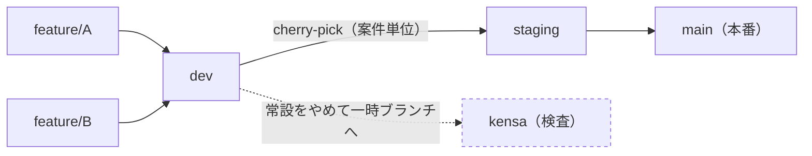
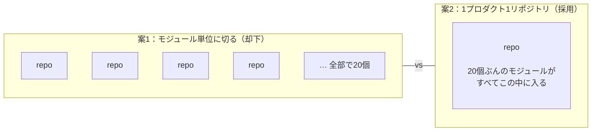

## はじめに

SVN で止まっていた化石チームに、Git と CI/CD を入れた半年間の話になります。

先に断っておくと、**技術的な新規性は一切ないです！** すみません。

やったこと
- SVN から GitLab へ移して、GitLab CI で .NET をビルドして App Service へ流す。


教科書どおりの構成です。手順そのものを知りたい方は、もっと良い記事がたくさんあります。

書くのは **移行に際した設計や判断** と **理想と現実のギャップ** 
ジュニアエンジニアの視点で起こった悩みや成長を書いています。

数字で言うとこうなりました。

- リリースのリードタイム: **約5時間 → 約30分**
- 本番デプロイ: 低頻度のビッグバンデプロイ（年間数回） → **2026年上半期だけで30回**

あまりインパクトは大きくないですが、開発の生産性はそれなりに上がったと思います。
うまくいった話ばかりではなく、失敗した話もあります。そのあたりも含めて書きます。

レガシーかつ少人数で、何から手をつけるか分からない。そういう環境にいる方の判断材料になれば嬉しいです。

## 状況
私が所属しているチームは、自社プロダクトを5つ保守開発しているチームです。
自社系企業にお勤めの方なら察せられると思いますが、開発組織がプロダクトをリリースすることを優先し、開発ツールやその後のアップデートが疎かになることがよくあると思います。
まさに弊チームはそのレガシープロダクトの寄せ集めを保守するチームでしたっ！！😢

- チームメンバーは約7名（エンジニア6名・PM1名、新卒から入った私ともう一名含む）

ただし、個々のプロダクトは運用負荷はさほど高くなく、忙しくはあるもののスケジュールにゆとりを持っており **(やる気があれば)** 改善できる、そんな環境でした。


具体的にどういう状態だったかというと、

- バージョン管理は SVN
- CI/CD なし、自動テストなし
- リリース前のリグレッションテストは**チェックシートを手で消化する方式で、実働5時間程度**(もっとひどいケースもある)
- リリース単位が大きく、切り戻しが難しい

「1回のリリースに全員が緊張する」構造でした。
ビックバンリリースなので、めんどくさいと思っていてもあまり改善する気はなかったみたいです。

「sreを目指していた」「レガシーな環境にうんざりしていた」「開発にgitを使っていた」
という理由から1年目の時の私が手を挙げて、このプロジェクトのリードを担当しました。(配属3~4か月)

経験が浅いまま決めた結果、あとから失敗と分かった判断がいくつかあります。それも含めて書きます。

## 課題と判断
社内ではほとんどのチームでGitLabを用いていましたが、いろんな歴史的背景がありsvnのままだったそうです。
svnからgitlabへの移行はそこまで難易度としては高くありませんでした。

理由は、**この移行は会社方針として決まっていた**こと。自分で言い出した改善ではないので、「やるかどうか」ではなく「どうやって着地させるか」というのが見えていたため。
厄介だったのは、**チームに Git 経験者が一人もいなかった**こと。

少し大袈裟ですが、ツールの入れ替えではなく「新しい開発プロセスの導入」と「チーム全員のスキル獲得」を同時にやる話でした。

なお、5プロダクトを一斉に移行することはせず、**最も開発が活発なプロダクトを先行の実験台**にして、影響を見ながら順に横展開しました。
ほぼ全員が未経験なので、一斉にやると全プロダクトが同時に止まるリスクを鑑みてそう対応しました。

とはいえプロダクトの数が多いのと、あるプロダクトではいくつかのチームが共同して開発しており、その管理だけ任されている状況で連携が必須であったりなどありましたが、主なミッションは以下の通りでした。

- ブランチ戦略をどうするか
- リポジトリ構成をどうするか
- どのようにメンバーに普及していくか

## それぞれの解決策
### ブランチ戦略

最初に敷いたのはこの4本です。

- `main`（本番）
- `staging`
- `kensa`（検査）
- `dev`（開発）

feature ブランチを `dev` に入れて、そこから上に昇格させていく形です。

もともと SVN では中央集権的に管理しており、大きな案件(プロジェクト)ごとにソースコードを格納していました。それをベースに開発環境へデプロイをし、検証していたようです。
デメリットとしては変更差分が大きくなるためマージでコンフリクトが頻発していたこと、開発環境の奪い合いになることでした。

Git では小さな機能ごとにfeatブランチを立て、devを開発の統合ブランチにしていくことにしました。これによりいくつかの案件があっても並行で開発環境へデプロイを行え、かつ機能が消えないことが明確なメリットでした。

#### 検査ブランチを畳んだ話

半年運用して、`kensa` を常設ブランチから一時ブランチに格下げしました。理由はシンプルで、**検査工程自体が常時走るものではなかった**からです。
頻度が多くないため、一時的に作る対応で問題ありませんでした。

- 他のブランチが進むたびに `kensa` にも追従マージが要る
- 「いま `kensa` にどこまで入っているか」を誰かが把握しておく必要がある
- 検査環境と、そこ向けの CI ジョブを維持し続ける必要がある

よく考えれば当たり前のことなんですけどね、svnからgitへ文化を持っていくと起こったことでした。

---
昇格は最初マージでしたが、案件単位でリリースする都合上、途中から cherry-pick になりました。マージだと `dev` に入っているものが全部上がってしまうためです。
結果として `dev` と `staging` は恒常的に差分を持つ状態になっています。

半年動かして、落ち着いたのはこの形です。



### その他導入しようとしたもの
FeatureFlagの概念も導入しようとしましたが、PMから本番環境へのデプロイは慎重になるように言われていたため、導入自体は断念しました。

デプロイとリリースが分離できていないことは、いまも本番リリースの頻度を縛っています。半期25回では全く十分だと思っていないので、次の一手はやはり Feature Flag だと考えています。
（フラグの後片付けが負債化する問題と、ON/OFF の組み合わせでテストが複雑になる問題があるので、入れ方は検証中です）

### リポジトリ構成はどうしたか

前提として、**GitLab のグループはプロダクト単位で最初から分けていました。** ここは会社の運用に沿った形で、悩みどころではありません。
悩んだのは、**そのグループの中をどう切るか**です。

言い忘れていましたが、アプリケーションアーキテクチャとしてはモジュラーモノリスに近い構成を採用しています。素直に考えれば、リポジトリはモジュール単位で切ることになります。実際、最初に検討したのはこの案でした。

ただ、**最も大きいプロダクトはモジュールだけで20個ほどあります。** 5人で5プロダクトを見ている体制で、1プロダクトの下に20個のリポジトリがぶら下がると、分割で得られるものより管理コストのほうが明らかに大きい。
そう判断して、**1プロダクト1リポジトリ**に決めました。



#### これは失敗でした

運用してみると、2箇所で詰まりました。

**1つ目は CI/CD の構成ファイルです。**

リポジトリは1つでも、**ビルドもデプロイもモジュール単位**です。つまり1つのリポジトリの中に、モジュールの数だけパイプラインの分岐を抱えることになります。
どのモジュールを直しても同じ設定ファイルを触ることになり、運用の負荷を上げてしまいました。(そりゃそうなる)

**2つ目は権限です。**

Git の権限はリポジトリ単位でしか切れません。1プロダクト1リポジトリにした時点で、**モジュール単位・チーム単位で権限を分ける手段が無くなります。**
冒頭に書いたとおり、あるプロダクトは複数のチームで開発しているので、ここが綺麗に分けきれませんでした。

いま振り返ると、**判断の軸を「リポジトリの数」に置いてしまったのが間違い**でした。

「20個は多すぎる」→「じゃあ1個」。この判断は、数の話しかしていません。本当に決めるべきだったのは数ではなく**境界**で、リポジトリの分割単位は次の2つで決まります。

- **デプロイ単位** — 常に一緒にデプロイされるものは、同じリポジトリでいい
- **権限の境界** — 別々のチームが触るものは、分けないといけない

この2軸で切っていれば、20個でも1個でもなく、**中間の数個**に落ち着き、説得出来たかなと振り返って思います。

細かく分けすぎる必要もなかったですが、大きな枠組みを作り、それぞれで管理するべきだったかなと反省しています。
リポジトリ運用経験の少なさとアプリケーションレイヤーへの理解が至らなかったところが大きいです。
完全なる設計の敗北ですね。。

### どのようにメンバーに普及していくのか
いくつかアプローチがあると思われますが、まずは状況

- メンバーはgit未経験であること
- エンジニアであること
- CLIに馴染みがないこと

アプローチとしては

1. Git操作を簡単にするため、GitHub Desktop や TortoiseGit などGUIツールを共有する
2. lazygit などTUIを使ってもらう
3. 原点とも言える git command を覚えてもらう

私が選択したのは3の git command を覚えてもらうことでした。
色々な狙いがありましたが、完璧には普及しませんでした。

3の狙いとしては

- Git Commandを覚えてもらうことで、その後にGUIツールを使おうと、内部でなにが起こっているのかを理解できる
- CLI操作に慣れてもらう
  →最終的にterraformなどCLIを前提として開発へと移行すること

あわせて、半年で4回の勉強会（Git / リポジトリ戦略 / ブランチ戦略 / CI/CD戦略）を企画・実施しました。ツールを配って終わりにすると使われないと思ったからです。

色々ありましたが、若いメンバーは比較的CLIに慣れていただけましたがPMはそうはいきませんでした。決して開発の機会が少ないわけではなく、チームでも最も開発している方ですが、
`わからない場合に調べることで作業効率が落ちる` という理由からGUIツールをはじめから利用していました。

...私の判断としては譲歩しました。GUI ツールを提案し、詰まっていたらその都度サポートし、Git の仕様を何度も説明する。ということでまずは開発を滞りなく進める、同時にgitの内部仕様も説明する、、、というマンパワー作戦で、ある程度理解してもらえたかなと思います。

正直これが正解だったのかは、いまも分かっていません。「CLIでの操作」を諦めた分、後でコストを払うかもしれないとも思いまいしたが、agentにgit操作をお願いするならコマンドなど覚える必要はないですからね。

メンバーに学習負荷を与えること、それをどのようにクリアしていくのかについては私の中で難しいミッションとして残っています。
特にPMなどロールが高ければ高いほど、どういったアプローチが正解に近いのか、、難しいですね。ただでさえ時間がないですからね、、

### なぜ Git は通って、IaC は通らなかったのか

同じ時期に、インフラの IaC 化も持ち込もうとして、**こちらは定着させられずに撤退しました。**

プランも手順も用意していたのですが、チームに共有した段階で、大半のメンバーがそもそも CLI に馴染みがないことが分かりました。Git の学習をお願いしている最中に、さらに別の学習を積むのは違うと判断して引きました。

このとき学んだのは、

> 「正しい技術を持ち込めば使われる」は間違いで、チームの現在地に合わせて教育とセットで入れないとツールは定着しない

ということです。

振り返ると、Git と IaC の差は「正しさ」ではありませんでした。

- Git は**会社方針で決まっていた**（やらない選択肢が無い）／IaC は私が持ち込んだ提案だった
- Git は**全員が毎日触る**ので学習が回収される／IaC は触る人が限られる
- Git は**CI/CD という分かりやすい見返り**を提示できた／IaC の見返りは説明しづらかった(運用負荷が高くないため)

技術が定着するかどうかは、技術の良し悪しより「**強制力があるか**」「**見返りが本人にとって具体か**」で決まる、というのがいまの結論です。

とまあなんだかんだでgitへの移行はうまくいったのでした。

## CI/CDの構築

SVN から Git への移行が完了してひと段落ついたところで、次は CI/CD を進めることにしました。会社から降ってきたミッションではなく、自発的な取り組みです。

正直に書くと、チームをモダナイズしたいという綺麗な動機だけではありませんでした。レガシーな環境で働き続けている自分が嫌になっていた、というほうが本音に近いです。とはいえ会社が掲げる生産性・品質の改善という大義名分はきちんと立つ話なので、その名目で少し工期をもらいました。

仕組みとして知ってはいたものの、実際にどう構築するのが正解かは分かっていませんでした。CI/CD って？自動テスト？どう書けばいいの？というところからのスタートです。

当たり前にある技術ですから、導入も設計も実装も難しくはありませんでした。(リポジトリ設計のせいで詰まったところはあるが)

設計にあたって参考にさせていただいた記事はこちらです。

https://levtech.jp/media/article/column/detail_496/

テストピラミッドやテストコードの書き方といった基本的なことが書かれています。ただ、実際に詰まったのは設計ではなく環境のほうで、そこは AI では解けませんでした。

### 作ったもの

パイプラインはこの順番です。新規性はないので軽く

```
build → 単体テスト → 結合テスト → デプロイスロット作成 → デプロイ後の E2E → スワップ
```

これに加えて、MR が出たタイミングで Claude によるレビューが走ったり、社内特有のルールを果たす細かいジョブもあったりします。

以下、うまくいった点と詰まった点をまとめます。

### うまくいった点

#### CD の構築はスムーズだった

環境が Azure App Service だったことが大きく、デプロイスロットを量産するのが簡単だったので、ここはほとんど詰まりませんでした。
デプロイ手順もこのスロットのスワップによる Blue-Green に統一しています。切り戻しはスワップし直すだけなので、リリースのやり直しやすさはここでかなり上がりました。

ただし胸を張れる作りではありません。Terraform も CDK も使っておらず、Azure のサービスプリンシパルに権限を渡して、手続き的にコマンドを流しているだけです。冪等性がないので、たまに失敗します。

#### Claude によるレビューと、CI 失敗の解析

Claude を使っている箇所は2つあります。ひとつは MR のレビューを一次対応させる仕組み、もうひとつは CI が落ちたときの原因を自動で解析させる仕組みです。

両方とも非常に効果的で、失敗の原因調査にかかる時間が10分ほどから5分程度になりました。ログを自分で追う前に、当たりがついた状態で見に行けるのが大きいです。
レビュー対応は効果測定が難しいですが、MRを投げてから1週間以内にマージされないMRが激減しました。(具体的な数字は伏せます)
開発者体験は概ね良好です。

参考にしたのはこの記事です。サブエージェントごとにモデルを使い分けられるのがいいところでした。

https://qiita.com/ktat/items/ab527d5e8e8e48d2b6db

#### 横展開は簡単だった

一度形ができてしまえば、他のプロダクトやモジュールへ広げるのは簡単でした。
cicd構成ファイルは大変なことになっていますが。。

### うまくいかなかった点

CI です。ここは相当手こずりました。

#### そもそもビルドできる場所がなかった

対象の一部のアプリケーションは .NET Framework 4.7.2 や .NET Core 2.0 で動いています。.NET Core 2.0 は 2018年10月にサポートが終了しており、ベースイメージもそこで止まったままです。

さらに、.NET Framework は Windows でしかビルドも動作もしません。
社内の GitLab Runner は Linux でした。どこでビルドするのか、というところで完全に止まりました。

結局、一時的に自分の PC を Runner にして動かしていました。当然これは恒久的な解ではないので、いまは Windows の VM を立てるか、オンプレで動かすかを検討しています。

#### テストを書けるコードではなかった
最もグロテスクな話かもしれません。

アプリケーションのアーキテクチャにも問題がありました。インターフェースは存在しますが、**コントローラーに業務ロジックが全部ベタ書き**されている状態です。

これだと単体テストで差し替えることができません。一部の API についてはアーキテクチャを見直して service 層を作りましたが、中途半端なものになりました。そもそもテストコードを書けるような環境ではなかった、というのが正直なところです。

テストコードを書く前提ではないアーキテクチャを改善するのは骨が折れます。
ただでさえレガシーで書き方が古かったり、コメントがなかったり、意味不明な命名だったり、コード量が多かったり、それ以前の話もあるのですが、ユーザージャーニーをベースにいくつかのメソッドは切り出しましたね。すべてのプロダクトは難しかったですが

#### 結果、テストピラミッドは崩壊した

単体テストが(ほとんど)書けないので、実際に動かして確認するテストに寄せるしかありません。結果としてスモークテストまみれになりました。参考記事で読んだテストピラミッドとは、ちょうど逆立ちした形です。

CI/CD を入れれば品質が上がる、という話ではありませんでした。テストが書けるコードでなければ、CI は置き場所を用意しただけで終わります。
ここは移行そのものより根が深い課題で、解決への道のりは相当ハードルが高いと思われます。というか作り直さない限りは難しそうだなというのが感想ですが、
- 運用負荷の低いものに改善する価値があるのか
- 採用/開発生産性のために書き直す余裕があるのか

ここらへんのトレードオフになりそうです。

### なぜCI/CDで構築の難易度に差が生まれるのか

振り返ると、CD と CI で難易度がここまで違ったのには理由があります。

CD が簡単だったのは、App Service のデプロイスロットという既にある仕組みに乗るだけだったからです。
こちらが用意するものは少なく、アプリケーションの中身にも手を入れずに済みました。

一方 CI が地獄だったのは、既存のコードの質にそのまま依存するからです。
テストが書けないコードの上に、テストのパイプラインは載りません。CI は置き場所を作るだけでは動かず、コードを直すところまでセットで必要になります。

CD が先に動くと、リリースが楽になったという分かりやすい成果が出るので、そのあとの投資も通しやすくなります。


## 半年でどう変わったか

数字で置いておきます。

- リリースのリードタイム: 約5時間 → 約30分
- 本番デプロイ: 低頻度のビッグバンデプロイ → 2026年上半期で25回

ただし、リードタイムの「約5時間」は当時のチェックシートの項目数と担当工数から出した概算です。きちんと計測できていたわけではないので、目安として読んでください。

25回という数字も、十分だとは思っていません。理想はデプロイとリリースが分離された状態を目指すべきでしょう。

## おわりに ― 半年でわかったこと

エンジニアリングで想像できなかった難しさは、技術をどう扱うかよりも、**それを受け止められる状態をどう作るか**でした。

- **Git が定着したのは**、勉強会を3回やって、PM に譲歩して、詰まるたびに横で説明したからです。ツールを配って終わりにしていたら、まともに使われていなかったと思います。
- **CD がすんなり動いたのは**、App Service のスロットという PaaS のおかげです。
- **CI がいまも崩れているのは**、受け皿（テストが書けるコード）をまだ作れていないからです。

つまり、残っているのはツールの問題ではなく、私の宿題です。(とほほ)

これは「チームの状態が悪いからツールが入らない」という話ではありません。**受け皿をつくるところまでが、ツールを入れる人の仕事だった**、ということです。


とはいえ、半年でいくつかの開発プロセスは改善できました。手作業（toil）はかなり減りましたし、リリースのたびに全員が緊張する、という状態からは抜けられたと思います。

### 得られたもの

いちばん大きかったのは、設計についての経験です。

すでに動いている SVN のソースを Git へ移すだけでも、考えることはいくつもありました。
- ディレクトリ構造の見直し
- 不要なソースの破棄
- リポジトリ設計、ブランチ設計とその運用。

書いてきたとおり、リポジトリ設計は失敗しています。自分の理解不足もありますが、**ステークホルダーときちんと対話できていなかった**ことも大きいです。いま振り返れば、PM が何に不安を持っているのかを想像できていませんでした。

この失敗のあとに担当した設計では同じ間違いはしていません。対話することの重要さと、将来を見据えて設計することが少しはできるようになったと思います。

この取り組みを通して
- チーム内で信頼を得られたこと
- 設計のアンチパターンが分かるようになったこと
- そして自分が SRE やアーキテクトの方向を志向している

と気づけたことも収穫でした。

配属から3ヶ月ほどでプロダクト数の多い VCS 移行を任されたことは、各プロダクトのアーキテクチャやソースコードに詳しくなるきっかけにもなりましたし、開発のカルチャーを知ることもできました。成長に必要なプロセスだったと確信しています。
