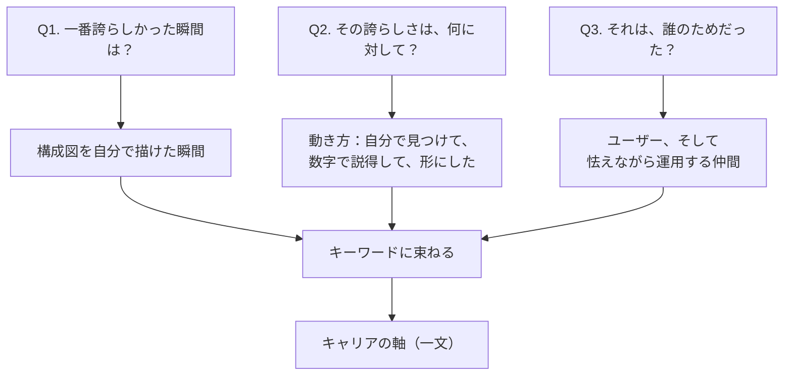
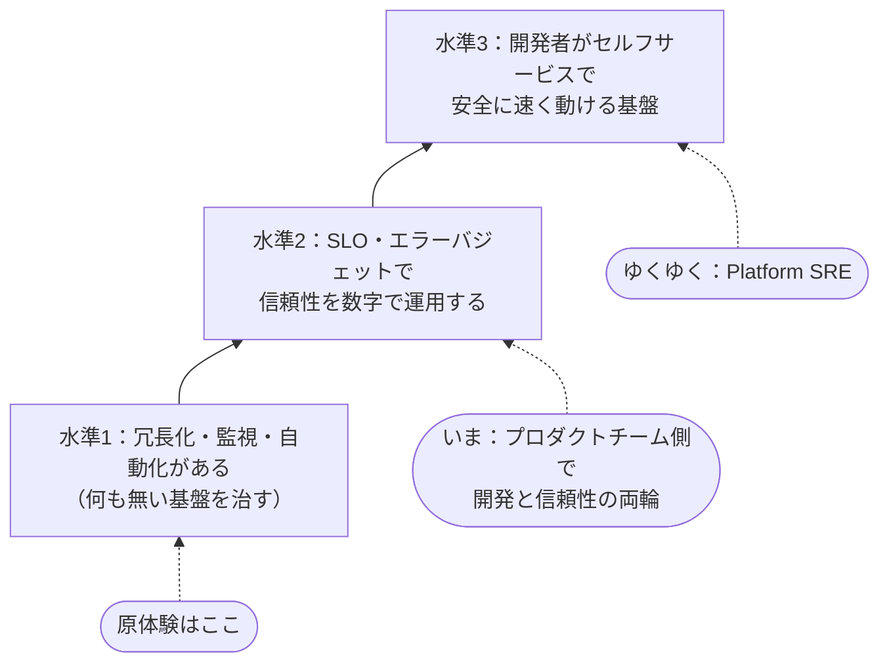

## はじめに：「何がしたいの？」に答えられない

「あなたは、将来何がしたいの？」

私はこの問いに「クラウドとかSREとか、その辺の専門性を高めたいです」と答えてきました。
嘘ではありません。でもこれは**技術キーワードであって、軸ではない**。その証拠に「なんでSREなの？」と一段掘られると、本質的な理由は出てこなかったと思います。
「面白そうだから」「参入障壁が厚そうで、キャリア的に有利だから」——それっぽい言葉で埋めるだけ。

何がしたいのか、自分でもぼんやりとしか分かっていない。
行き先を決めずに筋トレだけしているような状態に先延ばしにしているような危機感を覚えて、自分のキャリアの軸を言葉にすることにしました。

この記事は、何に悩んで、どういうふうに考えて、どう結論を出したかの記録です。

## 過去を振り返る

最初は「5年後どうなりたいか」を考えようとしました。これが全然ダメでした。未来に問いかけると、出てくるのは世間的に正しそうな答えばかりで、どれも自分の言葉になりません。

そこで発想を逆にしました。**軸は過去の「感情が動いた瞬間」にもう表れているはず**。
だから振り返るのは「何をやったか（事実）」ではなく「何を感じたか（感情）」。
職務経歴書に書くような実績の棚卸しとは別物です。

使った問いは3つだけです（ひとりだと自分に甘い質問しかしないので、私はAIに壁打ち相手をやらせて一問ずつ詰めてもらいました）。

1. **キャリアで一番誇らしかった瞬間は？**
2. **その誇らしさは、何に対して？**
3. **それは、誰のためだった？**

ここまでの流れを図にするとこうなります。

## 過去から出てきたキーワード

### 一番誇らしかった瞬間

出てきたのは、資格を取った日でもリリースの日でもなく、**インフラのリアーキテクチャの構成図が自分の頭から出てきた瞬間**でした。

当時、クリティカルなサービスが、VM1台・冗長化なし・監視なしで動いていました。それを冗長化・自動スケール・監視ありの構成に作り変える設計を、初めて誰かの真似ではなく自分の頭で考えられた。教材の構成図が「読めた」ときではなく、自分で「描けた」とき。ここに一番強い感情が残っていました。

### その誇らしさは、何に対して？

掘ってみると、誇らしさの正体は技術そのものではありませんでした。

> 誰にも頼まれてない。自分で問題を見つけて、自分で提起して、数字で説得して、形にしたから

このプロジェクトは誰かにアサインされたものではありませんでした。
VM1台の構成を見たときの本音は「**この状況を放置できない、この環境で働く自分が恥ずかしい**」でした。
サービスが、単一障害点を抱えたまま監視もなく動いている。これは技術者倫理の観点でも放置してはいけない状態です。だから過去の障害実績とコストを数字で整理して、自分から構成変更を提起して、合意を取って、作った。
振り返れば、CI/CDの導入も監視とSLOの立ち上げも、全部この動き方でした。

### 誰のためだった？

ユーザーか、事業か、チームか。一番を選ぶなら、**ユーザー**でした。
あのサービスは認証や契約管理を担っていて、止まればユーザーの業務がそのまま止まる。
しかもユーザーは、裏側がVM1台で動いていることを知らないし、選べない。知っているのは自分たちだけ。
だから自分たちが直すしかない。

3つの問いから出てきたキーワードを並べます。

- 放置できない（許せない・恥ずかしい・治したい）
- 頼まれてなくても、自分で見つけて、数字で説得して、形にする
- 裏側の実態を知らないユーザーの代わりに、信頼性に責任を持つ
- 怯えながらの運用をなくし、定着するまで前に進める

## 出した結論：私のキャリアビジョン

キーワードを束ねて、私のキャリアビジョンはこう宣言しました。

> **放置された基盤と「怯えながらの運用」をなくし、チームが安心して速く動ける“当たり前”をつくる**

ここで言う「当たり前」は、固定の水準ではありません。環境によって、その組織に「本来あるべきなのに無いもの」は変わります。
VM1台・監視なしの現場なら、まず冗長化と監視。それが揃っている組織なら、SLOとエラーバジェットで信頼性を数字で運用すること。さらにその先なら、開発者がセルフサービスで安全に速く動ける基盤。

**私は、その組織の「当たり前」の水準を見極めて、一段引き上げて、定着するまで前に進める人になる。** これが私のやりたいことの宣言です。
私の原体験はたまたま一番手前の水準（何も無い基盤を治す）でしたが、レガシーの整備がゴールなのではなく、同じ軸の上でより高い水準の信頼性エンジニアリングへ進んでいくつもりです。

このビジョンを実現する仕事に名前をつけると、結果としてSREでした。
「SREが流行ってるからSREになりたい」のではなく、**やってきたこと・やりたいことに名前をつけたらSREだった**。
技術キーワードから軸は生まれなかったのに、軸から逆引きしたら技術キーワードに着地した、という感覚です。

## もう一段の問い：SREの中の、どこに立つか

軸は決まりましたが、もう一段の問いが残りました。
ひとくちにSREと言っても、組織の中での立ち位置には型があります。『SREの知識地図』（技術評論社）の第8章では、SREの実装モデルは**埋め込み型・中央集中型・ハイブリッド型**の3つに大別され、その下に4つの実装パターンが整理されています。

| モデル | パターン | ざっくり言うと |
|---|---|---|
| 埋め込み型 | **Product SRE** | プロダクトチーム内に配置され、特定プロダクトの信頼性に専念する |
| 埋め込み型 | **Embedded SRE** | 横断組織のSREが開発チームに入り込み、設計段階から信頼性を作り込む |
| 中央集中型 | **SRE Center of Practice** | 信頼性の標準・ベストプラクティスを策定し、教育・支援で組織に広める |
| 中央集中型 | **Platform SRE** | 共通プラットフォームの信頼性を専門に担い、開発チームの生産性を支える |

自分の過去をここに当てはめると、面白いことに気づきます。
私はSRE組織のない環境で、開発チームの一員として基盤を治し、監視とSLOを立ち上げてきました。
動き方は実質**Embedded SRE**です。
一方で、一番誇らしかったのは基盤の構成図を描けた瞬間で、これは**Platform SRE**の領域。
勉強会を主導してチームに定着させてきた「推進」の部分は、**SRE Center of Practice**の役割そのものでもあります。

どの型にも自分の断片があって、しばらく決められずにいました。決め手になったのは、この2つの問いです。

**「5年後、自分のアウトプットを毎日直接使うのは誰であってほしい？」**——答えは、サービスのユーザーではなく**社内の開発者**でした。
基盤もまたユーザーを守る側のものであり、その上に乗るすべてのサービスに効く、一番影響の大きい場所だからです。

**「では、プロダクトの機能開発は手放せる？」**——答えは、**今は手放せない**でした。
開発者のための基盤を作るには、開発者としてアプリ側を理解している必要がある。その理解は、まだ貯めている途中だからです。

いまのところの結論はこうです。

> **今は、プロダクトチーム側で開発と信頼性を両輪でやり、アプリ側の理解を貯める。ゆくゆくは、Platform SREとして基盤側からより多くのチームとユーザーを支える。**

断定はしません。実際に型が確立された環境で経験を積んだら、違う答えになるかもしれない。
ただ、以前の「SREって何から勉強すればいいんだろう」という霧の中の悩みと違って、いまは自分の現在地と向かう先が地図の上に置けています。

## おわりに

やってみて分かったのは、私には軸が無かったわけではない、ということです。
軸は行動にはとっくに表れていました。頼まれてもいないのに基盤を直しに行く、という動き方がまさにそれです。
ただ、自分が自然にやってしまうことは、「普通のこと」に見える。だからわざわざ言葉にしようと思わない。
**軸は作るものではなく、質問で掘り出すもの**でした。

もし同じように「技術キーワードは言えるけど、何がしたいかは答えられない」という人がいたら、勉強を増やす前に、3つの問いで過去を振り返ってみることをおすすめします。
「一番誇らしかった瞬間は？」「それは何に対して？」「誰のためだった？」

私の場合、出てきたのは「俺が治したい」という、およそキャリアビジョンらしくない一言でした。
でもその一言が、どんなきれいな文章よりも、自分のこれからを説明していました。

## 参考

- 『SREの知識地図』（技術評論社）— SREの実装モデルとパターン（第8章）の整理は本書に基づいています
- [エンジニアのキャリアの軸の決め方](https://zenn.dev/haragames/articles/engineer-career-axis) — 「技術キーワードではなく課題解決で軸を決める」という考え方に背中を押されました
