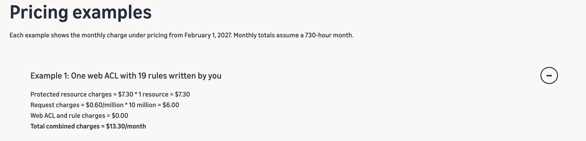
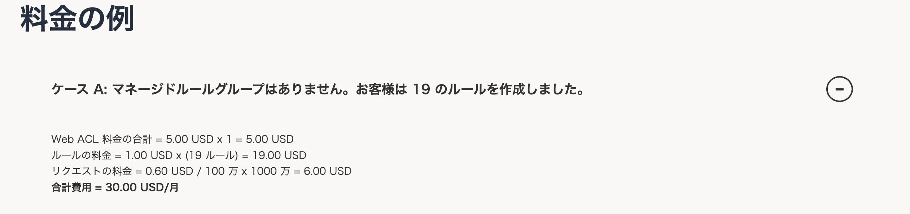
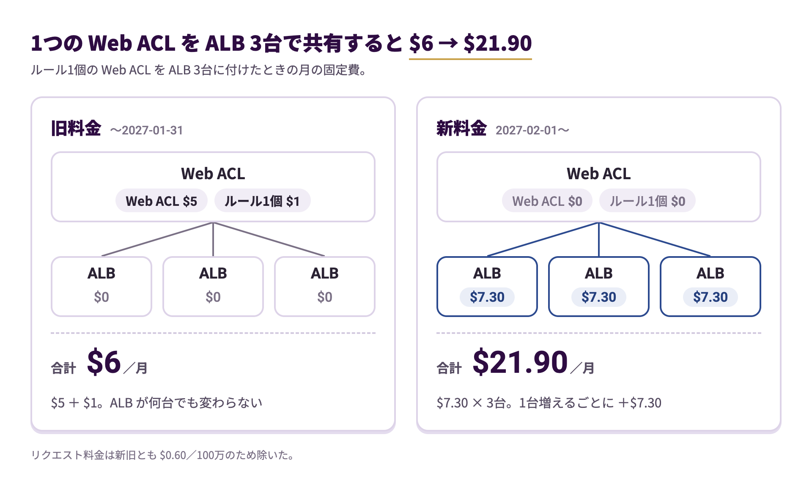

2026年11月23日、AWS WAFの料金体系が変わると発表されました。既存アカウントは**2027年2月1日の利用分から**新料金になります。

## TL;DR

- 課金の対象が「Web ACLとルール」から「**Web ACLを付けたゲートウェイ**」（ALB・API Gateway・CloudFrontなど）に変わる
- 移行時に特別な操作は必要ない
- ルールが多い構成やBot Control・Fraud Controlを使う構成は安くなる。
- ただしゲートウェイが多い構成は、旧料金でWeb ACLを共有していた場合に高くなる。例（ALB50台で共有）は月$11.20 →$366.20（約33倍）

## 公式の情報

この記事は次のページを元にしています。

- [Introducing AWS WAF simplified pricing（AWS Security Blog）](https://aws.amazon.com/blogs/security/introducing-aws-waf-simplified-pricing/)：変更の理由・料金の考え方・FAQ。
- [AWS WAF introduces simplified pricing（What's New）](https://aws.amazon.com/about-aws/whats-new/2026/11/aws-waf-introduces-simplified-pricing/)：発表の要約と対象リージョン
- [AWS WAFの料金](https://aws.amazon.com/waf/pricing/)：新旧の料金表と計算例6つ。「Pricing from February 1, 2027」と「Pricing through January 31, 2027」のタブで切り替える
- [AWS Firewall Managerの料金](https://aws.amazon.com/firewall-manager/pricing/)：Firewall ManagerでWAFを配っている場合

## 何が変わるか

| 項目                     | 旧料金（〜2027-01-31）           | 新料金（2027-02-01〜）           |
| ---------------------- | -------------------------- | -------------------------- |
| Web ACL                 | $5.00／月                    | 無料                         |
| ルール・ルールグループ            | 1つごとに$1.00／月               | 無料                         |
| 保護リソース                 | なし                         | $0.01／時間（約**$7.30／月**）     |
| リクエスト                  | $0.60／100万                 | $0.60／100万（据え置き）           |
| WCU（1,500超）            | 500WCUごとに$0.20／100万リクエスト   | 2,500までが標準。超えても料金は変わらない    |
| ボディ検査（既定サイズ超）          | 16KBごとに$0.30／100万リクエスト     | 無料                         |
| CAPTCHA・Challenge      | $0.40／1,000回・$0.40／100万回   | 無料                         |
| Bot Control（common）     | $10／月＋$1／100万（1,000万まで無料）  | 基本料金に含む                    |
| Bot Control（targeted）   | $10／月＋$10／100万（100万まで無料）   | プレミアム                      |
| Fraud Control（ATP・ACFP） | $10／月＋最初の200万件は$1,000／100万 | プレミアム                      |
| Anti-DDoSルールグループ       | 購読料＋リクエスト料金（額は未確認）         | 基本料金に含む                    |
| カスタムレスポンス              | 額は未確認                      | 基本料金に含む                    |
| プレミアムリクエスト             | なし                         | $5.00／100万（基本のリクエスト料金に上乗せ） |

保護リソースは、Web ACLが付いているリソースのことを指します。CloudFrontディストリビューション・ALB・API Gatewayのステージなどが当たります。この記事ではこれらをまとめて「ゲートウェイ」と呼びます。

### プレミアムとは

AWSが用意しているルールグループのうち「高度な検知をするもの」（advanced protections）検査したリクエストに$5.00／100万が上乗せされます。

プレミアム扱いになるルールグループは次の5つです。

| ルールグループ                                           | 内容                                         |
| ------------------------------------------------- | ------------------------------------------ |
| Bot Control                                        | 名乗らないボットを、ブラウザ側の信号と機械学習で見分ける               |
| Fraud ControlのATP（Account Takeover Prevention）       | 盗まれた認証情報によるログインを防ぐ                         |
| Fraud ControlのACFP（Account Creation Fraud Prevention） | 登録ページで不正なアカウント作成を防ぐ                        |
| API Security（新規）                                   | BOLAなど、よく狙われるAPI攻撃を防ぐ                      |
| AI Security（新規）                                    | LLM・MCP・A2Aのエンドポイントを守る。形式のおかしいMCPリクエストを止める |

課金対象はプレミアムのルールグループが実際に検査したリクエストだけです。料金は100万件あたり$5.00で、複数のプレミアムが同じリクエストを見ても課金は1回です。

ほかに押さえておく点です。

- 新料金は全リージョン同額
- リクエスト100万件ごとに、ログの取り込み500MB分が含まれる（旧料金のときから同じ）

- Shield AdvancedとCloudFront定額プランの利用者は変わらない
- Marketplaceで買ったルールグループには、販売者が決めた料金を別に払う
- 個別の価格契約（private pricing）は契約期間が終わるまで続く

:::message  
既存アカウントは2027-02-01に自動で切り替わります。作業は要りません。新規アカウントがいつから新料金かははっきりしません。

 :::

## AWSの計算例を旧料金で計算し直した

料金ページには計算例が6つあります。ただし、英語だと新料金の合計しか載っていないので、同じ条件を旧料金でも計算しました。

(日本語のページは11/25現時点で変わっていないので比較できました。)

計算例：[AWS WAF Pricing › Pricing examples](https://aws.amazon.com/waf/pricing/#Pricing_examples:~:text=custom%20estimate%20now%C2%A0%C2%BB-,Pricing%20examples,-Each%20example%20shows)

| 例   | 条件                                           | 旧料金        | 新料金         |
| --- | -------------------------------------------- | ---------- | ----------- |
| 1   | ALB1台・ルール19個・月1,000万リクエスト                    | $30.00     | $13.30      |
| 2   | ルール7個＋Bot Control（common）・月2,200万             | $48.20     | $20.50      |
| 3a  | Web ACL3つ（各1リソース）・ルール計21個・targetedが全3,500万を検査 | $430.00    | $217.90     |
| 3b  | 3aと同じ構成でtargetedを後ろに置き、700万だけ検査              | $150.00    | $77.90      |
| 4   | ルール3個・ATP（ログイン）とACFP（登録）・月4,000万のうち320万が対象   | $2,894.00  | $47.30      |
| 5   | ルール9個＋Marketplaceのルールグループ・月1,000万（WAF分のみ）    | $21.00     | $13.30      |
| 6   | **Web ACL1つ（ルール5個）をALB50台に付けた・月200万**         | **$11.20** | **$366.20** |

## コストは付けたゲートウェイの数

リクエスト料金は新旧とも$0.60／100万なので差が出るのは、Web ACL1つあたりの固定費となります。

- 旧料金：$5＋$1×N（Nはルールとルールグループの合計）
- 新料金：$7.30×R（RはWeb ACLを付けたゲートウェイの数）

旧料金では、1つのWeb ACLに何台つないでも固定費は同じでした。新料金では共有しても安くなりません。付けたゲートウェイ1つごとに$7.30かかるためです。

### 1ゲートウェイとして数えられるもの

料金ページによれば、Web ACLを付けた次のものが1つずつ数えられます。

- CloudFrontディストリビューション（CloudFront SaaS Managerはテナントごと）
- ALB
- API Gateway（REST API）の**ステージ**
- AppSyncのGraphQL API
- Cognitoユーザープール
- App Runnerサービス
- Verified Accessインスタンス
- Amplifyアプリ

API Gatewayはステージ単位です。dev・stg・prodの3ステージが同じWeb ACLを共有すると、それだけで月$21.90です。

CloudFrontと後段ALBの両方にWeb ACLを付けると、リソース料金は2つ分かかります。両方を通るリクエストは、リクエスト料金も2回かかります。。。😢

## コストを抑えるにはゲートウェイをまとめる

新料金が数えるのは、Web ACLを付けたゲートウェイの数です。後ろで動くサービスの数は数えません。20サービスを3つの構成で比べました（ルール10個。リクエスト料金は除く）。

| 構成（20サービス）               | 保護リソース | 旧：Web ACLを共有 | 旧：ゲートウェイごとにWeb ACL | 新料金   |
| ------------------------ | ------ | ----------- | ------------- | ----- |
| ALB1台を共有（EKS・ECS）        | 1      | $15         | $15           | $7.30 |
| サービスごとにALB               | 20     | $15         | $300          | $146  |
| サービスごとにAPI Gateway（3ステージ） | 60     | $15         | $900          | $438  |

ゲートウェイを1つに寄せた構成は安くなります。EKSやECSでサービスをALB1台にぶら下げていれば、サービスが増えても月$7.30のままです。

旧料金でWeb ACLをまとめていた構成は高くなります。旧料金なら、Web ACLを共有すればゲートウェイがいくつあっても$15でした。

ゲートウェイを減らせないなら、WAFは保護リソース1つで済むCloudFrontだけにかける手もあります。(オリジンを晒さないよう注意する必要あり)

### 高くなりそうなときの手

- ALBごとに付けたWeb ACLを、前段にあるCloudFrontへまとめる（AWSもブログで勧めている）
- 小さなCloudFrontディストリビューションが多いなら、CloudFrontの定額プランと比べる。1ディストリビューションあたり月100万リクエスト未満ならFreeプランがWAF込みで$0
- 不要になったリソースからWeb ACLを外す。リソース料金は付けている時間だけかかる

### プレミアムは後ろに置いて範囲を絞る

プレミアム料金は、プレミアム枠のルールグループまで届いたリクエストだけにかかります。なので既知のトラフィックを許可・ブロックするルールは前に置くことで触られないようにするのが良さそうです。

## なぜ変えたのか

### AWSの説明

AWSは、守りを足すたびに料金が増える形をやめるためと説明しています。

- 旧料金では、守りを足すたびに料金も増えた。どのルールを入れるかが、そのまま料金の計算になっていた
- 新料金では、ルール・Bot Control（common）・Anti-DDoSを足しても料金は変わらない。WCUを使っても単価は上がらない
- ルールは頻繁に変わる。新しいCVEやボットの変化には、当日中に対応することもある。ルールを足しても並べ替えても料金が変わらなければ、見積もりが崩れない

### 筆者の見解

ここからは筆者の推測です。

リクエスト料金は変わらず、固定費がルールではなくゲートウェイの数で決まるようになりました。つまりルールは好きなだけ足してよい。そのかわりゲートウェイは絞ってほしい、と読めます。

絞った先としてAWSが勧めているのはCloudFrontです。

- ブログは、下流のリソースを1つずつ守るよりCloudFrontで守るほうが安くなりうると書いている
- ブログは冒頭とFAQで、WAF込みのCloudFront定額プラン（Freeプランなら$0）を紹介している

もうひとつは、高度な検知を安くしたことです。Fraud Controlは最初の200万件が100万件あたり$1,000でしたが、新料金では$5です。やっす〜ん
API SecurityとAI Securityも新規に出てきたということで、近年のAI Agentによる通信やハッキング的な不正なアクセスに対して、値段下げるから守ってくれと言わんばかりの対応ですよね。

ただ割を食うのは、トラフィックの少ないゲートウェイをたくさん守っている構成になります。サービスごとにAPI Gatewayを置くサーバーレス構成などはリアーキを余儀なくされそうですね。