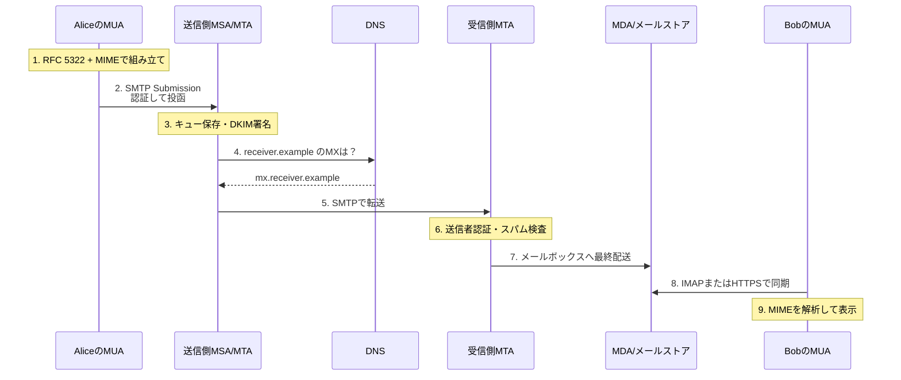
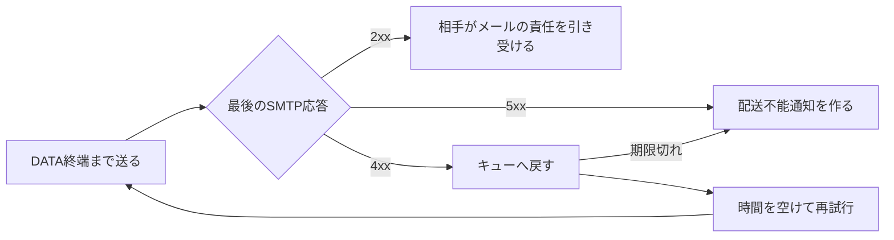
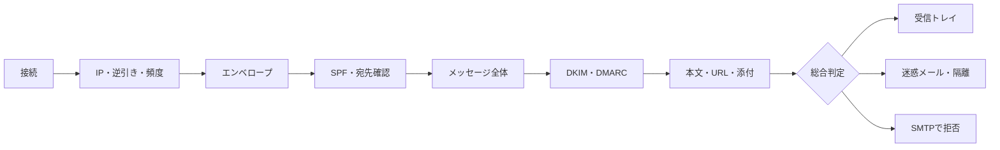

メールの「送信」を押した数秒後、相手の受信トレイに新着メールが現れる。

この数秒の間に、何が起きているか説明できるでしょうか。

メールソフトが相手の端末へ直接データを送っているわけではありません。本文と添付ファイルを共通形式に変換し、送信サーバーへ預け、DNSで宛先を探し、複数の検査を通過したあと、ようやく相手のメールボックスへ保存されます。

本稿は、次の記事のように「普段は見えない通信の裏側を、入口から出口まで一本につなげて理解したい」と思ったことが出発点です。

https://zenn.dev/moko_poi/articles/c2402f13a870a1

題材は、Alice（`alice@sender.example`）からBob（`bob@receiver.example`）へ送る1通のメールです。SMTPやDNSを初めて詳しく見る方でも流れを見失わないよう、先に全体像を示し、そのあと各地点を拡大します。

:::message
先に結論を一文で。

**メールは、いくつものサーバーが「いったん保存し、次へ渡す」ことで届く、非同期の配送システムです。**

この仕組みを **ストア&フォワード** と呼びます。
:::

## まず全体像

典型的なメール配送は、次の9段階に分けられます。

1. メールソフトが、本文や添付ファイルをRFC 5322・MIME形式に組み立てる
2. メールソフトが、送信受付サーバーへメールを投函する
3. 送信側サーバーが、メールをキューに保存してDKIM署名を付ける
4. DNSのMXレコードから、宛先ドメインの受信サーバーを探す
5. 送信側と受信側のサーバーが、SMTPでメールを受け渡す
6. 受信側が、SPF・DKIM・DMARCや本文の安全性を検査する
7. 配送担当が、受信者のメールボックスへ保存する
8. 受信者のメールソフトが、IMAPなどでメールを同期する
9. MIMEを元に戻し、安全に画面へ表示する



実際には、企業のメールゲートウェイや転送サービスが間に入ることもあります。同じ事業者内のメールなら、公開DNSやインターネット上のSMTP通信を省略することもあります。また、受信側の検査は独立した6番目の処理ではなく、SMTP接続中から始まり、`250 OK` の前後にまたがります。図は役割をつかむための論理順です。

それでも、**組み立てる・預ける・宛先を決める・検査する・保存する・表示する**という論理的な役割は変わりません。

### 「届いた」は、どの地点を指すのか

メールでは、「送信できた」と「相手に見えた」の間に複数のゴールがあります。

| 地点 | 起きたこと | まだ保証されないこと |
|---|---|---|
| 送信操作完了 | アプリが送信要求を受け付けた | 送信サーバーが預かったか |
| 投函完了 | 送信側MSAがメールを預かった | 宛先サーバーが受け取るか |
| SMTP転送完了 | 受信側MTAがDATA終端へ `250 OK` を返した | 受信トレイに入るか |
| 最終配送完了 | メールボックスへ保存された | 受信者の端末に表示されるか |
| 同期完了 | 受信者の画面に表示された | 本人が読んだか |

この記事でいう「届く」は、原則として **メールボックスに保存され、受信者のメールソフトに表示できる状態になるまで** とします。

## 登場人物を整理する

メールの用語は略語が多いため、先に役割だけを押さえます。

| 略称 | 名前 | 役割 | 郵便にたとえると |
|---|---|---|---|
| MUA | Mail User Agent | メールを作成・閲覧するアプリ | 手紙を書く人、読む人 |
| MSA | Message Submission Agent | 利用者を認証し、投函を受け付ける | 郵便窓口 |
| MTA | Mail Transfer Agent | サーバー間でメールを転送する | 郵便局間の輸送 |
| MDA | Mail Delivery Agent | 宛先のメールボックスへ格納する | 最後の配達員 |

GmailのWeb画面、Outlook、Apple Mail、ThunderbirdなどがMUAです。PostfixやEximのように、設定を変えてMSAとMTAの両方を担えるソフトウェアもあります。クラウド型のメール基盤では各役割が別サービスに分割され、外から見えないこともあります。

名前より大切なのは、**利用者から預かる役割** と **サーバー同士で運ぶ役割** が分かれていることです。

## 1. 送信ボタンの直後、メールを組み立てる

Aliceが送信ボタンを押した時点では、Bobのサーバーとの通信はまだ始まっていません。最初の仕事は、画面上の入力を「どのメールシステムでも扱えるデータ」に変換することです。

### メールの基本形は「ヘッダー + 空行 + 本文」

インターネットメールの基本構造は、[RFC 5322](https://www.rfc-editor.org/rfc/rfc5322)で定義されています。簡略化すると、ただのテキストです。

```text
From: Alice <alice@sender.example>
To: Bob <bob@receiver.example>
Date: Wed, 15 Jul 2026 10:00:00 +0900
Subject: =?UTF-8?B?5piO5pel44Gu5omT44Gh5ZCI44KP44Gb?=
Message-ID: <20260715.100000.12345@sender.example>
MIME-Version: 1.0
Content-Type: text/plain; charset=UTF-8
Content-Transfer-Encoding: base64

44GK55ay44KM44GV44G+44Gn44GZ44CC
```

空行より上が **ヘッダー**、下が **本文** です。`Subject:` のencoded-wordと、本文のbase64をデコードすると、それぞれ「明日の打ち合わせ」「お疲れさまです。」になります。

- `From:` はメッセージ上の著者・差出人。画面表示やDMARC評価にも使う
- `To:` はメッセージ上の宛先。画面には表示するがSMTPの配送先ではない
- `Date:` は作成日時
- `Message-ID:` はメールを識別するためのID
- `Content-Type:` は本文の種類と文字コード

`Message-ID` はスレッド表示や重複判定にも使われます。MUAが付けることも、投函を受けたMSAが補うこともあります。

### MIMEが本文・HTML・添付ファイルを一つに束ねる

画像やPDFは、そのままではテキスト中心のメール形式に入りません。そこで使われるのが [MIME](https://www.rfc-editor.org/rfc/rfc2045)（Multipurpose Internet Mail Extensions）です。複数の部品を束ねる形式は [RFC 2046](https://www.rfc-editor.org/rfc/rfc2046) で定義されています。

MIMEは、1通のメールを複数の部品に分け、それぞれに種類と符号化方式を付けます。

```text
multipart/mixed
├── multipart/alternative
│   ├── text/plain       プレーンテキスト版
│   └── text/html        HTML版
└── application/pdf     添付ファイル
```

バイナリの添付ファイルは、多くの場合 `base64` でASCII文字へ変換されます。base64は3バイトを4文字で表すため、データ量はおおむね3分の1増えます。10MBのファイルを添付すると、通信上のメールサイズが10MBを超えるのはこのためです。

日本語本文には `base64` や `quoted-printable` が使われます。日本語の件名や表示名は、必要に応じてencoded-wordという形式へ変換されます。

:::details SMTPUTF8は何を拡張するのか
[`SMTPUTF8`](https://www.rfc-editor.org/rfc/rfc6531) は、主にメールアドレスのローカル部などへ非ASCII文字を使えるようにするSMTP拡張です。

本文をUTF-8で書くこと、件名を日本語にすること、アドレス自体に日本語を含めることは別の問題です。相手サーバーが `SMTPUTF8` を広告しない場合、国際化メールアドレスを含むメールはその経路では配送できません。
:::

### 配送用の「封筒」は本文とは別にある

ここがメールを理解する最重要ポイントです。

メールには、先ほどのメッセージ本体とは別に **SMTPエンベロープ** があります。郵便でいえば、メッセージ本体は便箋、エンベロープは封筒です。

| 情報 | 代表的な項目 | 主な用途 |
|---|---|---|
| SMTPエンベロープ | `MAIL FROM`、`RCPT TO` | 配送先の決定、エラーの返送 |
| メッセージヘッダー | `From:`、`To:`、`Subject:` | 著者・宛先・内容の表現、表示、返信、認証 |

```text
# SMTPエンベロープ。配送中の会話で渡す
MAIL FROM:<bounce@sender.example>
RCPT TO:<bob@receiver.example>

# メッセージヘッダー。メッセージ内の著者と宛先を表す
From: Alice <alice@sender.example>
To: Bob <bob@receiver.example>
```

SMTPの配送先は `RCPT TO` で決まり、`To:` ヘッダーでは決まりません。この分離により、BCCの宛先をほかの受信者へ見せずに配送できます。通常、BCCのアドレスはメッセージヘッダーに残さず、`RCPT TO` の宛先としてだけ渡します。実装によっては空の `Bcc:` を残したり、BCC向けに別のコピーを作ったりします。

`MAIL FROM` も、画面上の `From:` と一致するとは限りません。メール配信サービスは、エラーを処理する専用アドレスを `MAIL FROM` に使うことがあります。

柔軟な一方、表示上の `From:` だけなら他人のアドレスを書けてしまいます。この隙間を埋めるのが、後半で扱うSPF・DKIM・DMARCです。

:::message
この時点では、メールは「運べる形」になっただけです。まだ送信側サーバーにも預けられていません。
:::

## 2. MUAからMSAへ投函する

組み立てたメールを最初に預かるのがMSAです。この区間を **Message Submission** と呼びます。

### Webメールでは、ブラウザがSMTPを話すとは限らない

デスクトップのメールソフトは、通常SMTP SubmissionでMSAへ接続します。

一方、Webメールのブラウザは、HTTPSで事業者のWeb APIへ送信内容を渡すのが一般的です。ブラウザ自身がSMTPで外部へ送るわけではありません。事業者のバックエンドが内容を受け取ったあと、同じようにキューへ入れて配送を始めます。

```text
メールアプリ: MUA --SMTP Submission--> MSA
Webメール  : ブラウザ --HTTPS--> Webバックエンド --内部処理--> MSA/MTA
```

入口は違っても、「認証された利用者からメールを預かる」という役割は同じです。

### 25番・587番・465番を使い分ける

SMTP関連でよく見るポートは3つです。

| ポート | 主な用途 | TLS | 認証 |
|---:|---|---|---|
| 25 | MTA同士のリレー | STARTTLSを利用可能 | 通常は利用者のSMTP AUTHをしない |
| 587 | メールの投函 | STARTTLSで暗号化 | 通常は必要 |
| 465 | メールの投函 | 接続直後からTLS | 通常は必要 |

587番は [RFC 6409](https://www.rfc-editor.org/rfc/rfc6409) のSubmissionポートです。465番はImplicit TLS、つまりTCP接続の直後から暗号化された状態で話します。[RFC 8314](https://www.rfc-editor.org/rfc/rfc8314) は、メールの投函や取得で平文通信を使わないことを求め、Implicit TLSを推奨しています。実運用では587番のSTARTTLSも広く使われています。

25番は、郵便局同士の搬入口です。利用者の投函口と分離することで、MSAは認証済みユーザーだけを受け付け、MTAは世界中の宛先サーバーから来るメールを受け付けられます。

家庭やモバイル回線から外部の25番ポートへの接続は、迷惑メール対策として通信事業者に遮断されることがあります。これはOP25B（Outbound Port 25 Blocking）と呼ばれます。通常のメールアプリが587番または465番を使う理由の一つです。

### 投函時のSMTP会話

587番でSTARTTLSを使う場合の会話を、説明用に短くすると次のようになります。`C:` はクライアント、`S:` はサーバーです。

```text
S: 220 smtp.sender.example ESMTP ready
C: EHLO alice-pc
S: 250-smtp.sender.example
S: 250-STARTTLS
S: 250-AUTH PLAIN LOGIN
S: 250 SIZE 52428800

C: STARTTLS
S: 220 Ready to start TLS
   ... TLSハンドシェイク ...

C: EHLO alice-pc
S: 250-smtp.sender.example
S: 250-AUTH PLAIN LOGIN
S: 250 SIZE 52428800
C: AUTH ...
S: 235 2.7.0 Authentication successful

C: MAIL FROM:<bounce@sender.example>
S: 250 2.1.0 Sender OK
C: RCPT TO:<bob@receiver.example>
S: 250 2.1.5 Recipient OK
C: DATA
S: 354 End data with <CRLF>.<CRLF>
C: From: Alice <alice@sender.example>
C: To: Bob <bob@receiver.example>
C: Date: Wed, 15 Jul 2026 10:00:00 +0900
C: Message-ID: <20260715.100000.12345@sender.example>
C: Subject: =?UTF-8?B?5piO5pel44Gu5omT44Gh5ZCI44KP44Gb?=
C: MIME-Version: 1.0
C: Content-Type: text/plain; charset=UTF-8
C: Content-Transfer-Encoding: base64
C:
C: MTDmmYLjgYvjgonjgYrpoZjjgYTjgZfjgb7jgZnjgII=
C: .
S: 250 2.0.0 Queued as A1B2C3
C: QUIT
S: 221 2.0.0 Bye
```

順番に見ると、難しいことはしていません。

1. `EHLO` で名乗り、サーバーが対応機能を返す
2. `STARTTLS` で暗号化を開始する
3. 暗号化後にもう一度 `EHLO` し、機能を確認する
4. `AUTH` で利用者を認証する
5. `MAIL FROM` と `RCPT TO` で封筒を渡す
6. `DATA` のあとにヘッダーと本文を渡す
7. 1行のピリオドでデータの終端を伝える

TLS開始後に `EHLO` をやり直すのは、暗号化前のSMTP状態がリセットされるためです。認証情報はTLSで保護された経路上で送ります。

最後の `250 2.0.0 Queued` は重要です。意味するのは、

> 送信側サーバーが、このメールを預かりました

であって、

> Bobの受信トレイに入りました

ではありません。

メールアプリの「送信済み」フォルダーも、多くの場合はMUAや事業者が送信メールのコピーを保存したものです。相手への配送完了証明ではありません。

### MSAは受け取る前後にポリシーを確認する

MSAは、単に右から左へ流すだけではありません。実装や事業者によって、次のような処理を行います。

- 利用者認証と送信権限の確認
- 送信数、宛先数、メッセージサイズの制限
- ウイルスや迷惑メールの送信チェック
- 不足している `Date:` や `Message-ID:` の補完
- 経路を記録する `Received:` ヘッダーの追加
- キューへの永続保存

この検査を通過してキューに保存できたところで、MSAは成功応答を返せます。

:::message
この時点で送信側はメールを預かりました。ここから先の再送責任は、利用者の端末ではなくメールサーバーが持ちます。
:::

## 3. 送信側サーバーがキューへ保存する

MSAが受理したメールは、送信側MTAの **メールキュー** に入ります。キューは、配送待ちメールを保存する場所です。

メールがHTTPと大きく違うのは、このキューがあることです。

| | 一般的なHTTP通信 | SMTP配送 |
|---|---|---|
| 基本形 | 要求にその場で応答する | 預かってから次へ転送する |
| 相手が停止中 | クライアントへエラーを返す | キューへ残してあとで再送する |
| 再試行する主体 | 呼び出し元の実装次第 | メールを預かったMTA |
| 所要時間 | 通常は秒単位 | 数秒から数日になることもある |

キューには、メッセージ本体だけでなくSMTPエンベロープも保存します。`RCPT TO` を失うと、再送先が分からなくなるためです。

1通に複数の宛先がある場合、結果は宛先ごとに分かれます。Bobには届いたがCarolのサーバーは停止中、という場合、Bob分を完了にし、Carol分だけをキューへ残せます。

### DKIM署名を付ける

送信側の管理範囲から外へ出す前に、多くのメール基盤は **DKIM署名** を付けます。DKIM（DomainKeys Identified Mail）は、ドメインがメールの一部へ電子署名する仕組みです。

```text
DKIM-Signature: v=1; a=rsa-sha256;
 d=sender.example; s=mail2026;
 h=from:to:subject:date:message-id;
 bh=本文のハッシュ値;
 b=電子署名
```

主な要素は次のとおりです。

- `d=sender.example`: 署名に責任を持つドメイン
- `s=mail2026`: 公開鍵を選ぶセレクター
- `h=`: 署名対象にしたヘッダー
- `bh=`: 本文から計算したハッシュ
- `b=`: 秘密鍵で作った署名

受信側は、DNSの `mail2026._domainkey.sender.example` から公開鍵を取得して検証します。本文や署名対象ヘッダーが配送途中で不正に変われば、検証に失敗します。

:::message
DKIMは暗号化ではありません。配送中のサーバーは本文を読めます。

また、DKIMが証明するのは「その署名ドメインがこのメールに責任を持ったこと」です。Aliceという人間の身元や、内容の安全性を直接証明するものではありません。
:::

署名後にフッターを追加するなど、メール内容を変更すると署名が壊れることがあります。そのためDKIM署名は、通常、送信組織内で必要な変更を終えたあとの出口に近い場所で付けます。

### Receivedヘッダーで通過地点を残す

各メールサーバーは受け取ったとき、原則として `Received:` ヘッダーを先頭へ追加します。

```text
Received: from msa.sender.example
        by outbound.sender.example with ESMTP
        id A1B2C3;
        Wed, 15 Jul 2026 10:00:01 +0900
```

駅のスタンプのように、どこから、どのサーバーが、いつ受け取ったかを記録します。新しい `Received:` が上へ追加されるため、あとで経路を追うときは **下から上へ** 読みます。

ただし、送信者が本文側へ偽の `Received:` を書くこともできます。受信組織が管理するサーバーまでの、信頼できる境界を意識して読みます。

:::message
この時点で、メールは送信側のキューに安全に保存されました。次は「receiver.example宛てを、どのサーバーへ渡すか」を調べます。
:::

## 4. DNSのMXレコードで宛先を探す

Webアクセスでは、ドメイン名からAまたはAAAAレコードを引き、接続先IPアドレスを探します。

メールでは、その前に **MXレコード**（Mail Exchanger）を引きます。MXは「このドメイン宛てのメールを受け取るサーバー」を示すDNSレコードです。

ここで使うドメインは、メッセージヘッダーの `To:` ではなく、SMTPエンベロープの `RCPT TO:<bob@receiver.example>` にある `receiver.example` です。

### MX検索は二段階

説明用のDNS応答を見てみます。

```shell
$ dig +short MX receiver.example
10 mx1.receiver.example.
20 mx2.receiver.example.

$ dig +short A mx1.receiver.example
192.0.2.25

$ dig +short AAAA mx1.receiver.example
2001:db8::25
```

`.example` と表示中のIPアドレスは説明用です。実際に確認するときは、自分が調べたいドメインへ置き換えてください。

MTAは次の順で接続先を決めます。

1. 宛先ドメインのMXレコードを取得する
2. 数字の小さいMXを優先する
3. MXのホスト名からA・AAAAレコードを取得する
4. 得られたIPアドレスの25番ポートへ接続する
5. 接続できなければ、同順位の別アドレスや次順位のMXを試す

`10` や `20` は距離ではなく **優先度** です。小さい値ほど優先されます。複数のMXを用意しておけば、保守中や障害時に別サーバーへ配送できます。

### MXが見つからない場合

MX検索には、いくつかの分岐があります。

| DNSの結果 | MTAの動作 |
|---|---|
| MXがある | 優先度に従って各MXを試す |
| MXがなく、ドメインにA/AAAAがある | そのドメイン自身を暗黙のMXとして試す |
| ドメインが存在しない | 配送不能として扱う |
| `MX 0 .` がある | メールを受け取らない意思表示として扱う |
| DNSが一時的に失敗した | キューへ残して再試行する |

`MX 0 .` は **Null MX** と呼ばれます。Webサイト専用ドメインなどが「このドメインはメールを受信しない」と明示するための仕組みです。

DNSの応答はTTLの間キャッシュされます。MXを変更しても、古い情報がTTL切れまで使われる可能性があります。メール基盤の移行で新旧サーバーをしばらく並行稼働させるのは、このためです。

### メール認証もDNSを使う

DNSは宛先案内だけでなく、後述する送信者認証の公開場所でもあります。

| 用途 | 問い合わせる代表例 |
|---|---|
| 配送先 | `receiver.example MX` |
| SPF | `sender.example TXT` |
| DKIM公開鍵 | `selector._domainkey.sender.example TXT` |
| DMARC方針 | `_dmarc.sender.example TXT` |

つまりDNSは、メールにとって **住所録と身元確認台帳の両方** を担っています。

:::message
この時点で、送信側MTAは受信側MTAのホスト名とIPアドレスを知りました。次は25番ポートへ接続し、メールを直接受け渡します。
:::

## 5. MTA同士がSMTPでメールを受け渡す

送信側MTAは、選んだMXの25番ポートへTCP接続します。ここでもSMTPを使いますが、投函時とは目的が違います。

- 投函: 利用者からMSAへ。通常は認証が必要
- リレー: 送信側MTAから受信側MTAへ。通常はSMTP AUTHを使わない

受信側MTAは世界中の正当な送信サーバーからメールを受ける必要があります。「Bob宛てのメールを、このサーバーが受け持つ」というDNS上の情報と、接続元・メール内容に対する検査を組み合わせて受信可否を決めます。

### サーバー間のSMTP会話

典型的なやり取りを簡略化すると、次のようになります。

```text
S: 220 mx1.receiver.example ESMTP ready
C: EHLO outbound.sender.example
S: 250-mx1.receiver.example
S: 250-SIZE 52428800
S: 250-8BITMIME
S: 250-STARTTLS
S: 250 SMTPUTF8

C: STARTTLS
S: 220 2.0.0 Ready to start TLS
   ... TLSハンドシェイク ...

C: EHLO outbound.sender.example
S: 250-mx1.receiver.example
S: 250-SIZE 52428800
S: 250-8BITMIME
S: 250 SMTPUTF8

C: MAIL FROM:<bounce@sender.example>
S: 250 2.1.0 Sender OK
C: RCPT TO:<bob@receiver.example>
S: 250 2.1.5 Recipient OK
C: DATA
S: 354 Start mail input
C: DKIM-Signature: ...
C: From: Alice <alice@sender.example>
C: To: Bob <bob@receiver.example>
C: Date: Wed, 15 Jul 2026 10:00:00 +0900
C: Message-ID: <20260715.100000.12345@sender.example>
C: Subject: =?UTF-8?B?5piO5pel44Gu5omT44Gh5ZCI44KP44Gb?=
C: MIME-Version: 1.0
C: Content-Type: text/plain; charset=UTF-8
C: Content-Transfer-Encoding: base64
C:
C: MTDmmYLjgYvjgonjgYrpoZjjgYTjgZfjgb7jgZnjgII=
C: .
S: 250 2.0.0 Message accepted for delivery
```

`EHLO` の応答に並ぶ名前は、利用できるSMTP拡張です。

| 拡張 | 意味 |
|---|---|
| `SIZE` | 受信可能な最大メールサイズを示す |
| `8BITMIME` | 8bitのMIME本文を扱える |
| `STARTTLS` | この接続をTLSへ切り替えられる |
| `SMTPUTF8` | 国際化メールアドレスなどを扱える |

サーバーが広告していない拡張を、送信側が勝手に使うことはできません。

`RCPT TO` の段階で「その利用者はいない」と拒否すれば、大きな本文を送る前に会話を終えられます。`DATA` の終端は `<CRLF>.<CRLF>`、つまり空の1行ではなく、ピリオドだけの1行です。本文中の行頭にピリオドがある場合は、送信側がもう一つ足して区別します。

### 最後の250で配送責任が移る

SMTPで最も重要なのは、`DATA` の最後に返る応答です。

```text
S: 250 2.0.0 Message accepted for delivery
```

これは、受信側MTAがメッセージを受理し、配送する責任を引き受けたことを示します。ここまで来れば、送信側MTAは自分のキューからその宛先分を削除できます。

ただし、これはまだ「受信トレイに入った」という意味ではありません。受信側は、SMTP接続中から送信元を調べ、最後のピリオドを受け取ってからDKIMや本文を検査したうえで250を返すことがあります。受理後に追加の迷惑メール判定や振り分けを続ける構成もあります。

### サーバー間TLSは、歴史的には「可能なら暗号化」

投函区間では、メールアプリとMSAがTLSを必須に設定できます。

一方、不特定多数のMTA同士をつなぐ25番ポートでは、長く **Opportunistic TLS** が使われてきました。相手が `STARTTLS` を提供すれば暗号化し、提供しなければ配送を優先して平文へフォールバックする考え方です。

これには弱点があります。通信途中で `STARTTLS` の広告を消されると、送信側が「相手はTLS非対応」と誤認する可能性があります。そこで、暗号化を強制・監視する仕組みが追加されました。

:::details MTA-STS・DANE・TLS-RPT
- **MTA-STS**: 受信ドメインがDNSとHTTPSで「正しい証明書を持つMXへTLSで接続すること」を宣言する仕組み
- **DANE for SMTP**: DNSSECで保護されたTLSAレコードを使い、接続先とTLS鍵・証明書を検証する仕組み
- **TLS-RPT**: MTA-STSやDANEに関係するTLS配送失敗を、受信ドメインへ集計報告する仕組み

これらに対応した送信MTAは、ポリシーに合う安全なTLS接続を確立できなければ、平文で送らずキューへ残せます。
:::

:::message alert
SMTPのTLSは、基本的に **いま接続している2台の間** を守るホップ間暗号化です。

中継サーバーや受信サービスは、処理のためにメール本文を読めます。送信者から受信者まで本文を暗号化したままにしたい場合は、S/MIMEやOpenPGPなど別のエンドツーエンド暗号化が必要です。
:::

## 6. 失敗したらキューから再送する

SMTP応答の先頭の数字を見ると、直前のコマンドが成功したか分かります。メール全体の配送結果を判断するときは、`DATA` 終端のピリオドに対する最後の応答を見ます。

| 応答 | 分類 | 送信側の基本動作 | 例 |
|---:|---|---|---|
| 2xx | 成功 | 直前のコマンドを完了する。DATA終端なら責任が移る | `250 Message accepted` |
| 4xx | 一時的失敗 | 配送できなければキューへ残して再送する | `451 Temporary local problem` |
| 5xx | 恒久的失敗 | 同じ条件では再送せず、配送不能を通知する | `550 Mailbox unavailable` |

[`4.2.2` や `5.7.1` のような拡張ステータスコード](https://www.rfc-editor.org/rfc/rfc3463)が付く場合は、より詳しい分類を表します。実際の文言や運用判断は受信事業者によって異なります。



[RFC 5321](https://www.rfc-editor.org/rfc/rfc5321) は、一般的な再試行間隔を少なくとも30分、配送を断念するまでを少なくとも4〜5日程度としています。ただし、これは固定のタイマーではありません。実装は失敗理由に応じて間隔を変え、事業者は保持期間を設定できます。

この設計のおかげで、受信サーバーが短時間停止しても、利用者がメールを送り直す必要はありません。メールサーバー同士が回復を待ちます。

### グレイリスティングは、わざと一度断る

迷惑メール対策として、初めて見る「接続元・差出人・宛先」の組み合わせへ一時エラーを返すことがあります。これが **グレイリスティング** です。

正しく実装されたMTAは4xxを見て再送しますが、使い捨ての単純な送信プログラムは戻ってこないことがあります。副作用として、最初のメールが数分から数十分遅れる場合があります。

### バウンスはエンベロープ差出人へ戻る

5xxを受け取ったとき、または4xxの再送期限を超えたとき、送信側は通常 [**DSN**（Delivery Status Notification）](https://www.rfc-editor.org/rfc/rfc3464)を作ります。いわゆるバウンスメール、MAILER-DAEMONから届くエラー通知です。

通知先は、表示ヘッダーの `From:` ではなく、エンベロープの `MAIL FROM` です。

```text
Final-Recipient: rfc822; bob@receiver.example
Action: failed
Status: 5.1.1
Diagnostic-Code: smtp; 550 5.1.1 User unknown
```

DSN自身の `MAIL FROM` は空（`MAIL FROM:<>`）にします。DSNも配送不能だったときに、さらにDSNを返して無限ループになるのを防ぐためです。

「送信直後は成功したのに、数日後にエラーが返った」という現象は矛盾ではありません。最初の成功はMSAが預かったこと、その後の失敗は宛先まで運び切れなかったことを表しています。

:::message
DATA終端への応答が250なら次のサーバーへ責任が移り、4xxなら待って再送し、5xxなら原則として諦めて知らせる。SMTPの信頼性は、この単純な分岐と永続キューで作られています。
:::

## 7. 受信側が「誰からの何のメールか」を審査する

受信側MTAは、世界中から届くメールを無条件には受け入れません。

大きく二つの問いを評価します。

1. **そのドメインを名乗ることは許可されているか**
2. **受信者が欲しい、安全なメールか**

前者を判断する代表がSPF・DKIM・DMARCです。後者には送信元の評判、本文、URL、添付ファイル、利用者の設定などを使います。

処理の具体的な順序や点数は事業者によって異なりますが、概念的には次の関門があります。



### 接続した時点から審査は始まる

受信側は本文が届く前から、接続元を見ています。

- 接続元IPアドレスの過去の評判
- IPアドレスの逆引きPTRと、正引き結果の整合性
- `EHLO` で名乗ったホスト名
- 短時間の接続数や送信数
- 既知の不正送信元を集めたDNSBL

これらだけで正当性を断定はできません。しかし、大量送信ボットや設定不良サーバーを早い段階で絞る材料になります。

### SPF: そのIPから送ってよいか

**SPF**（Sender Policy Framework）は、接続元IPアドレスが、エンベロープ差出人のドメインから送信を許可されているかを調べます。

送信側ドメインは、DNSに次のようなTXTレコードを公開します。

```text
sender.example. IN TXT "v=spf1 ip4:192.0.2.10 include:_spf.mail-provider.example -all"
```

受信側はおおむね次を照合します。

```text
接続元IP: 192.0.2.10
MAIL FROM: bounce@sender.example
                        └─ sender.example のSPFを検索
```

許可されたIPなら `pass`、明示的に許可されていなければ `fail` などの結果になります。`MAIL FROM` が空のDSNでは、`EHLO` のドメインを評価します。

:::message alert
SPFが直接検証するのは、画面に見える `From:` ではありません。

また、本文が改ざんされていないことも検証しません。SPF単独では、表示上の差出人詐称を防ぎ切れないのです。
:::

単純なメール転送では、受信側から見える接続元IPが元の送信MTAから転送MTAへ変わります。そのため、元ドメインのSPFに転送MTAのIPが含まれず、正当なメールでも失敗しやすいという弱点があります。

### DKIM: 署名が正しく、内容が保たれているか

受信側は `DKIM-Signature:` の `d=` と `s=` を読み、DNSから公開鍵を取得します。

```text
s=mail2026
d=sender.example
        ↓
mail2026._domainkey.sender.example のTXTレコードを検索
```

公開鍵で署名を検証し、署名対象のヘッダーと本文が想定どおりなら `pass` です。

DKIMは接続元IPが変わっても、メール自体が変わらなければ検証できます。そのため単純転送に比較的強い一方、メーリングリストが件名を書き換えたり、本文へ案内文を追加したりすると署名が壊れることがあります。

SPFとDKIMは、違う角度から同じメールを見ています。

| | SPF | DKIM |
|---|---|---|
| 主に確かめるもの | 接続元IPの送信許可 | ドメイン署名と内容の完全性 |
| 基準となるドメイン | `MAIL FROM` または `EHLO` | `DKIM-Signature` の `d=` |
| 単純転送 | IPが変わるため失敗しやすい | 内容が変わらなければ残りやすい |
| 内容の変更 | 影響しない | 署名対象なら失敗し得る |
| 表示上の `From:` を直接守るか | 守らない | 必ず一致するとは限らない |

最後の行が重要です。SPFが `delivery-service.example` でpassし、DKIMが `mail-vendor.example` でpassしても、表示上の `From: alice@sender.example` と無関係なら、Aliceのドメインを守ったことにはなりません。

### DMARC: 表示上のFromと認証結果を結び付ける

**DMARC**（Domain-based Message Authentication, Reporting, and Conformance）は、受信者が見る `From:` ドメインを中心に、SPF・DKIMの結果を結び付けます。

判定の核心は、次の式です。

```text
DMARC pass =
    （SPFがpass かつ SPFドメインがFromドメインと整合）
  または
    （DKIMがpass かつ DKIMのd=がFromドメインと整合）
```

**SPFとDKIMの両方が通る必要はありません。** Fromと整合したどちらか一方がpassすれば、DMARCはpassできます。

ここでいう整合（alignment）には、主に二つのモードがあります。

- relaxed: 組織ドメインが同じ
- strict: ドメインが完全に同じ

例えば表示上のFromが `sender.example` なら、relaxed設定では `bounce.sender.example` や `mail.sender.example` も同じ組織ドメインとして整合し得ます。

送信ドメインは、`_dmarc.sender.example` にポリシーを公開します。

```text
_dmarc.sender.example. IN TXT
"v=DMARC1; p=quarantine; rua=mailto:dmarc-report@sender.example"
```

代表的な `p=` の値は次のとおりです。

| 値 | ドメイン所有者が示す取り扱い希望 |
|---|---|
| `none` | DMARC失敗による特別な扱いを求めない。監視に使われることが多い |
| `quarantine` | 疑わしいものとして隔離などを希望する |
| `reject` | 拒否を希望する |

これはドメイン所有者の **希望** です。最終判断は受信側のローカルポリシーにあり、必ずそのとおり処理する義務があるわけではありません。

:::details 2026年のDMARC仕様
2026年5月に [RFC 9989](https://www.rfc-editor.org/rfc/rfc9989) が公開され、従来のRFC 7489とRFC 9091を廃止しました。SPF・DKIMとのalignmentを見る基本モデルは変わりません。

レポート仕様は、集約レポートの [RFC 9990](https://www.rfc-editor.org/rfc/rfc9990) と失敗レポートの [RFC 9991](https://www.rfc-editor.org/rfc/rfc9991) に分かれました。また、旧仕様の `pct` タグは削除され、テスト状態を示す `t=y/n` が導入されています。

古い記事や設定例ではRFC 7489や `pct=` が多く見つかるため、実装時は現行仕様と利用サービスの対応状況を確認してください。
:::

:::message
DMARC passが示すのは、**表示されたFromドメインの利用が、そのドメイン側から認められたと判断できること** です。

正規アカウントが乗っ取られていれば、詐欺メールでも認証を通る可能性があります。DMARC passは「安全」「受信トレイ入り」の保証ではありません。
:::

### 転送やメーリングリストを助けるARC

転送ではSPFが、本文変更を伴うメーリングリストではDKIMが壊れやすく、結果としてDMARCも失敗することがあります。

**ARC**（Authenticated Received Chain）は、中継者が「自分が受け取った時点の認証結果」と、その後の変更を署名付きの鎖として残す仕組みです。最終受信者は、信頼できる中継者のARCをローカル判断の材料にできます。

ARCがDMARC失敗を自動的にpassへ変えるわけではありません。誰のARCを信頼するかも含めて、受信側が判断します。

### 認証のあとに、メールの中身と評判を見る

送信ドメイン認証は入口にすぎません。受信トレイへ入れるかは、さらに多くの情報から決まります。

| 観点 | 例 |
|---|---|
| 送信元の評判 | IP・ドメインの履歴、苦情率、未知の送信元か |
| 送信の挙動 | 急激な送信量、宛先エラー率、接続頻度 |
| 本文 | 不審な表現、難読化、表示名の偽装 |
| URL | 既知の危険サイト、表示文字列とリンク先の不一致 |
| 添付 | マルウェア、危険な形式、暗号化アーカイブ |
| 受信者との関係 | 過去のやり取り、連絡先、迷惑メール報告 |
| 利用者設定 | ブロック、許可リスト、振り分けルール |

認証を通った広告メールが迷惑メールに入ることも、転送された正当なメールの認証が一部失敗して受信トレイに入ることもあります。認証結果は重要ですが、総合判定の一材料です。

受信側は、SMTP会話中に5xxで拒否することもあれば、いったん250で受理してから迷惑メールフォルダーや隔離領域へ置くこともあります。後者では送信側から配送成功に見えるため、「バウンスはないが受信トレイにもない」という状態が生まれます。

:::message
この時点で、受信側は「配送を引き受けるか」と「受け取ったメールをどこへ置くか」を判断しました。次は、Bob専用のメールボックスへ保存します。
:::

## 8. MDAがメールボックスへ最終配送する

受信側MTAが外部とのSMTP通信を終えると、MDAまたは同等の内部配送サービスへメールを渡します。

この区間では [LMTP（Local Mail Transfer Protocol）](https://www.rfc-editor.org/rfc/rfc2033) がよく使われます。SMTPに似ていますが、複数宛先それぞれの最終配送結果を返しやすい、ローカル配送向けのプロトコルです。大規模なクラウドサービスでは、独自キューや内部APIが同じ役割を担うこともあります。

### 最終配送で行うこと

代表的な処理は次のとおりです。

1. 宛先ユーザー、エイリアス、転送設定を解決する
2. 容量制限や受信者のルールを確認する
3. `Return-Path:` など最終配送用の情報を付ける
4. Inbox、Spam、Quarantineなど保存先を決める
5. メッセージを永続ストレージへ書き込む
6. 検索用インデックスやスレッド情報を更新する
7. 新着イベントを通知系へ渡す

`Return-Path:` には、配送に使われたエンベロープ差出人が記録されます。

```text
Return-Path: <bounce@sender.example>
```

受信者が普段見る `From:` と異なることがあるのは、これが表示用ではなく、配送エラー用の差出人を記録しているからです。

受信者側の振り分けには、Sieveのようなサーバー側フィルタ言語や、各サービス独自のルールが使われます。「上司から来たら重要フォルダーへ」「特定のメーリングリストは専用フォルダーへ」といった処理です。

### メールボックスは一つのファイルとは限らない

小規模なシステムでは、1通ずつファイルへ保存するMaildirなどを利用できます。大規模サービスでは、分散データベース、オブジェクトストレージ、検索インデックスを組み合わせることもあります。

利用者からは一つの受信トレイに見えても、実体はサービスごとに大きく異なります。重要なのは、障害が起きても失わない形で保存され、利用者単位のフォルダーや状態として取得できることです。

容量超過をSMTP中に検知して4xx・5xxを返す構成も、受理後の内部配送で判明してDSNを生成する構成もあります。どの時点でも、すでに責任を引き受けたシステムが次の処理またはエラー通知を担います。

:::message
ここで「メールボックスへの配送」が完了しました。ただし、Bobのスマートフォン画面に表示する仕事は、SMTPではなくメールアクセスの仕組みが担当します。
:::

## 9. 受信者のメールソフトへ同期して表示する

保存済みメールへアクセスする代表的な方法は、Webメール、IMAP、POP3です。

| 方法 | 代表ポート | 基本的な使い方 |
|---|---:|---|
| Webメール | 443 | ブラウザがHTTPSでサービスへアクセスする |
| IMAP | 993 | サーバー上のメール、フォルダー、既読状態を同期する |
| POP3 | 995 | サーバーのmaildropからメールを取得する |

993番と995番は、接続直後からTLSを使うポートです。143番のIMAPや110番のPOP3でもSTARTTLSは利用できますが、平文のまま認証情報を送ってはいけません。

### IMAPは「サーバー上のメールボックスを操作する」

現在のIMAP4rev2は [RFC 9051](https://www.rfc-editor.org/rfc/rfc9051) で定義されています。

IMAPでは、メールをサーバーに置いたまま、次の状態を複数端末で共有できます。

- 受信トレイや各フォルダー
- 既読・未読、返信済みなどのフラグ
- メールの移動や削除
- 必要なヘッダーや本文だけの取得

PCで既読にしたメールがスマートフォンでも既読になるのは、端末内のファイルを直接共有しているのではなく、サーバー上の状態を同期しているためです。

IMAP IDLEなどを使えば、接続中にメールボックスの変化を知らせられます。スマートフォンでは、OSのプッシュ通知基盤やメール事業者の通知サービスを組み合わせることもあります。SMTPが受信者の画面へ直接プッシュしているわけではありません。

### POP3は「メールを取り出す」に重点がある

POP3は、サーバー上のmaildropからメッセージ一覧を取得し、本文をダウンロードする単純なモデルです。設定によってサーバーにコピーを残せますが、フォルダーや豊富な状態同期はIMAPほど中心的ではありません。

複数端末で同じメールボックスを扱う現在の利用形態では、IMAPやWebメールが使われることが多くなっています。

### 最後にMIMEを人間向けへ戻す

メールソフトは、受け取った生のメッセージを解析します。

1. ヘッダーと本文を分ける
2. MIMEのboundaryから各パートへ分ける
3. base64やquoted-printableをデコードする
4. 文字コードを解釈する
5. text/plainまたはtext/htmlを選ぶ
6. 添付ファイルを名前・種類とともに表示する

HTMLメールは、そのままWebページとして実行すると危険です。MUAはスクリプトや危険な要素を除去し、外部コンテンツを制限して描画します。

外部画像を自動表示しない設定があるのは、プライバシー対策でもあります。メール固有のURLを持つ1ピクセル画像を読み込ませると、送信側は「いつ、どのIP付近から画像へアクセスしたか」を推測できるためです。

### 表示されたことと、読んだことも別

開封通知（MDN）を要求できるメールはありますが、受信者やMUAは通知を拒否できます。通知が返っても、画面に表示されたこと以上に、本人が内容を読んで理解したことまでは証明できません。

画像の読み込みを使った開封計測も、画像ブロック、キャッシュ、プライバシー保護機能の影響を受けます。

**配送完了・画面表示・読了は、最後まで別の出来事です。**

## 10. ヘッダーからメールの旅を読み解く

ここまでの流れは、受信メールの「メッセージのソース」「原文を表示」といった機能から確認できます。画面名はMUAによって異なります。

説明用のヘッダーを、配送に関係する部分だけ抜き出します。

```text
Return-Path: <bounce@sender.example>
Authentication-Results: mx.receiver.example;
    spf=pass smtp.mailfrom=sender.example;
    dkim=pass header.d=sender.example;
    dmarc=pass header.from=sender.example
Received: from outbound.sender.example (outbound.sender.example [192.0.2.10])
    by mx.receiver.example with ESMTPS id RCV123
    for <bob@receiver.example>;
    Wed, 15 Jul 2026 10:00:02 +0900
Received: from msa.sender.example
    by outbound.sender.example with ESMTPSA id A1B2C3;
    Wed, 15 Jul 2026 10:00:01 +0900
DKIM-Signature: v=1; d=sender.example; s=mail2026; ...
From: Alice <alice@sender.example>
To: Bob <bob@receiver.example>
Date: Wed, 15 Jul 2026 10:00:00 +0900
Message-ID: <20260715.100000.12345@sender.example>
Subject: =?UTF-8?B?5piO5pel44Gu5omT44Gh5ZCI44KP44Gb?=
```

### Receivedは下から上へ読む

この例では、時系列は次の順です。

1. 10:00:01に `msa.sender.example` から `outbound.sender.example` へ渡った
2. 10:00:02に `outbound.sender.example` から `mx.receiver.example` へ渡った

各サーバーが新しい `Received:` を先頭へ足すため、いちばん下が古く、上へ進むほど新しくなります。

隣り合う時刻の差が大きい場所は、キューで待った可能性があります。ただしタイムゾーン、サーバー時刻のずれ、経路上のヘッダー欠落も考慮します。

### Authentication-Resultsで認証結果を見る

`Authentication-Results:` は、受信側の認証サービスが記録した判定です。

```text
spf=pass   smtp.mailfrom=sender.example
dkim=pass  header.d=sender.example
dmarc=pass header.from=sender.example
```

結果だけでなく、**どの識別子を評価したか** を一緒に見ます。

- SPFなら `smtp.mailfrom`
- DKIMなら `header.d`
- DMARCなら `header.from`

すべてpassでもドメインがばらばらなら、期待した送信設定ではない可能性があります。DMARCではalignmentまで確認します。

:::message alert
`Authentication-Results:` も文字としては偽造できます。

受信組織が信頼するサーバーによって付けられたものを確認してください。知らない組織がメールの途中で付けた結果を、そのまま信頼してはいけません。
:::

### Return-PathとMessage-IDを見る

`Return-Path:` は最終配送時のエンベロープ差出人、`Message-ID:` はメッセージの識別子です。

配送サービスのログを追うときは、次の値が手掛かりになります。

- `Message-ID:`
- 各 `Received:` にあるキューID
- エンベロープ差出人と宛先
- 送受信日時
- DSNの `Status:` と `Diagnostic-Code:`

「届かない」という情報だけでは範囲が広すぎます。どのキューIDが、どの相手から、何時に、何番の応答を受けたかまで絞ると、配送の旅をサーバーログへ接続できます。

## 手元で確認するコマンド

DNSレコードは `dig` で確認できます。以下のドメインとセレクターは説明用なので、調べたい値へ置き換えてください。

```shell
# 宛先ドメインの受信サーバー
dig +short MX receiver.example

# エンベロープ差出人ドメインのSPF
dig +short TXT sender.example

# 表示FromドメインのDMARC
dig +short TXT _dmarc.sender.example

# DKIM-Signatureの s= と d= から公開鍵を引く
dig +short TXT mail2026._domainkey.sender.example
```

MXのTLSとSMTP拡張だけを観察するなら、OpenSSLも使えます。

```shell
openssl s_client \
  -starttls smtp \
  -connect mx1.receiver.example:25 \
  -servername mx1.receiver.example \
  -crlf
```

ネットワークによってはOP25Bで接続できません。また、他者のメールサーバーへ不用意にメッセージを送らず、管理対象システムまたは検証環境で試してください。

## 届かない・遅いときの切り分け

症状ごとに、最初に見る場所を整理します。

| 症状 | 最初に確認するもの |
|---|---|
| 送信操作そのものが失敗 | MUAのエラー、MSAへのTLS・認証、サイズ制限 |
| すぐバウンスが来た | DSNのStatus、Diagnostic-Code、失敗した宛先 |
| 数時間後にバウンスが来た | 4xx履歴、DNS障害、キューの再送期限 |
| バウンスはないが相手に見えない | 迷惑メール・隔離、振り分け、宛先、受信側の検索 |
| 一部の宛先だけ届かない | 宛先ごとのSMTP応答とキュー状態 |
| 配送が遅い | `Received:` の隣接時刻、送受信MTAのログ |
| SPF・DKIM・DMARCが失敗 | `Authentication-Results:` と各DNSレコード |
| 同じメールが複数届いた | 同じ `Message-ID:` の経路と再送ログ |

### 認証失敗は、見る場所を分ける

- SPF失敗: 接続元IP、`MAIL FROM` ドメイン、SPFレコード、転送の有無
- DKIM失敗: `d=`、`s=`、公開鍵、署名後に内容が変わっていないか
- DMARC失敗: 表示 `From:` と、passしたSPFまたはDKIMのドメインが整合するか

SPFの設定だけを直しても、DKIMの鍵だけを再登録しても、DMARCのalignmentがずれていれば目的は達成できません。三つを別々に確認し、最後に関係を見ます。

:::details なぜ同じメールが2通届くことがあるのか
受信側がメールを保存した直後、`250 OK` が送信側へ届く前に接続が切れたとします。

受信側には保存済みですが、送信側には成功したか分かりません。送信側は安全を優先して再送し、受信側が再び受け取ると、同じメールが2通になる可能性があります。

`Message-ID:` などを使って重複を抑える実装はありますが、SMTP全体が厳密なexactly-once配送を保証しているわけではありません。確実に失わないことを優先した結果として、まれに重複が起きます。
:::

## Web通信と比べると、メールの特徴が見える

参考記事の「ブラウザからDBまで」と対比すると、メールの設計がよりはっきりします。

| | Webの典型的な要求 | メール配送 |
|---|---|---|
| 起点 | クライアントが情報を取りに行く | 送信者がメッセージを預ける |
| 宛先探索 | 主にA・AAAA | まずMX、その後A・AAAA |
| 主なプロトコル | HTTP | SMTP |
| 基本モデル | 要求と応答 | ストア&フォワード |
| 相手の一時停止 | その場で失敗しやすい | キューで待ち再送できる |
| 複数の事業者 | 1要求では比較的少ない | 送信側・受信側・中継が責任をリレーする |
| 成功の意味 | 応答を受け取った | どの段階が成功したかで意味が変わる |

メールが少し遅れても壊れにくいのは、リアルタイム性より「一度預かったメッセージを失わず、相手が戻るまで待つこと」を重視しているからです。

## まとめ

Aliceのメールを、もう一度最初からたどります。

1. **組み立てる**  
   MUAがヘッダーと本文を作り、MIMEでHTMLや添付ファイルを束ねる。

2. **投函する**  
   MUAが587番のSTARTTLSや465番のTLSでMSAへ接続し、認証して預ける。WebメールではHTTPSから内部配送へ合流する。

3. **保存する**  
   送信側がメールとエンベロープをキューへ保存し、必要な変更を終えてDKIM署名を付ける。

4. **宛先を探す**  
   `RCPT TO` のドメインからMXを引き、受信MTAのIPアドレスを得る。

5. **責任を渡す**  
   MTA同士が25番ポートのSMTPで会話する。最後の250で、次のMTAが配送責任を引き受ける。

6. **失敗に備える**  
   4xxならキューで待って再送し、5xxなら原則としてDSNをエンベロープ差出人へ返す。

7. **審査する**  
   受信側がSPF・DKIM・DMARC、送信元の評判、本文、URL、添付を総合評価する。

8. **最終配送する**  
   MDAまたは内部配送サービスが、InboxやSpamなど受信者のメールボックスへ永続保存する。

9. **表示する**  
   MUAがIMAPやHTTPSで同期し、MIMEをデコードして安全に画面へ表示する。

覚えておきたいのは、次の5点です。

- `To:` と `From:` はメッセージ上の宛先・著者であり、SMTPの配送には `RCPT TO` と `MAIL FROM` を使う
- 「送信済み」やDATA終端への `250 OK` は、受信トレイ到着や既読を意味しない
- SPF・DKIM・DMARCは役割が違い、DMARCは表示Fromとのalignmentをつくる
- SMTPのTLSは基本的に区間暗号化で、本文のエンドツーエンド暗号化ではない
- メールの信頼性は、キュー、責任の受け渡し、再送によって支えられている

送信ボタンは、メールの旅の終点ではありません。

それは、最初の窓口へ一通を預ける合図です。そこから先では、DNSが道を示し、SMTPサーバーが責任を受け渡し、認証とフィルターが入口を守り、最後にメールソフトが人間の読める形へ戻しています。

## 参考資料

### 本稿の着想

- [ブラウザからDBに行き着くまでただまとめる](https://zenn.dev/moko_poi/articles/c2402f13a870a1)

### メッセージとメール配送

- [RFC 5598: Internet Mail Architecture](https://www.rfc-editor.org/rfc/rfc5598)
- [RFC 5322: Internet Message Format](https://www.rfc-editor.org/rfc/rfc5322)
- [RFC 2045: MIME Part One](https://www.rfc-editor.org/rfc/rfc2045)
- [RFC 2046: MIME Part Two](https://www.rfc-editor.org/rfc/rfc2046)
- [RFC 5321: Simple Mail Transfer Protocol](https://www.rfc-editor.org/rfc/rfc5321)
- [RFC 6409: Message Submission for Mail](https://www.rfc-editor.org/rfc/rfc6409)
- [RFC 3207: SMTP Service Extension for Secure SMTP over TLS](https://www.rfc-editor.org/rfc/rfc3207)
- [RFC 8314: TLS for Email Submission and Access](https://www.rfc-editor.org/rfc/rfc8314)
- [RFC 7505: A Null MX Resource Record for Domains That Accept No Mail](https://www.rfc-editor.org/rfc/rfc7505)
- [RFC 6531: SMTP Extension for Internationalized Email](https://www.rfc-editor.org/rfc/rfc6531)
- [RFC 3463: Enhanced Mail System Status Codes](https://www.rfc-editor.org/rfc/rfc3463)
- [RFC 3464: An Extensible Message Format for Delivery Status Notifications](https://www.rfc-editor.org/rfc/rfc3464)

### 送信ドメイン認証と安全な転送

- [RFC 7208: Sender Policy Framework](https://www.rfc-editor.org/rfc/rfc7208)
- [RFC 6376: DomainKeys Identified Mail](https://www.rfc-editor.org/rfc/rfc6376)
- [RFC 9989: DMARC](https://www.rfc-editor.org/rfc/rfc9989)
- [RFC 9990: DMARC Aggregate Reporting](https://www.rfc-editor.org/rfc/rfc9990)
- [RFC 9991: DMARC Failure Reporting](https://www.rfc-editor.org/rfc/rfc9991)
- [RFC 8617: The Authenticated Received Chain](https://www.rfc-editor.org/rfc/rfc8617)
- [RFC 8601: Message Header Field for Indicating Message Authentication Status](https://www.rfc-editor.org/rfc/rfc8601)
- [RFC 8461: SMTP MTA Strict Transport Security](https://www.rfc-editor.org/rfc/rfc8461)
- [RFC 7672: SMTP Security via Opportunistic DANE TLS](https://www.rfc-editor.org/rfc/rfc7672)
- [RFC 8460: SMTP TLS Reporting](https://www.rfc-editor.org/rfc/rfc8460)

### 受信と表示

- [RFC 9051: Internet Message Access Protocol Version 4rev2](https://www.rfc-editor.org/rfc/rfc9051)
- [RFC 1939: Post Office Protocol Version 3](https://www.rfc-editor.org/rfc/rfc1939)
- [RFC 2033: Local Mail Transfer Protocol](https://www.rfc-editor.org/rfc/rfc2033)
- [RFC 8098: Message Disposition Notification](https://www.rfc-editor.org/rfc/rfc8098)
