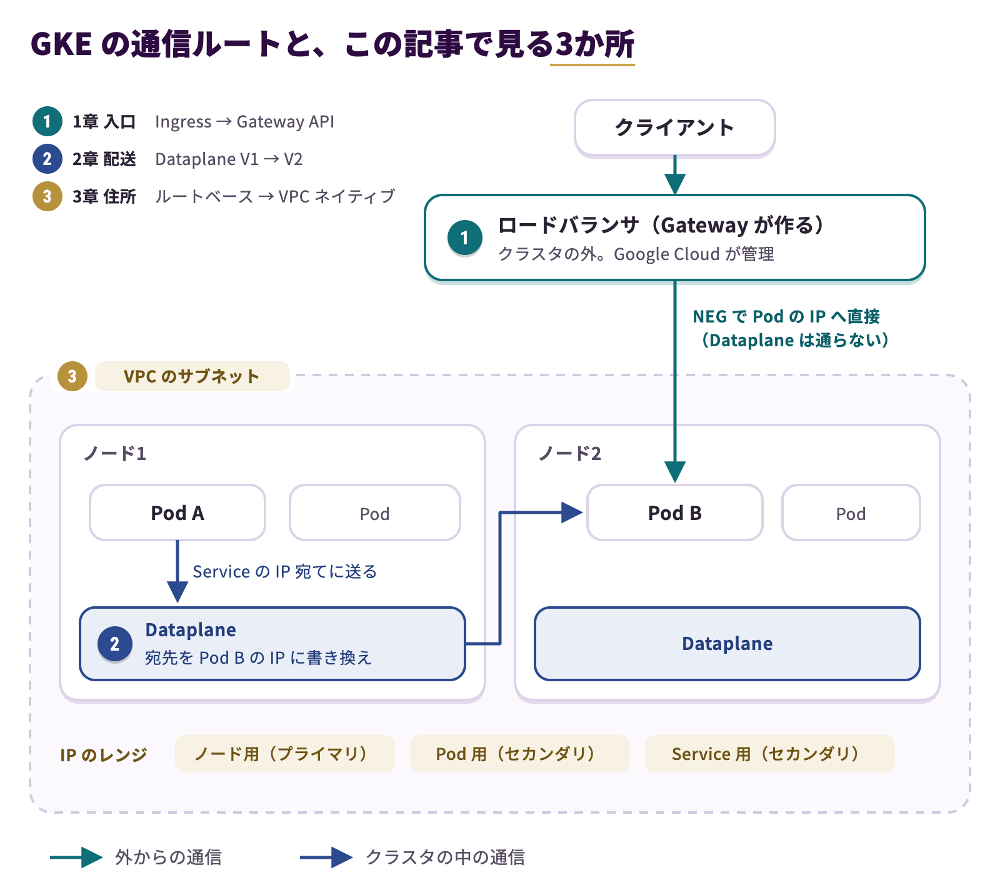
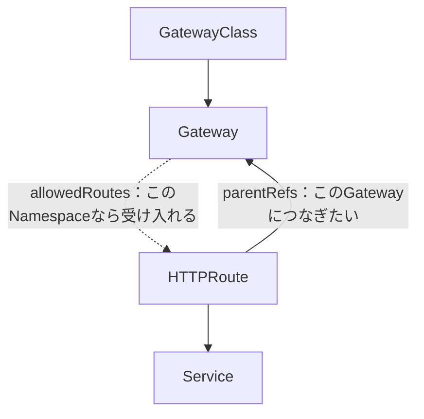

## はじめに

この記事は、初めてのGoogle Cloud・GKE構築で私が躓いたポイントをまとめたものです。

技術選定では要件に合わせて最適な決断をする必要があります。例えばgkeクラスタの選択はstandardとautopilotなど。

この2つのmodeはGoogle Cloudで初めから2つ選択肢があったわけではなく、初期はstandardしかなくautopilotは後続だったわけです。そして今ではgoogle cloudの推奨はautopilotであり、クラスタ構築のデフォルト選択にもなっています。

この記事ではいくつかのリソースに関して、歴史を振り返り「なぜ現代ではこうなっているのか」を、できるだけわかりやすく解説していきます。

あとはこういう志向で解説している記事が少なかったっていうのもありますね。

今回は主にGKEネットワーキングシステムの話になります。

### 前提

- 本記事はGKEのGatewayのうち、GatewayClass`gke-l7-global-external-managed`（グローバル外部アプリケーションロードバランサ、HTTPS）を対象にします。NLB（L4）とサービスメッシュ等は扱いません
- サービスメッシュやeBPFなどの専門用語に対して、細かな解説をしません。よろしくお願いします
- 図示や文章の説明に一部AIを活用していることをご了承ください

### 扱うもの


| 章   | テーマ                 | 昔 → 今                                                    |
| --- | ------------------- | -------------------------------------------------------- |
| 1   | 入口：外からどう入れるか        | Ingress → Gateway API                                    |
| 2   | 配送：ノードの中でPodへどう届けるか | Dataplane V1（kube-proxy + iptables） → Dataplane V2（eBPF） |
| 3   | 住所：PodのIPをどう配るか     | ルートベース → VPCネイティブ                                        |



*外から入る通信と、クラスタ内の通信。この記事では番号の3か所を見ていきます*

## 1. Ingress → Gateway API：クラスタの入口

### Gatewayってなに？

Gatewayは、クラスタ内のServiceへ通信を届ける「入口」のリソースです。一般的にはNLB,ALBになるんじゃないでしょうか。

GKEなら、gatewayを書くとGoogle CloudのLBができあがるわけです。冒頭の図の①がこれ。

LBはクラスタの外にあり、Google Cloudが管理します。

どんなLBを置くかはclassで選択でき、内部LBだったり、レイヤーが違ったり、gatwayそのものを深掘っても面白いのですが、割愛します。

### なんでcontrollerじゃなくてAPI？

LBの構築をする場合、IngressかGateway API、またはterraformでリソースを作るなどいくつか選択肢があります。Gatewayが推奨ということで、いくつか調べていくと、最初に浮かんだ疑問がこれです。

> Ingressは「Ingress controller」なのに、Gatewayはなんで「Gateway API」なの？

答えを言うと、比べる軸がずれていたのと、理解が足りてませんでした。


|     | API（仕様・リソースの定義） | 実装（コントローラ）                                       |
| --- | --------------- | ------------------------------------------------ |
| 旧   | Ingress         | Ingress controller（ingress-nginx、GKE Ingressなど）  |
| 新   | Gateway API     | Gatewayコントローラ（GKE Gatewayコントローラ、Envoy Gatewayなど） |


Gateway APIは、GatewayClass・Gateway・HTTPRouteなどのリソースを書くための窓口（インターフェース）にすぎません。そしてその中身を実装するのはコントローラです。この構造はIngressも同じです。

そのため全体を指すときは「Gateway API」と呼ぶんですよね。

コントローラーの管理はGoogle Cloudが対応します。クラスタの外にあるんですよね。

### なんで「Ingress v2」じゃなくて「Gateway」？

これは言い出しっぺ本人が答えています。Bowei Duさんです。

Kubernetes Podcast #104（2020年5月）で、Boweiさんはこう話しています。Kubernetesは、そもそも「クラスタの内と外」を定義していない。なのにIngressという英単語は「パブリックなインターネットから入ってくる通信」を連想させてしまう。

> So that's why we went with the Gateway name instead of Ingress.

同じ回で「it's not a V2, it's a sequel（V2じゃなくて続編）」とも言っています。V2なら旧版は消えていきますが、続編は並んで生きる。いまもIngressが「機能追加は凍結、でも削除の予定はない」なのは、このためですね〜。

このやりとりはgithubで議論されているらしく(？)、当時追っていた人は面白かったでしょうね。

### ざっくり年表


| 時期      | 出来事                                                               |
| ------- | ----------------------------------------------------------------- |
| 2015-11 | Ingressがベータで登場（Kubernetes 1.1）                                    |
| 2019-05 | KubeCon EU（バルセロナ）で「Ingress V2」を発表。GatewayClassとGatewayという名前はもうあった |
| 2019-11 | KubeCon NA（サンディエゴ）で議論。Routeと3つのロールを加えた今の形に。リポジトリ名は「service-apis」  |
| 2020-08 | IngressがやっとGA（Kubernetes 1.19）。ベータ期間は約4年9か月                       |
| 2021-02 | Service APIsからGateway APIに改名                                      |
| 2023-10 | Gateway API v1.0がGA                                               |
| 2023-11 | Ingressのドキュメントに「Ingress is frozen」と入る                             |
| 2025-11 | ingress-nginxの引退を発表。ドキュメントもGatewayを推奨する書き方に                       |
| 2026-03 | ingress-nginxの最終リリース                                              |


（脱線）v1.0のGAブログは「最初の提案は4年前のサンディエゴ」と書いています。ところが「proposed」のリンクを踏むと、半年前のバルセロナの講演動画が開きます。そのスライドではRoute側はまだ「VirtualHost」という名前で、「Names are temporary」と注記つき。名前が決まるまで、けっこう揺れていたんですね〜

勘違いしやすい点も1つ。2026年3月に引退したのは**ingress-nginxというコントローラ**です。Ingress APIではありません。

### Ingressの何がつらかったのか

私はIngressを触ったことがないため、公式の言葉をお借りします。Gateway APIの移行ガイド（[Migrating from Ingress](https://gateway-api.sigs.k8s.io/guides/getting-started/migrating-from-ingress/)）は、乗り換える理由を3つ挙げています。

- **できることが少ない**：対応しているのはHTTP・HTTPSだけで、ルーティングも単純なものしか書けない
- **アノテーションまみれになる**：足りない機能は、アノテーション（注釈）を付けまくって補う。書き方が実装ごとにバラバラなため、別の実装へ持っていけない
- **権限を分けにくい**：LB側の設定（TLSなど）とアプリのルーティングを、同じIngressリソースに書くことになるため、アプリとプラットフォームチームで衝突する

ざっくりまとめると、こんな感じだと思います。正直、私には解説できるレベルにない。。

### Gateway APIだとこう変わる

さっきの3つの弱点は、Gateway APIでこう変わりました。

- **できることが少ない → 増えた**：ヘッダーによる振り分けや重み付け（カナリアリリース）を、HTTPRouteの標準機能として書けます。HTTP以外にも、gRPC・TLS・TCP・UDP向けのRouteが用意されている
- **アノテーションまみれ → 標準機能と別リソースへ**：たとえばHTTP→HTTPSの転送は、GKE IngressだとFrontendConfigという独自リソースが必要だったが、GatewayならHTTPRouteの標準のフィルターで書けます
- **権限を分けにくい → リソースが分かれた**：LB側の設定とアプリのルーティングが、GatewayとHTTPRouteという別々のリソースに分かれました。チームが分かれても管理しやすくなった

↑私自身しっかりドキュメントを読み込んでようやくちょっとわかったので、↑説明を読んでも、理解はできないと思います。

なのでingress v2にするんじゃなくて、別のプロダクトと出すほどに、大きく改善した。と言う理解で問題ないと思います。  

:::details 私のGatewayとポリシー（名前は例）

```yaml
apiVersion: gateway.networking.k8s.io/v1
kind: Gateway
metadata:
  name: gateway
  namespace: gateway
  annotations:
    networking.gke.io/certmap: example-certmap   # 証明書マップ（Terraform で作成）
spec:
  gatewayClassName: gke-l7-global-external-managed
  addresses:
    - type: NamedAddress
      value: example-gateway-ip                   # 固定 IP の名前（Terraform で作成）
  listeners:
    - name: https
      protocol: HTTPS
      port: 443
      allowedRoutes:
        namespaces:
          from: Selector
          selector:
            matchExpressions:
              - key: kubernetes.io/metadata.name
                operator: In
                values: [wordpress]               # 受け入れる Namespace
---
apiVersion: networking.gke.io/v1
kind: GCPBackendPolicy
metadata:
  name: wordpress
  namespace: wordpress
spec:
  default:
    securityPolicy: example-armor-policy          # Cloud Armor（Terraform で作成）
  targetRef:
    group: ""
    kind: Service
    name: wordpress
```

:::

### 肝は権限分離：3つのロール

Gateway APIの肝はロールごとにリソースを分けたことです。GKEのドキュメントではGateway APIを「クラスタ運用者・アプリ開発者・インフラ提供者という組織のロールに対応したリソース」と説明しています。

4パターンほどの管理モデル(usage pattern)があります。面白いのでぜひ↓

参考になる公式ドキュメント：[https://docs.cloud.google.com/kubernetes-engine/docs/concepts/gateway-api?hl=ja](https://docs.cloud.google.com/kubernetes-engine/docs/concepts/gateway-api?hl=ja)


| リソース         | 決めること                 | 持ち主             |
| ------------ | --------------------- | --------------- |
| GatewayClass | どのLBで実装するか            | インフラ提供者（GKEが用意） |
| Gateway      | どのIP・ポート・証明書で受けるか     | クラスタ運用者         |
| HTTPRoute    | どのリクエストをどのServiceへ送るか | アプリ開発者          |




GatewayとHTTPRouteは、両方が合意したときだけ疎通することができます。Gateway側が`allowedRoutes`で受け入れるNamespaceを決め、Route側が`parentRefs`でつなぎたいGatewayを指す。

Ingressのように1つのリソースに全部書くのと違い、Gatewayを持つ人が受け入れ先を選べるわけです。

GatewayとRouteを親子に分けた理由も、Boweiさんが同じポッドキャストで話しています。外に公開するGatewayは、Routeを書くよりも高い権限が要る。そのため分けるのが自然だった、と。

### 誰がGatewayを持つか：4つのパターン

じゃあ実際、誰がGatewayを持つのか？　GKEのドキュメントには4つの使用パターンが載っています（詳しくは[公式](https://docs.cloud.google.com/kubernetes-engine/docs/concepts/gateway-api?hl=ja#usage-patterns)を見てください）。


| #   | パターン                      | Gatewayを持つ人 | ひとこと                              |
| --- | ------------------------- | ----------- | --------------------------------- |
| 1   | セルフマネージドGateway           | サービスオーナー    | Ingressと同じ使い方。自分のアプリ専用            |
| 2   | Namespaceごとのプラットフォームマネージド | プラットフォーム管理者 | Namespace（チーム）ごとに専用のGateway       |
| 3   | クラスタごとの共有Gateway          | プラットフォーム管理者 | 複数のNamespaceで同じGatewayを共有         |
| 4   | フリートごとの共有Gateway          | プラットフォーム管理者 | マルチクラスタGatewayで、クラスタやリージョンをまたいで共有 |


ここからは個人の意見です。私は、迷ったら**3のクラスタごとの共有Gateway**がいいと思っています。

- プラットフォームチームがいれば楽。いなくても、クラスタを管理している人がGatewayを持てば比較的簡単に分離できる
- アプリごとにLBを作らなくていい。IP・証明書・DNSの管理が1か所で済む
- アプリ側はHTTPRouteを書くだけ

私の構成も、アプリはArgoCDとWordPressの1つだけですが3の形にしています。Gatewayは`gateway`というNamespaceに置き、`allowedRoutes`でWordPressのNamespaceを受け入れています（上の折りたたみに載せたものです）。アプリを足すときは、HTTPRouteを書いて`values`に1行足すだけ。

トレードオフとしては、リスナーや証明書の変更ミスが全チームに効いてしまうことです。

外部向けと内部向けのように、要件が違うならGatewayを分ける。そのくらいの温度感がちょうどいいと思っています。

### コラム：TerraformとHelm、どこまで書く？

↑はよく議論されるテーマです。

- 固定IP・証明書マップ・Cloud ArmorのポリシーはTerraformで作る。ではGateway自体は？　Terraformまで寄せるか、Helmで書くか
- Gatewayはアプリのチャートに入れるか、別のチャートにするか
- Gateway専用のNamespaceを作るか

Gatewayは「Terraformで作ったもの」を名前で指し、HTTPRouteは「Gateway」を指します。この参照の線をどこで切るかが、境界の引き方そのものなのかなと思っています。

私の師はterraformはパブリッククラウドのリソースの管轄、helmはクラスタの管轄、チャートはアプリとミドルウェアでの分割そう言うふうな考えを持っています(意訳)　なのでgatewayは最小限になっています。

とってもいいなと思って、私もそれがほとんどのケースでハマると思っていますが、みなさんはどうしていますか？

## 2. Dataplane V1 → V2：ノードの中でどう届けるか

### Dataplaneってなに？

ざっくり言えば、各ノード上でPodのパケットを実際に転送・許可/拒否する仕組み(実装)、でしょうか。

- Service宛てのパケットを裏にいるPodのどれかへ届ける（宛先をPodのIPに書き換える）
- NetworkPolicy（Pod同士の通信の許可・拒否）を効かせる

ややこしくてイライラしますが、ワーカーノードとしてのデータプレーンではありません。ネットワーク概念としてのデータプレーンで、gkeはこれを製品名にしているのです。eksではアドオンでCNIプラグインなどを足せるはず(勉強中)

**ServiceとDataplaneはどう違う？**

dataplane v1 → v2の変更を見る前に、まずserviceとdataplaneってどう違うのか、ここに躓きました。

私は「パケットの行き先を決める」のはServiceの仕事だと思っていました。ところがKubernetesのドキュメントは、kube-proxyの仕事をこう説明しています。

> Each instance of kube-proxy watches the Kubernetes control plane for the addition and removal of Service and EndpointSlice objects. For each Service, kube-proxy calls appropriate APIs (depending on the kube-proxy mode) to configure the node to capture traffic to the Service's clusterIP and port, and redirect that traffic to one of the Service's endpoints (usually a Pod, but possibly an arbitrary user-provided IP address).

（各ノードのkube-proxyは、ServiceとEndpointSliceの追加と削除を監視する。Serviceごとに、clusterIPとポート宛ての通信が捕まるようノードを設定する。捕まえた通信は、Serviceのエンドポイント（たいていはPod）のどれかへ転送する。[Virtual IPs and Service Proxies](https://kubernetes.io/docs/reference/networking/virtual-ips/)より）

Serviceは「このIPとポート宛ての通信を、このPodたちに届けてほしい」という宣言であり、パケットに触りません。

Dataplaneは、各ノードで宣言どおりにパケットを書き換える仕組みです。V1ならkube-proxyとiptables、V2ならeBPFが担います。どちらを使うかはクラスタの設定で決まり、GKEが各ノードに用意してくれます（基本は作るときに選びます。後述）。


|      | Service                    | Dataplane           |
| ---- | -------------------------- | ------------------- |
| 正体   | KubernetesのAPIリソース（宣言）     | 各ノードで動くプログラム        |
| やること | 「このIPとポート宛ては、このPodたちへ」と決める | 宣言どおりにパケットを書き換えて届ける |


Kubernetesのコンポーネントの説明でも、kube-proxyは「ノード上のネットワークルールを維持し、Service を実装します」とされています（[Kubernetesのコンポーネント](https://kubernetes.io/ja/docs/concepts/overview/components/)）。

1章で見たGateway API（仕様）とGatewayコントローラ（実装）も、同じ関係です。

### コラム

Googleの公式ブログ（2025年）は、旧方式を「dataplane v1（DPv1）」と呼んでいます。ドキュメントでは「legacy dataplane」です。以降この記事ではV1と書きます。

### V1：kube-proxyとiptables

V1のベースになっている技術は「kube-proxy」と「iptables」の2つです。NetworkPolicyを使う場合は、ここに「Calico」が加わります。それぞれの役割↓

- **kube-proxy**：各ノードで動くプログラムであり、ServiceとEndpointSliceを監視。変更があるたびに、Serviceごと・Podごとのiptablesのルールを書き直す
- **iptables**：Linuxカーネルの機能。「この条件のパケットはこう書き換える」というルールを並べておくと、届いたパケットがそのとおりに書き換わる
- **Calico**：NetworkPolicyを効かせる担当。こちらもiptablesのルールで通信を許可・拒否を設定する

Serviceへ送ったパケットは、iptablesの中でこんなふうに処理されます。

```
Pod A ──→ 10.2.0.10（Service の IP）宛て
            │
            ▼ ノードの iptables
        KUBE-SERVICES  「10.2.0.10 なら KUBE-SVC-xxx へ」
        KUBE-SVC-xxx   「1/3 の確率で KUBE-SEP-1 へ、…」
        KUBE-SEP-1     「宛先を 10.1.1.5 に書き換え（DNAT）」
            │
            ▼
          Pod B（10.1.1.5）
```

### つらみ：ルールが何万行も、、

この方式は、クラスタが大きくなるとつらくなります。Kubernetesのドキュメントにこうあります。

> PodとServiceが数万あるクラスタでは、iptablesのルールも数万になる。ServiceやEndpointSliceが変わったとき、kube-proxyがカーネルのルールを更新するのに長い時間がかかることがある
> （[Virtual IPs and Service Proxies](https://kubernetes.io/docs/reference/networking/virtual-ips/) より私訳）

もう1つの弱点は、iptablesのルールがPodやNamespaceを知らないことです。Googleの2020年のブログは「iptablesと違い、eBPFのプログラムはKubernetes固有のメタデータを扱える」と書いています。これにより、NetworkPolicyで許可・拒否した通信を、Pod・Namespace・ポリシーの名前と結びつけて記録できるようになりました。

> へ〜AIに調査させましたが、これは知らなかった。面白い観点ですね

### V2：eBPFとCilium（2020年〜）

- eBPF：カーネルを再コンパイルしたりモジュールを読み込んだりせずに、カーネルの中で小さなプログラムを安全に動かせる仕組み
- CiliumはeBPFで動くOSSのCNI

GKE Dataplane V2は、このCiliumをベースにGoogleが作ったデータプレーンです。


| 時期         | 出来事                                |
| ---------- | ---------------------------------- |
| 2020-08-20 | Dataplane V2をベータで発表                |
| 2021-05-10 | GA（GKE 1.20.6-gke.700から）           |
| 2025年時点    | Autopilotでは既定。Standardでは「推奨」       |
| 2026-11時点  | 既存クラスタをV2へ移行する機能がプレビュー（VPCネイティブのみ） |


V2になるとこうなる

- kube-proxyを使わない。Serviceの振り分けもiptablesに頼らない
- NetworkPolicyが常に有効。Calicoのような仕組みを別に選ぶ必要がない
- NetworkPolicyのログを取る仕組みが組み込まれている(オブザーバビリティで効く)

### 後から変えられない！！！……はずだった

ここが罠です。**Dataplane V2は、基本的にクラスタを作るときに決めるもの**です。GKE Dataplane V2のページの「制限事項」には、いまもこう書かれています。

> GKE Dataplane V2 は、新しいクラスタの作成時にのみ有効にできます。GKE Dataplane V2 を使用するように既存のクラスタをアップグレードすることはできません。
> （[GKE Dataplane V2](https://docs.cloud.google.com/kubernetes-engine/docs/concepts/dataplane-v2?hl=ja) より）

ところが2026年11月時点で、既存のクラスタをV1からV2へ移行する機能がプレビューで出ています。公式のページどうしで書いてあることが違うため、要注意です。移行のページによれば、条件と注意点はこんな感じ。

- VPCネイティブのクラスタだけ。ルートベースのクラスタは移行できない（3章の話です）
- クラスタは1.35.3-gke.1155000以降、ノードプールは1.35.1-gke.1516000以降
- 移行中にノードが作り直され、Podは新しいノードへ移される

> 注意: 移行後にクラスタを Dataplane V1 に戻すことはできません。
> （[GKE Dataplane V2 への移行について](https://docs.cloud.google.com/kubernetes-engine/docs/concepts/about-migrating-dataplane-v2?hl=ja) より）

プレビュー（一般提供の前）でもあるため、最初からV2で作っておくのが推奨です。

Autopilotなら既定でV2です。Standardでは自分で指定します（gcloudなら`--enable-dataplane-v2`、Terraformなら`datapath_provider = "ADVANCED_DATAPATH"`）。

私はStandardクラスタを公式のTerraformモジュールで作ったとき、これを知らなくてV1で作っていました....。`datapath_provider`を書かなかったため、モジュールの既定値になっていたんです。ぴえん

## 3. ルートベース → VPCネイティブ：Podのアドレスを持つのか

### サブネットを作るだけなのに、レンジが3つも、、？

GKEを作る前に、まずVPCとサブネットを作ります。ここで最初に引っかかりました。

ノード用のIPレンジとは別にPod用とService用の「セカンダリレンジ」を決めろと言われるんです。

セカンダリレンジってなに？ってなりましたね。

:::details Terraformだとこんな感じ（値は例）

```hcl
resource "google_compute_subnetwork" "subnet" {
  name          = "example-subnet"
  ip_cidr_range = "10.0.0.0/20"   # ノード用
  region        = "asia-northeast1"
  network       = google_compute_network.vpc.id

  secondary_ip_range {
    range_name    = "pods"
    ip_cidr_range = "10.1.0.0/16" # Pod用
  }
  secondary_ip_range {
    range_name    = "services"
    ip_cidr_range = "10.2.0.0/20" # Service用
  }
}
```

:::

ノードのIPがあれば動きそうなのに、なぜPodの住所まで先に決めるのでしょうか？ 実は昔はそうしていませんでした。そして、それがつらかったんです。

### 昔：ルートベース（2015〜2017年ごろ）

初期のGKEは、ノードごとにPod用のIP範囲（/24）を割り当てていました。そして「この範囲宛てのパケットはこのノードへ」というルートを、ノード1台につき1行ずつVPCのルート表に足していきます。これがルートベースのクラスタです。

```
【ルートベース】
VPC のルート表（ノードが増えるたびに 1 行ずつ増える）
  10.4.0.0/24 → ノード1
  10.4.1.0/24 → ノード2
  10.4.2.0/24 → ノード3
  ...

送信元 ──→ VPC「10.4.1.5 宛て？ ルート表を見ると…ノード2だ」──→ ノード2 ──→ Pod
```

想像するだけでも厳しいですね。2018年の発表ブログによれば、ルートにはクォータ（上限）があり、クラスタの大きさがそこで頭打ちになります。さらにクラスタが使うIPは、VPCの他のリソースと重ならないよう手作業で避けておく必要がありました。

### 今：VPCネイティブ（2018年〜）

そこで2018年に出てきたのが、エイリアスIPを使うVPCネイティブのクラスタです。

PodのIPは、サブネットのセカンダリレンジから配られます。各ノードには/24（256個）のエイリアスIPがまとめて渡され、そのノードの上で最大110個のPodが使います。

```
【VPC ネイティブ】
サブネット
  ├─ プライマリ   10.0.0.0/20   ノード
  └─ セカンダリ   10.1.0.0/16   Pod（ノードごとに /24 をエイリアス IP として配る）

送信元 ──→ VPC「10.1.1.5？ ノード2のエイリアス IP だね」──→ ノード2 ──→ Pod
```

VPCがPodのIPを最初から知っている。ここがルートベースとの違いです。

2025年のGoogleブログ（[GKE network interface](https://cloud.google.com/blog/products/networking/gke-network-interface-from-kubenet-to-ebpfcilium-to-dranet)）は、PodがVPCから直接IPをもらえるようになったことについて「ネットワークの第一級市民（first-class citizens）になる」と書いています。

公式ドキュメントが挙げる利点はこのあたりです。

- ルートのクォータを消費しない。クラスタを大きくできる
- PodのIPはPodを作る前にVPCで予約される。他のリソースとぶつからない
- Podの範囲だけにファイアウォールルールを書ける
- VPCピアリングの先や、Cloud VPN・Cloud Interconnectでつないだオンプレからも届く
- NEG（後述）のように、VPCネイティブでしか動かない機能がある

gcloudやAPIで作る場合、1.21.0-gke.1500以降はVPCネイティブが既定です。いまはどこから作ってもVPCネイティブになります。

### 何が楽になったのか：Podを直接指せる

PodのIPがVPCから見えるようになると、ノードの外からPodを直接指せるようになります。

例えばLBを例に出すと、昔はノード単位でしかターゲットにできませんでした。

```
【昔】インスタンスグループ
LB ──→ ノード（NodePort） ──→ kube-proxy の iptables ──→ Pod（別のノードにいることも）
        ここで 1 回目の振り分け         ここで 2 回目の振り分け

【今】NEG（コンテナネイティブのロードバランシング）
LB ──→ Pod の IP
```

NEG（ネットワークエンドポイントグループ）はPodのIPとポートを並べたリストです。LBはこのリストを見てPodへ直接送ります。

メリットとしては、ホップが減るため、レイテンシもスループットも改善しますし、経路もシンプルになります。

このNEGはVPCネイティブのクラスタでしか動きません。そのため、NEGの上に乗っている仕組みもVPCネイティブが前提になります。

- GoogleのサービスメッシュであるCloud Service Meshは、NEGのデータモデルが必須
- 1章で扱ったGateway APIも、公式に「VPCネイティブのクラスタでのみサポート」と書かれている

## まとめ

3つの層を振り返ります。


| 昔                     | 今                  | なぜ変わったか                       |
| --------------------- | ------------------ | ----------------------------- |
| Ingress               | Gateway API        | 注釈頼み、権限を分けられなかった              |
| kube-proxy + iptables | Dataplane V2（eBPF） | ルールが数万になると更新が重く、何が起きたか見えにくかった |
| ルートベース                | VPCネイティブ           | ルートの上限とIP管理がスケールしなかった         |


この記事では、私が実装してみて理解に詰まったところを、歴史背景に着目してまとめてみました。

新しいことを学習するとき、キーワードから入ってしまうと「今はなぜそれがあるのか」を見逃してしまうことがあります。

自分なりの解釈をするのも大事です。ですが、歪んだ認知になってしまうこともあります。そのツールや概念がどのような「思想」と「ニーズ」で生まれたのかを探るとおもしろいなと思い、今回振り返りを込めて書いてみました。

本当はGatewayのみに着目しても良かったのですが、すでにたくさんの記事があるので、、違った切り口からまとめてみました。


Cloud Native、Kubernetesには、ネットワークに限らずセキュリティやオブザーバビリティなど、専門領域がまだまだあります！　これをきっかけに、より深く理解する習慣をつけていきたいですっ🔥

## 参考

**1章：Gateway API**

- [API Overview（Gateway API）](https://gateway-api.sigs.k8s.io/docs/concepts/api-overview/)
- [Gateway API の概要（GKE）](https://docs.cloud.google.com/kubernetes-engine/docs/concepts/gateway-api?hl=ja)
- [Gateway のデプロイ（GKE）](https://docs.cloud.google.com/kubernetes-engine/docs/how-to/deploying-gateways)
- [Gateway リソースをポリシーで構成する（GKE）](https://docs.cloud.google.com/kubernetes-engine/docs/how-to/configure-gateway-resources)
- [Gateway を保護する（GKE）](https://docs.cloud.google.com/kubernetes-engine/docs/how-to/secure-gateway)
- [Ingress の構成（GKE）](https://docs.cloud.google.com/kubernetes-engine/docs/how-to/ingress-configuration)
- [Google マネージド SSL 証明書（GKE）](https://docs.cloud.google.com/kubernetes-engine/docs/how-to/managed-certs)
- [GKE のロードバランシングについて（GKE）](https://docs.cloud.google.com/kubernetes-engine/docs/concepts/about-load-balancing)
- [Migrating from Ingress（Gateway API）](https://gateway-api.sigs.k8s.io/guides/getting-started/migrating-from-ingress/)
- [HTTP redirects and rewrites（Gateway API）](https://gateway-api.sigs.k8s.io/guides/user-guides/http-redirect-rewrite/)
- [Kubernetes Podcast #104: Ingress and the Service APIs, with Bowei Du](https://kubernetespodcast.com/episode/104-ingress-and-service-apis/)
- [Gateway API v1.0: GA Release（Kubernetes Blog、2023-10-31）](https://kubernetes.io/blog/2023/10/31/gateway-api-ga/)
- [Ingress（Kubernetes）](https://kubernetes.io/docs/concepts/services-networking/ingress/)
- [Ingress NGINX Retirement: What You Need to Know（Kubernetes Blog、2025-11-11）](https://kubernetes.io/blog/2025/11/11/ingress-nginx-retirement/)

**2章：Dataplane V2**

- [GKE Dataplane V2（GKE）](https://docs.cloud.google.com/kubernetes-engine/docs/concepts/dataplane-v2)
- [GKE Dataplane V2 への移行について（GKE、プレビュー）](https://docs.cloud.google.com/kubernetes-engine/docs/concepts/about-migrating-dataplane-v2)
- [Bringing eBPF and Cilium to Google Kubernetes Engine（Google Cloud Blog、2020-08-20）](https://cloud.google.com/blog/products/containers-kubernetes/bringing-ebpf-and-cilium-to-google-kubernetes-engine)
- [Virtual IPs and Service Proxies（Kubernetes）](https://kubernetes.io/docs/reference/networking/virtual-ips/)

**3章：VPCネイティブ**

- [VPC-native clusters（GKE）](https://docs.cloud.google.com/kubernetes-engine/docs/concepts/alias-ips)
- [Creating a routes-based cluster（GKE）](https://docs.cloud.google.com/kubernetes-engine/docs/how-to/routes-based-cluster)
- [Introducing VPC-native clusters for Google Kubernetes Engine（Google Cloud Blog、2018-05-30）](https://cloud.google.com/blog/products/gcp/introducing-vpc-native-clusters-for-google-kubernetes-engine)
- [Container-native load balancing（GKE）](https://docs.cloud.google.com/kubernetes-engine/docs/concepts/container-native-load-balancing)
- [GKE network interface: from kubenet to eBPF/Cilium to DRANET（Google Cloud Blog、2025-09-18）](https://cloud.google.com/blog/products/networking/gke-network-interface-from-kubenet-to-ebpfcilium-to-dranet)