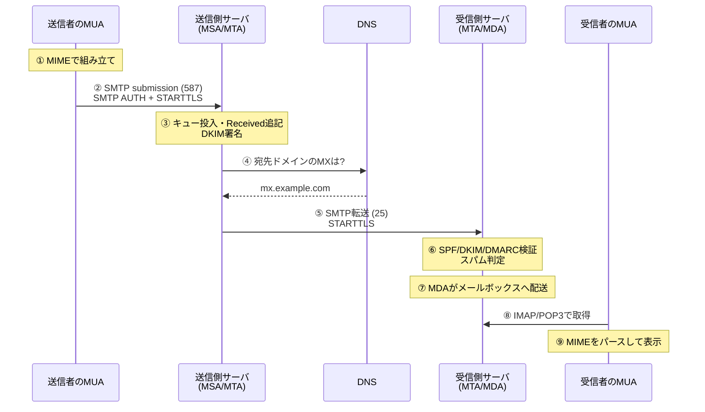
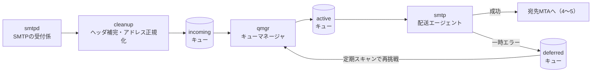
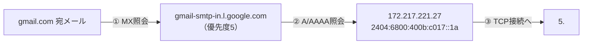
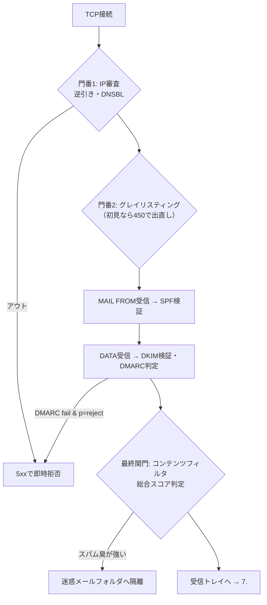
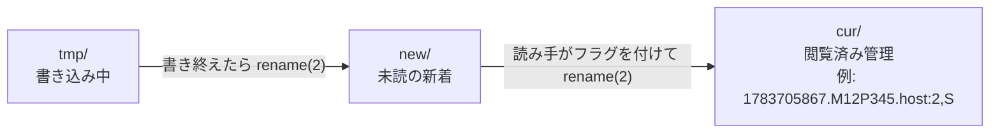

## はじめに

メールの送信ボタンを押してから、それが相手の受信トレイに入るまで。
その間にどんな技術が動いているか、説明できますか？

Webには「URLを入力してからページが表示されるまで」や「ブラウザからDBに行き着くまで」といった名作記事がたくさんあります。

https://zenn.dev/moko_poi/articles/c2402f13a870a1

でも「メールを送ってから届くまで」を通しで深く追いかけた記事は、意外と見当たりません。
毎日何千億通も飛び交っているのに、です。

この記事では、送信ボタンを押した瞬間から相手が開くまでに何が起きているのかを、
実際に手元で叩いたコマンドの結果を交えて順番に追いかけます。

Webとの一番大きな違いを先に言ってしまいます。

- **Web**：クライアントがサーバに「取りに行く」**リクエスト/レスポンス型**
- **メール**：サーバからサーバへ「バケツリレーで運ぶ」**ストア&フォワード型**

この違いが、メールならではの挙動を生みます。
すぐには届かない。途中で消えずにキューに残る。送信できても届いたとは限らない。なりすまし対策にDNSまで動員される——。

想定読者は、HTTP・DNS・TLSの基礎はなんとなく知っているけれど、メールの裏側は覗いたことのないエンジニアです。
SMTPを一度も手で触ったことがない方も、きっと楽しめます。

## 全体像（メール配送の9ステップ）

まず、メールが通る道のりを一望します。用語は後で解説します。

1. **組み立て**: MUAがメールをMIME形式で組み立てる
2. **投函**: MUAが送信側サーバ（MSA）へSMTPで投函する（587番・SMTP AUTH）
3. **送信側の処理**: サーバがキューに積み、Receivedスタンプを押し、DKIM署名を付ける
4. **宛先解決**: 宛先ドメインのMXレコードをDNSで引く
5. **サーバ間転送**: 送信側MTA → 受信側MTAへSMTPで転送する（25番・STARTTLS）
6. **検証**: 受信側がSPF / DKIM / DMARCを検証し、スパム判定する
7. **最終配送**: MDAがメールボックスへ書き込む
8. **取得**: 受信者のMUAがIMAP / POP3で取りに行く
9. **表示**: MIMEをパースして画面に描画する



ステップごとに登場人物がいて、ステップごとに「落とし穴」と「先人の工夫」があります。
ここから1つずつ、中を開けて見ていきましょう。

## 前提知識（登場人物とメールの構造）

本編に入る前に、押さえておきたい前提を3つだけ。
メール配送の**登場人物**、メールの**二重構造**、そして**配送モデル**です。
ここが分かると、以降の1〜9が一本の線でつながります。

### 登場人物は4人（MUA・MSA・MTA・MDA）

HTTPの世界が「ブラウザとサーバ」の2人劇だとすると、メールは少なくとも4つの役割が連携するリレーです。

| 役割 | 正式名称 | 仕事 | 代表的なプロダクト | 郵便でいうと |
|---|---|---|---|---|
| **MUA** | Mail User Agent | メールの作成・表示 | Outlook、Thunderbird、Apple Mail、GmailのWeb画面 | 手紙を書く人の机 |
| **MSA** | Message Submission Agent | ユーザーからの投函を受け付け、認証する（587番ポート） | Postfix、Sendmail、Exim | 郵便窓口 |
| **MTA** | Mail Transfer Agent | サーバ間でメールを中継・転送する（25番ポート） | Postfix、Sendmail、Exim、Microsoft Exchange | 郵便局間の輸送網 |
| **MDA** | Mail Delivery Agent | 届いたメールを受信者のメールボックスに格納する | Dovecot（LMTP/LDA）、procmail、maildrop | 配達員 |

表で「PostfixがMSAにもMTAにもいる」ことに気づいたでしょうか。
実際、多くの現場では同じソフトが設定とポートを変えて役割を兼任します（Dovecotも8.で再登場します）。
それでも役割を分けて考えるのには、理由があります。

昔（1980年代）は、1本のプログラムが全部やっていました。
メールを「出す」のも「他サーバへ中継する」のも、同じ25番ポート。
しかも誰の依頼でも中継する**オープンリレー**が当たり前でした。

これがスパムの温床になります。
25番には認証がないので、「自分のユーザーの正規メール」と「見知らぬ他人のスパム」を区別できないのです。

そこで1998年、役割が2つに分かれました（RFC 2476）。

- **投函（submission）**：ユーザーがメールを出す。認証必須の**587番**へ
- **中継（relay）**：サーバ間で転送する。従来どおり**25番**

これで、認証を通った自分のユーザーだけが投函できます。
25番と587番の詳しい使い分けは、2.で見ます。


### エンベロープとヘッダの分離（封筒と便箋）

ここは本記事でいちばん大事な前提です。
1通のメールは、**エンベロープ**（封筒）と**メッセージ本体**（便箋）の二重構造になっています。

- **エンベロープ**: SMTPの `MAIL FROM` / `RCPT TO` コマンドで伝えられる差出人・宛先（RFC 5321が規定）
- **メッセージ本体**: ヘッダ部（`From:` `To:` `Subject:` など）＋空行＋本文という構造（RFC 5322が規定。ちなみに1行の上限は998文字です）

郵便屋さんが便箋を読まず、封筒の宛名だけで配達するように——
**配送システム（MTA）は、エンベロープだけを見て配送します**。
便箋の `To:` ヘッダは、人間が読むための飾りにすぎません。
極端な話、`To:` に誰の名前があろうと、メールは `RCPT TO` の相手にしか届きません。

この分離には、デメリットとメリットの両面があります。

**デメリット**：`From:` ヘッダはエンベロープと一致しなくてよく、送信者が自由に書けます。
これが**なりすまし**の根本原因です。バグではなく、1982年からの仕様。
この穴を後から塞ぐのがSPF・DKIM・DMARC（6.で詳解）です。

**メリット**：BCCの宛先が他の受信者に見えないのも、同じ分離のおかげ。
BCCは `RCPT TO`（封筒）には書かれますが、ヘッダ（便箋）には書かれません。

```text
# エンベロープ（配送に使われる。受信者からは基本見えない）
MAIL FROM:<alice@example.jp>
RCPT TO:<bob@example.com>
RCPT TO:<carol@example.net>   ← BCC宛先はここにだけ存在する

# メッセージ本体のヘッダ（受信者が見るのはこちら）
From: Alice <alice@example.jp>
To: Bob <bob@example.com>
Subject: 会議の件
```

bobに届いたメールに、carolの痕跡はどこにもない。それだけの話です。
（RFC 5322 §3.6.3は、送信時にMUAが `Bcc:` ヘッダを削除する方式などを定めています）

:::message
配送に使われたエンベロープ（封筒）は、メールが届くと役目を終えて捨てられます。
ただし差出人アドレス（`MAIL FROM`）だけは、最終配送のときに受信側サーバが `Return-Path:` というヘッダとしてメール本体の先頭に書き写します（RFC 5321 §4.4）。
受信したメールのソースに `Return-Path:` があるのは、このためです（詳しくは7.）。
:::


### ストア&フォワード（今すぐ届かなくてもいい設計）

3つ目は配送モデルです。Webに慣れているほど戸惑います。
HTTPは同期型。リクエストを投げるとレスポンスが返り、サーバが落ちていれば即エラー。
一方SMTPは**ストア&フォワード**（store and forward）型です。
各サーバがメールをいったんディスク上の**キュー**に保存（store）し、配送責任を引き受けてから次へ転送（forward）する。バケツリレーです。

| | HTTP（リクエスト/レスポンス型） | SMTP（ストア&フォワード型） |
|---|---|---|
| 相手サーバがダウン中 | 即エラー | 送信は成功。途中のサーバが預かり再送し続ける |
| 再送の責任 | クライアント側 | メールを預かったサーバ側 |
| 届くまでの時間 | ミリ秒〜秒 | 数秒〜最大数日 |
| メッセージの行方 | 応答が返らなければ消える | キューに残り続ける |

RFC 5321 §4.5.4.1は、配送に失敗しても**30分以上**の間隔でリトライを続け、**4〜5日**は諦めるなと定めています。
「送信できたはずなのに、3日後にMailer-Daemonからエラーが返ってきた」——あの体験の正体がこれです。
つまり送信成功とは「相手に届いた」ではありません。「次のサーバが配送責任を引き受けた」という意味です（受信側が250 OKを返した瞬間に責任が移る。RFC 5321 §2.1）。
なお、キューにはメッセージ本体だけでなくエンベロープも保存されます。封筒を捨てたら再送できないからです。

### SMTPは「性善説」で生まれた

最後に、SMTPの生い立ちを少しだけ。
原型の**RFC 821**ができたのは**1982年**。
ホストが数百台しかなく、管理者同士が顔見知りの時代です。

だからSMTPには、**相手が名乗り通りの本人かを確かめる仕組みがありません**。
つないできた相手を、無条件に信じる。これが「性善説」です。

この性善説が、のちに穴になります。
差出人は自由に詐称でき、誰でもメールをばらまける。
スパムやなりすましの根っこは、ここにあります。

だから**本人確認の仕組み（SMTP認証・SPF・DKIM・DMARC）は、すべて後付け**です。
この記事の後半は、その「後付けの歴史」でもあります。

それでは、送信ボタンを押した直後のMUAの中から旅を始めましょう。

## 1. メールが組み立てられる（MUAの内部処理）

送信ボタンを押した瞬間、実はまだ1バイトもネットワークに流れていません。
最初に働くのは、目の前の **MUA**（Mail User Agent）です。
GmailのWeb画面、Thunderbird、Outlookといった「メールソフト」のこと。
その最初の仕事は、宛先・件名・本文・添付を**どのメールサーバでも解釈できる1本のテキスト**に組み立てることです。
Webでいえば、ブラウザがHTTPリクエストを組み立てる工程にあたります。

### 1.1 メールの正体はただのテキスト（RFC 5322）

メールソフトで「ソースを表示」を開いたことはありますか？
そこにあるのは、**RFC 5322**（Internet Message Format）が定める、驚くほど素朴なテキストです。
構成要素はたった3つ。

1. ヘッダ群（`名前: 値` の行の集まり）
2. 空行（1行）
3. 本文

```text
From: Mikumo Sora <sora@example.jp>
To: Yamada Taro <taro@example.com>
Subject: Meeting tomorrow
Date: Sat, 11 Jul 2026 14:30:00 +0900
Message-ID: <20260711143000.7f3a9c1b@example.jp>

Hi Taro,

See you at 10am.
```

ヘッダと本文の区切りは、空行1つだけ。
HTTPリクエストとまったく同じ設計です（HTTP/1.1のメッセージ形式は、メールの形式を下敷きにしています）。
各行は**998文字以下（MUST）、78文字以下が推奨（SHOULD）**、改行はCRLFです（RFC 5322 §2.1.1）。
998という半端な数字は、SMTP側の「1行はCRLF込みで1000オクテットまで」（RFC 5321）に由来します。

意外にも、RFC 5322で**必須のヘッダは `Date:` と `From:` の2つだけ**。
`To:` も `Subject:` もオプションです。
とはいえ実際のMUAは、送信ボタンを押すと `Message-ID:` や `MIME-Version:` を黙々と足していきます。

### 1.2 Message-ID（世界に1通だけの名札）

`Message-ID` は、そのメールを全世界で一意に識別するIDです。
形式は `<左辺@右辺>`。**右辺に自分のドメインを入れ、左辺の一意性は生成者が保証する**のがRFC 5322 §3.6.4の流儀です。
多くの実装はタイムスタンプ＋乱数＋ホスト名を組み合わせます（Gmail送信なら `@mail.gmail.com` で終わるID）。

このIDの真価は**スレッド表示**です。
返信ボタンを押すと、MUAは親メールの `Message-ID` を `In-Reply-To:` に、先祖代々のIDの連鎖を `References:` にコピーします。
GmailやThunderbirdが会話をツリー表示できるのは、件名の「Re:」ではなく、このIDの鎖をたどっているからです。

### 1.3 7bitの壁とMIME

ここで大問題があります。
メールを運ぶSMTPは、1982年のRFC 821以来**7bitのUS-ASCIIしか運べない**前提で、世界中にサーバが配備されてしまいました（8bitを通す拡張 8BITMIME は後のRFC 6152）。
つまり写真もPDFも、日本語すらも、そのままでは1バイトも運べません。

この壁を、壊さずに乗り越える発明が **MIME**（Multipurpose Internet Mail Extensions）です。
初出は1992年のRFC 1341、現在は改訂版のRFC 2045〜2049（1996年）。
「運べないなら、運べる文字に変換すればいい」という力技を、次の3点セットで実現します。

- `Content-Type:` — この部分は何者か（`text/html`、`image/jpeg`…）
- `Content-Transfer-Encoding:` — どうやって7bit化したか（`base64`、`quoted-printable`…）
- `boundary` — 複数パートの区切り文字列

「本文はテキストとHTMLの両方＋写真を1枚添付」というよくあるメールは、MUAの中でこんな入れ子に組み立てられます。

```text
multipart/mixed（全体：本文と添付の同梱）
├── multipart/alternative（同じ内容の別表現：どちらか一方を表示）
│   ├── text/plain
│   └── text/html
└── image/jpeg（添付ファイル）
```

実際のソースを簡略化するとこうなります（boundaryは説明用に短くしています）。

```text
MIME-Version: 1.0
Content-Type: multipart/mixed; boundary="MIXED"

--MIXED
Content-Type: multipart/alternative; boundary="ALT"

--ALT
Content-Type: text/plain; charset="UTF-8"
Content-Transfer-Encoding: base64

44GK55ay44KM44GV44G+44Gn44GZ44CC5re75LuY44Gu5YaZ55yf44KS44GU56K66KqN44GP
44Gg44GV44GE44CC
--ALT
Content-Type: text/html; charset="UTF-8"
Content-Transfer-Encoding: quoted-printable

<div dir=3D"ltr">=E3=81=8A=E7=96=B2=E3=82=8C=E3=81=95=E3=81=BE=E3=81=A7=
=E3=81=99=E3=80=82</div>
--ALT--

--MIXED
Content-Type: image/jpeg; name="photo.jpg"
Content-Disposition: attachment; filename="photo.jpg"
Content-Transfer-Encoding: base64

/9j/4AAQSkZJRgABAQEASABIAAD/2wBDAAgGBgcGBQgHBwcJCQgKDBQNDAsL
...（1MBの写真ならこの行が約18,400行続く）...
--MIXED--
```

`--MIXED` のような区切り行が `boundary` です。
MUAは本文に絶対に登場しない長いランダム文字列を選び、衝突を防ぎます。

### 1.4 Base64エンコードの仕組み

添付ファイルを7bit化する主役が **Base64**（RFC 2045 §6.8）です。
仕組みは単純。**3バイト（24bit）を6bitずつ4つに割り、64種類のASCII文字（A-Z a-z 0-9 + /）に置き換える**だけです。
3で割り切れない端数は `=` で埋めます。実際に叩いてみます。

```bash
$ printf 'ABC' | base64   # 3バイト → 4文字
QUJD
$ printf 'AB' | base64    # 2バイト → パディング1つ
QUI=
$ printf 'A' | base64     # 1バイト → パディング2つ
QQ==
```

3バイトが4文字になるので、この時点で**4/3倍（約33%増）**。
さらにRFC 2045は「**1行76文字以下**」と定めるので、76文字ごとに改行（CRLF＝2バイト）が入ります。
合計の膨張率は 4/3 × 78/76 ≒ **1.37倍**。1MBのファイルで実測しました。

```bash
# 1MB（1,048,576バイト）のダミーファイルをBase64化（76文字折り返し）
$ head -c 1048576 /dev/urandom > photo.jpg
$ base64 -b 76 -i photo.jpg -o photo.b64
$ ls -l photo.jpg photo.b64 | awk '{print $5, $9}'
1416501 photo.b64
1048576 photo.jpg
$ wc -l photo.b64
   18397 photo.b64
```

1,048,576バイト → 1,398,104文字＋改行18,397個。
手元のLF改行（1バイト）で1,416,501バイト、メール規定のCRLF（2バイト）なら **1,434,898バイト ≒ 1.37倍**。
計算どおりです。

この1.37倍は、Gmailの仕様にも刻まれています。
Gmailの添付上限は25MB。でも、後の2.で全文を見るSMTPサーバの応答（`smtp.gmail.com:587` から実際に採取）には、こんな1行があります。

```text
250-SIZE 35882577
```

受け付けるメッセージ全体の上限が35,882,577バイト（約34.2MB）。
**25MB × 1.37 ≒ 34.2MB**——添付上限は「Base64で膨らんだ後」を見込んで設計されているのです。

一方、日本語本文のように「大部分は通るが一部だけ8bit」というデータには **quoted-printable** も使われます。
通らないバイトだけを `=E3=81=8A`（＝「お」のUTF-8表現）のように `=`＋16進2桁へ置き換える方式です。
行末の `=` は「ソフト改行」（表示時に消える改行）。先ほどのHTMLパートがこれです。
英文主体なら膨張はわずかで、ソースが人間にもかろうじて読めるのが利点です。

### 1.5 日本語の件名はどう表現されるか（encoded-word）

本文はMIMEで解決しました。でも `Subject:` や差出人名などの**ヘッダは、原則として今もASCIIしか許されません**（経路全体がSMTPUTF8対応なら生UTF-8を許すRFC 6532という例外はありますが、実務の主流ではありません）。
そこで使うのが **encoded-word**（RFC 2047）、`=?文字コード?方式?データ?=` という形式です。
方式は `B`（Base64）と `Q`（quoted-printable風）の2種類。日本語ではほぼ `B` です。
実際に件名を1つ作ってみます。

```bash
$ printf '%s' "【7月報】進捗のご報告" | base64
44CQN+aciOWgseOAkemAsuaNl+OBruOBlOWgseWRig==
```

これがヘッダではこうなります。

```text
Subject: =?UTF-8?B?44CQN+aciOWgseOAkemAsuaNl+OBruOBlOWgseWRig==?=
```

受信側から見れば逆をやるだけです。

```bash
$ printf '%s' "44CQN+aciOWgseOAkemAsuaNl+OBruOBlOWgseWRig==" | base64 -d
【7月報】進捗のご報告
```

なお、encoded-word 1つは**75文字まで**、それを含むヘッダ行は**76文字まで**という制限があるため（RFC 2047）、長い件名は複数のencoded-wordに分割されて改行＋スペースで連結されます。受信メールの件名が `=?UTF-8?B?...?= =?UTF-8?B?...?=` と細切れになっているのはこのためです。

:::details 歴史小話: ISO-2022-JPからUTF-8へ
かつて日本語メールの文字コードといえば **ISO-2022-JP**（RFC 1468、1993年6月）一択でした。`ESC $ B` のようなエスケープシーケンスでASCIIとJIS X 0208を切り替える方式で、それ自体が7bitに収まるためBase64すら不要という、SMTPの制約に最適化された設計です。ただし規格上、半角カナや「①」などの機種依存文字は表現できず、「メールで丸数字を使うと文字化けする」という往年のマナーの根拠になっていました。

現在はGmailをはじめ主要サービスの送信メールはUTF-8＋Base64が標準になり、SMTP側にも8bit転送（8BITMIME、RFC 6152）や、メールアドレスやヘッダ自体の国際化（SMTPUTF8、RFC 6531/6532）が整備されています。それでも「ヘッダはASCII」という大原則と、それを支えるencoded-wordは今日も現役です。
:::

これで、宛先・件名・本文・添付が「どのサーバでも解釈できる1本の7bitテキスト」になりました。
MUAの組み立て工程はここまで。
次の2.では、この完成品がネットワークへ飛び出し、最初のサーバへ手渡される瞬間を見ます。

## 2. 送信処理（MUA→MSAへの投函）

送信ボタンを押した直後、MUAが接続しに行くのは……宛先ドメインのサーバではありません。
まず接続するのは、**あなたが契約しているプロバイダの送信サーバ**——**MSA**（Message Submission Agent）です。
手紙でいえば、相手の家に持っていくのではなく、近所のポストに投函する段階。
ここで初めてSMTPが登場します。

### 2.1 3つの送信ポート（25番・587番・465番）

SMTPはRFC 788（1981年）を経て、RFC 821（1982年）で確立されました。
長らくポートは**25番**の一本だけ。ユーザーの投函も、サーバ同士の転送も、すべて25番でした。

しかし1990年代後半、スパムの激増で状況が変わります。
「ユーザーからの投函（submission）」と「サーバ間の転送（relay）」は、要求がまったく違うのです。
投函なら認証を必須にでき、ヘッダ補完や送信ポリシーも適用できる。
そこでRFC 2476（1998年）が両者を分離し、投函専用の**587番**を定義しました（現行版はRFC 6409、Internet Standard 72）。
25番は「誰でも話しかけてよい玄関」、587番は「会員証（認証）がないと入れない通用口」です。

### 2.2 自宅から25番に繋げない理由（OP25B）

分離を強制したのはISPです。
2000年代前半、ボットに感染した家庭のPCが、ISPのサーバを素通りして宛先の25番へ直接スパムを撒く手口が横行しました。
対策としてISPは、**動的IPの回線から外向き25番へのTCP接続そのものを遮断**します。
これが **OP25B**（Outbound Port 25 Blocking）です。
日本ではJEAG（Japan Email Anti-abuse Group）が2006年2月に勧告を出し、以降、主要ISPが軒並み導入しました。

本当にブロックされているのか。実際に家庭用回線からGmailの受信サーバの25番へ繋いでみます。

```shell-session
$ nc -vz -G 5 gmail-smtp-in.l.google.com 25
nc: connectx to gmail-smtp-in.l.google.com port 25 (tcp) failed: Operation timed out
```

拒否（Connection refused）ですらなく、SYNパケットが黙って捨てられてタイムアウトします。
一方、587番にはこの後ちゃんと繋がります。
**エンドユーザーの回線から25番は事実上使えず、投函は587番（か465番）の一択**です。

:::message
25番が完全に死んだわけではありません。5.で見るサーバ間転送は今も25番で行われます。データセンターの固定IPからの通信はOP25Bの対象外だからです。
:::

:::details （余談）465番ポートが一度廃止され、20年越しに復活するまで

メールソフトの設定画面で「SSL/TLS: 465」という選択肢を見たことはありませんか？ このポート、実はジグザグの歴史を歩んでいます。

1. **1997年初頭**: IANAが465番を「smtps」（SMTP over SSL）として登録
2. **1998年末**: 「同じポートで平文からTLSへ昇格すればよい」というSTARTTLS方式（のちのRFC 2487→RFC 3207）の標準化を受け、登録を**取り消し**
3. その後465番はCiscoの「URD」という別プロトコルに再割り当てされてしまう
4. ところが現場のメールサービスは465番でのSMTP over TLSを使い続け、デファクトとして生存
5. **2018年1月**: **RFC 8314** が現実を追認し、465番を「submissions」（TLS上のメール投函）として**正式に再登録**

しかもRFC 8314は追認に留まらず、「投函にはSTARTTLSより**Implicit TLSを優先すべき**」とまで踏み込みました。20年越しの敗者復活戦です。

| ポート | 名前 | TLS | 用途 |
|---|---|---|---|
| 25 | smtp | 任意（STARTTLS） | サーバ間転送（MTA→MTA） |
| 587 | submission | STARTTLSで昇格 | ユーザーの投函（MUA→MSA） |
| 465 | submissions | **Implicit TLS**（最初からTLS） | ユーザーの投函（MUA→MSA） |

:::

### 2.3 STARTTLSとImplicit TLSの違い

- **STARTTLS**（RFC 3207）: まず**平文**でTCP接続し、SMTPの挨拶のあと`STARTTLS`コマンドを合図にTLSへ「昇格」する方式。
- **Implicit TLS**（RFC 8314）: TCP接続した瞬間から**いきなりTLS**を始める方式。HTTPSの443番と同じ発想です。

STARTTLSには構造的な弱点があります。
昇格前は平文なので、経路上の攻撃者が `STARTTLS` の広告行を握りつぶせば、通信を平文のまま続行させられる（STARTTLSストリッピング攻撃）。
RFC 8314がImplicit TLSを推奨するのはこのためです。
とはいえ587番＋STARTTLSも現役で、同RFCも移行期は両方の実装を求めています。

### 2.4 EHLO応答の読み方

では実際に、GmailのMSAと話してみましょう。
手元から587番に `nc` で接続し、`EHLO client.example.jp` を送った結果です（IPは例示用に置換）。

```shell-session
$ nc -w 8 smtp.gmail.com 587
220 smtp.gmail.com ESMTP 98e67ed59e1d1-38d302d5982sm986007a91.2 - gsmtp
EHLO client.example.jp
250-smtp.gmail.com at your service, [203.0.113.38]
250-SIZE 35882577
250-8BITMIME
250-STARTTLS
250-ENHANCEDSTATUSCODES
250-PIPELINING
250-CHUNKING
250 SMTPUTF8
```

`250-` は「続きあり」、最後の `250 `（スペース）が終端です。
この応答は**サーバができることの自己紹介（capability広告）**。1行ずつ意味があります。

- **SIZE 35882577**（RFC 1870）：受け付けるメッセージの最大サイズ（約34.2MB）。「添付上限は25MBのはずでは？」と思いますよね。1.のとおり添付はBase64で約1.37倍に膨らむので、25MiB × 4/3 × 78/76 ≒ 35,872,337バイト。残り10,240バイト（10KiB）はヘッダ分の余裕。**この半端な数字は「25MBの添付がBase64で膨らんでも収まる値」からの逆算**なのです
- **8BITMIME**（RFC 6152）: 本文に8ビットデータをそのまま流してよい、という拡張。原初のSMTPは7ビットASCII限定でした。
- **STARTTLS**（RFC 3207）: 前述のTLS昇格に対応している宣言。
- **ENHANCEDSTATUSCODES**（RFC 2034）: `250 2.0.0`のような「クラス.サブジェクト.詳細」形式の拡張ステータスコード（体系はRFC 3463）を返すという宣言。`5.7.1`（ポリシー拒否）など、失敗理由の切り分けに効きます。
- **PIPELINING**（RFC 2920）: コマンドを1つずつ応答を待たずに連投してよい、という往復回数削減の拡張。
- **CHUNKING**（RFC 3030）: `DATA`の代わりに`BDAT`コマンドで、サイズを宣言したチャンク単位の転送ができる拡張（終端の`.`やドットスタッフィングが不要になります）。バイナリ本文をそのまま流すには同じRFC 3030のBINARYMIME拡張が別途必要ですが、Gmailはこちらは広告していません。
- **SMTPUTF8**（RFC 6531）: `田中@例え.jp`のような非ASCIIのメールアドレスを扱える国際化拡張。

ところで、この一覧に**AUTHがない**ことに気づきましたか？
Gmailは平文の段階では認証方式を広告しません。パスワードが平文で流れる事故を防ぐためです。
TLSを確立してからもう一度EHLOを送ると、今度はAUTH行が現れました。

```shell-session
$ printf 'EHLO client.example.jp\r\nQUIT\r\n' | \
    openssl s_client -starttls smtp -connect smtp.gmail.com:587 -quiet
250-smtp.gmail.com at your service, [203.0.113.38]
250-SIZE 35882577
250-8BITMIME
250-AUTH LOGIN PLAIN XOAUTH2 PLAIN-CLIENTTOKEN OAUTHBEARER XOAUTH
250-ENHANCEDSTATUSCODES
250-PIPELINING
250-CHUNKING
250 SMTPUTF8
```

TLSの中に入ったので`STARTTLS`行が消え、代わりに`AUTH`行が出現しています。

:::details （余談）送信時のTLSは、実はもうポスト量子暗号

昇格したTLSの中身も実際に手元で覗いてみました。

```shell-session
$ openssl s_client -starttls smtp -connect smtp.gmail.com:587 -brief
Connecting to 142.251.169.109
CONNECTION ESTABLISHED
Protocol version: TLSv1.3
Ciphersuite: TLS_AES_256_GCM_SHA384
Peer certificate: CN=smtp.gmail.com
Verification: OK
Negotiated TLS1.3 group: X25519MLKEM768
```

注目は最終行の **X25519MLKEM768**。従来の楕円曲線鍵交換X25519と、2024年8月にFIPS 203として標準化されたポスト量子暗号**ML-KEM-768**を組み合わせたハイブリッド鍵交換です。「今は解読できなくても暗号文を保存しておき、将来の量子コンピュータで解読する」——いわゆるHarvest Now, Decrypt Later攻撃への備えが、40年物のプロトコルであるSMTPの足元で、もう当たり前に動いているのです。

:::

### 2.5 SMTP AUTHによる送信者認証

TLSの次は認証です。
**SMTP AUTH**（RFC 4954）は、SASLという認証フレームワークをSMTPに載せたもの。
先ほどのAUTH行が、対応方式の一覧でした。主なものを比べます。

- **PLAIN**（RFC 4616）: `認可ID\0ユーザー名\0パスワード` をBase64にして1行で送るだけ。暗号化では**ない**ので、TLS必須です。
- **LOGIN**: ユーザー名とパスワードを2往復に分けて送る方式。実は**正式なRFCが存在しない**非標準の慣習で、互換性のためだけに生き残っています。
- **XOAUTH2**: パスワードの代わりにOAuth 2.0のアクセストークンを送るGoogle発の方式。標準版としてOAUTHBEARER（RFC 7628）もありますが、普及しているのはXOAUTH2の方です。

:::details PLAINのBase64を自分で作ってみる
```shell-session
$ printf '\0user@example.com\0hunter2' | base64
AHVzZXJAZXhhbXBsZS5jb20AaHVudGVyMg==
```
この文字列を `AUTH PLAIN AHVzZXJ...` として送るだけ。Base64は誰でも復号できるので、TLSなしで使えば盗聴し放題です。
:::

トークン方式が主流になったのは、パスワードをMUAに保存させる方式が、漏洩・使い回しに弱すぎたからです。
Googleは「安全性の低いアプリ」として、パスワード認証を段階的に締め出しました。
個人アカウントは2022年5月30日に廃止、Google Workspaceも2024年9月30日〜2025年3月14日にかけて全面停止し、OAuth必須に。
いま残る**アプリパスワード**（2段階認証で発行できる16文字の文字列）は、XOAUTH2を話せない古いソフト向けの救済措置です。

### 2.6 「送信済み」は「届いた」ではない

認証が通ると、MUAは `MAIL FROM` と `RCPT TO` で封筒を渡し、`DATA` で1.のメッセージ本体を流し込みます（この対話の詳細は5.でじっくり見ます）。
本文の終端を送った瞬間、MSAはこう応えます。

```
250 2.0.0 OK  1720680000 abc123def456 - gsmtp
```

この `250` を受け取った時点で、MUAは画面に「送信済み」と表示します。
……ここ、この記事でも指折りの重要ポイントです。
**250 OKの意味は「配達しました」ではなく「責任をもって預かりました」**。
RFC 5321の言葉なら、サーバが配送責任（responsibility for delivery）を引き受けた、という宣言にすぎません。
ポストに手紙が落ちた音を聞いた段階であって、相手の家に届いた通知ではないのです。

メールはまだ、送信側サーバの中にいます。
ここから先——キューへの投入、Receivedスタンプ、DKIM署名——は、次の3.で見ていきましょう。

## 3. 送信側サーバ内部の処理（キュー・Received・DKIM署名）

2.の最後で、MSAは `250 OK` を返しました。この一言、プロトコル上はとても重い約束です。
**RFC 5321** 2.1節は、成功応答を返した時点で「サーバは配送するか、失敗を適切に報告する責任を負う（MUST）」と定めています。
つまり250が返った瞬間、メールの命運はあなたのPCを離れ、送信側サーバへ引き渡されるのです。

では、責任を引き受けたサーバの中で何が起きているのか。
**①キューに積む → ②Receivedスタンプを押す → ③DKIM署名を施す**。順に見ていきます。

### 3.1 メールキュー（ストア&フォワードの心臓部）

宛先サーバはいつも即答してくれるとは限りません。
メンテナンス中かもしれないし、障害で落ちているかもしれない。

Webなら「接続できません」とエラーを返して終わりです。
でもメールで「相手が落ちていたので消えました」は許されません。

そこでSMTPは**ストア&フォワード**で動きます。
受け取ったメールをまずディスク上の**メールキュー**に保存（ストア）し、
送れるタイミングで次のサーバへ転送（フォワード）する。バケツリレーです。

ポイントは保存の順番です。
MTAは `250 OK` を返す**前に**キューへの書き込みを終えます。
Postfixならfsyncで永続化を見届けてから応答します。
だからサーバが再起動しても停電しても、預かったメールは失われません。

:::details Postfixの内部パイプライン（smtpd → cleanup → キュー → qmgr → smtp）
代表的なOSSのMTAであるPostfixは、仕事ごとに分かれた小さなデーモンのパイプラインとして動きます。



- **smtpd(8)**: SMTPを話す入口。プロトコルの解釈とアクセス制御を担当
- **cleanup(8)**: 欠けているヘッダの補完やアドレスの正規化を行い、incomingキューへ格納
- **qmgr(8)**: キューマネージャ。incomingからactiveキューへメッセージを移す。activeは「今まさに配送作業中」の枠で、メモリ枯渇を防ぐため上限つき
- **smtp(8)**: 配送エージェント。宛先MTAへSMTPで転送する（4〜5の仕事）
- 一時エラーで送れなかったメールは**deferred**キューへ退避し、後で再挑戦

なお、PostfixにはDKIM署名機能が含まれていません。OpenDKIMやrspamdといった外部プログラムを**milter**（mail filter）として接続し、このパイプラインの途中で署名ヘッダを差し込むのが定番構成です。
:::

#### 3.1.1 リトライ戦略：5日間は諦めない

送れなかったメールをいつ再送するのか。
macOSにはPostfixが同梱されているので、デフォルト値を手元で確認できます。
実際に叩いた結果がこちらです。

```shell
$ postconf -d queue_run_delay minimal_backoff_time maximal_backoff_time maximal_queue_lifetime
queue_run_delay = 300s
minimal_backoff_time = 300s
maximal_backoff_time = 4000s
maximal_queue_lifetime = 5d
```

- **queue_run_delay = 300s**：deferredキューを5分おきにスキャンし、再送候補を探す
- **minimal_backoff_time = 300s / maximal_backoff_time = 4000s**：再試行の間隔。失敗のたびに倍々で広がる**指数的バックオフ**です。最短5分から始まり、上限の約66分（4000秒）に張りつく。「5分→10分→20分→40分→66分→66分→…」というイメージ
- **maximal_queue_lifetime = 5d**：**5日間**粘ってもダメなら、配送を断念

秒間隔で叩き続けても、相手の復旧を邪魔するだけ。
だから間隔を広げつつ、数日単位では粘る。
5日を超えて断念したとき、はじめて送信者に**バウンスメール**（配送失敗通知）が返ります。
その中身（DSN形式）は5.で詳しく見ます。

:::message
「メールが数十分遅れて届いた」の正体はたいていこのリトライです。受信側が一時エラー（4xx）を返している間、送信側は黙々と再送を続けています。受信側があえて初回だけ4xxを返してリトライしてくる相手だけを通す「greylisting」というスパム対策もあり、これは6.で登場します。
:::

### 3.2 Receivedヘッダ（通過スタンプ）

メールは複数のサーバを経由します。
どこで遅延したか、どこでループしているか——後から追跡できないと運用が成り立ちません。

そこでRFC 5321の4.4節は、受け取ったSMTPサーバに2つを課します。
**Received**ヘッダをヘッダ部の**先頭に挿入する**（MUST）、そして**既存のReceived行は一切変更しない**（MUST NOT）。
荷物に追記専用の通過記録が貼られていくイメージです。先頭追記なので、上から下へ読むと時間を遡ります。
1ホップぶんはこんな形です。

```
Received: from mail-sor-f41.google.com (mail-sor-f41.google.com. [209.85.220.41])
        by mx.example.jp (Postfix) with ESMTPS id 4XyZk21abcde
        for <taro@example.jp>; Sat, 11 Jul 2026 09:23:45 +0900 (JST)
```

「from（誰から）by（誰が）with（どのプロトコルで）for（誰宛てに）; いつ」という定型です。
ループ検出にも使われ、Postfixは経由ホップ数が `hopcount_limit`（既定50）を超えると転送を打ち切ります。
実際のReceivedヘッダを1行ずつ解剖する読み方は、おまけ章でやります。

### 3.3 DKIM署名（送信ドメインの実印）

SMTPそのものには、送信者が本物である証明も、内容が改ざんされていない保証もありません。
Fromヘッダはただのテキスト。誰でも `From: ceo@your-company.co.jp` と書けてしまいます。
この穴を埋める仕組みの1つが **DKIM**（DomainKeys Identified Mail、RFC 6376）です。
送信サーバがドメインの**秘密鍵**で電子署名し、受信サーバがDNSの**公開鍵**で検証する。
署名はこのステップ（送信側）、検証は6.（受信側）の仕事です。

#### 署名の流れとDKIM-Signatureヘッダ

署名は次の4段階で行われます。

1. 本文を**正規化**（canonicalization、後述）してSHA-256ハッシュを計算 → `bh=`
2. 署名対象のヘッダ（`h=` で列挙）と、DKIM-Signatureヘッダ自身（`b=` の値を空にしたもの）を正規化して連結
3. それを秘密鍵で署名 → `b=`
4. 完成したDKIM-Signatureヘッダをメッセージに追加

つまり **`bh=` は「本文のハッシュ」、`b=` は「選ばれたヘッダ群＋bh= に対する署名」**。
本文はハッシュを介して間接的に守られる、二段構えです。
できあがるヘッダはこんな形です（Zennの通知メールを模した例。ハッシュと署名はサンプル）。

```
DKIM-Signature: v=1; a=rsa-sha256; c=relaxed/relaxed;
        d=zenn.dev; s=google;
        h=mime-version:from:to:subject:date:message-id;
        bh=g3zLYH4xKxcPrHOD18z9YfpQcnk/GaJedfustWU5uGs=;
        b=AbCd0123...（RSA-2048鍵なら署名は256バイト、Base64で344文字続く）
```

| タグ | 意味 |
| --- | --- |
| `v=1` | DKIMのバージョン。現在は1のみ |
| `a=rsa-sha256` | 署名アルゴリズム。旧来の `rsa-sha1` はRFC 8301（2018年）で使用禁止に |
| `c=relaxed/relaxed` | ヘッダ／本文それぞれの正規化方式（省略時は `simple/simple`） |
| `d=zenn.dev` | 署名の責任を負うドメイン。検証時にDNSを引く起点になる |
| `s=google` | **セレクタ**。DNS上の鍵を指す名前（後述） |
| `h=...` | 署名対象に含めたヘッダの一覧。`From` は必ず含めることがRFC 6376で必須 |
| `bh=` | 正規化した本文のSHA-256ハッシュ（Base64） |
| `b=` | `h=` のヘッダ群＋`bh=` に対する署名本体（Base64） |

#### 正規化はなぜ必要か

メールは転送の途中で「悪意なく」変形されることがあります。
中継MTAが長いヘッダを折り返す、タブを空白に置き換える、本文末尾に空行を足す——。
電子署名は1ビットでも変われば不一致になるので、こうした無害な揺れで壊れては使いものになりません。
そこで署名・検証の双方が、同じ前処理＝正規化を通します。
**simple** はほぼ変更を許さない厳格版（本文末尾の空行のみ無視）、**relaxed** はヘッダ名の小文字化・連続空白の畳み込み・行折り返しの吸収などを行い、よくある変形に耐えます。
実務では `relaxed/relaxed` が定番です。

#### セレクタと鍵ローテーション

`s=` は「どの鍵で署名したか」を示す名前で、公開鍵は次の場所のDNS TXTレコードで公開されます。

```
<セレクタ>._domainkey.<ドメイン>
```

つまり誰でも他人のドメインの公開鍵を引けます。実際に叩いてみます。

```shell
$ dig +short txt google._domainkey.zenn.dev
"v=DKIM1; k=rsa; p=MIIBIjANBgkqhkiG9w0BAQEFAAOCAQ8AMIIBCgKCAQEAli9YNdKVkq+aBVzB30Ajsfe...（続く）"

$ dig +short txt pf2023._domainkey.github.com
"v=DKIM1; k=rsa; p=MIGfMA0GCSqGSIb3DQEBAQUAA4GNADCBiQKBgQCcmzmyZZ+vcAz0tFN9NIBJue1wTXD...（続く）"
```

Zennの鍵が現役で公開されているのが見えます。
セレクタ名 `google` は、Google Workspace経由の送信を示唆します。
ちなみに `p=` が `MIIBIjAN...` で始まればRSA-2048、GitHubの `MIGfMA0...` はRSA-1024。
RFC 8301は署名鍵に2048ビット以上を推奨しており、1024ビットは今では弱い構成です。

一方、Gmailの**過去の**セレクタを引くと様子が違います。

```shell
$ dig +short txt 20230601._domainkey.gmail.com
"v=DKIM1; k=rsa; p="
```

`p=` が空です。
RFC 6376は「`p=` が空の鍵レコードは**失効（revoked）**」と定めており、これは鍵ローテーションの痕跡です。
セレクタという間接層のおかげで、配送を止めずに鍵を交換できます。
①新セレクタで新鍵を公開 → ②署名を新鍵に切替 → ③流通中メールの検証が済んだ頃に旧鍵を失効。
`20230601` という日付型のセレクタ名から、Googleが定期ローテーションしている運用まで透けて見えます。

最後に、公開鍵の置き場が「DNS」であることの妙にも触れておきます。
`zenn.dev` のDNSゾーンに書けるのは、zenn.devの管理者だけ。
だから「`d=` のドメインのDNSに公開鍵があり、その鍵で署名が検証できた」という事実そのものが、「このメールはそのドメインの管理下から送られた」根拠になります。
認証局も証明書も要らず、既存のDNSインフラに相乗りできるわけです。
受信側がこの鍵をどう引き、どう検証するのか。その物語は6.で待っています。

## 4. 宛先サーバを特定する（DNS/MXレコード）

DKIM署名まで済んだメールは、送信側MTAのキューで出発を待っています。
次にやるべきは、「`example.com` 宛のメールを、インターネット上の**どのサーバ**に届ければいいのか」を調べること。
ここで登場するのがDNSです。

### 4.1 なぜMXレコードを引くのか

Webでは、ブラウザが `example.com` のA（またはAAAA）レコードを引いてIPを得れば、そこがWebサーバでした。
ではメールも、ドメインのAレコードのホストに繋げばいいのでは？と思いませんか。

実際、初期はそれに近い運用でした。
でも1986年のRFC 974で、メール専用の**MXレコード**（Mail eXchanger record）による配送先決定が定義されます（現行仕様はRFC 5321）。
ポイントは、メールの受け口をドメイン名そのものから一段切り離したこと。

- **Webとメールを別サーバに分離できる**。`example.com` のAレコードはWebサーバに向けたまま、メールだけ別ホストに受けさせられます。
- **複数台で冗長化・負荷分散できる**。MXは優先度付きで何本でも並べられます。
- **メールインフラを丸ごと外部委託できる**。MXをGoogleやMicrosoftのホストに向ければ、自社ドメインのままGmailやExchange Onlineで受信できます。ドメインの持ち主とメールサーバの運用者が別組織でも構わない、という分離です。

### 4.2 実測：gmail.com のMXを引く

実際に手元で `dig` を実行した結果がこちらです。

```shell
$ dig +noall +answer mx gmail.com
gmail.com.		1280	IN	MX	5 gmail-smtp-in.l.google.com.
gmail.com.		1280	IN	MX	10 alt1.gmail-smtp-in.l.google.com.
gmail.com.		1280	IN	MX	20 alt2.gmail-smtp-in.l.google.com.
gmail.com.		1280	IN	MX	30 alt3.gmail-smtp-in.l.google.com.
gmail.com.		1280	IN	MX	40 alt4.gmail-smtp-in.l.google.com.
```

ホスト名の前の 5〜40 が**優先度**（preference）で、**小さいほど優先**です（RFC 5321 §5.1）。
送信側MTAはまず優先度5の `gmail-smtp-in.l.google.com` を試し、繋がらなければ 10、20、30…と**フェイルオーバー**します。
プライマリが落ちてもメールが（遅延はしても）失われにくいのは、この多段構成のおかげです。

では同じ優先度のMXが複数並んでいたら？
RFC 5321は「送信側はランダム化して負荷を分散しなければならない（MUST）」と定めています。
DNSラウンドロビンと同じ発想の負荷分散が、プロトコル仕様に組み込まれているわけです。

ところで、TTLが1280秒という半端な値なのに気づきましたか。
手元のフルリゾルバがこのレコードをキャッシュ済みで、「残り有効時間」を返しているためです。
TTLが尽きるまではキャッシュが答えるので、世界中のMTAが1通ごとにGoogleの権威サーバを叩くわけではありません。
再帰解決の仕組み自体は本題から外れるので、Web側の名記事に譲ります。

### 4.3 二段解決（ホスト名→IPアドレス）

見てのとおり、MXが返すのはIPアドレスではなく**ホスト名**です。
だから名前解決は二段構えになります。



②も実際に手元で実行した結果を見てみましょう。

```shell
$ dig +noall +answer a gmail-smtp-in.l.google.com
gmail-smtp-in.l.google.com. 300	IN	A	172.217.221.27

$ dig +noall +answer aaaa gmail-smtp-in.l.google.com
gmail-smtp-in.l.google.com. 62	IN	AAAA	2404:6800:400b:c017::1a
```

これで送信側MTAはようやく「TCPで繋ぐべき相手」を手に入れました。

:::message
**MXのターゲットにCNAMEを書いてはいけない**、という有名な落とし穴があります。

DNSサーバは本来MX応答に参照先のIPアドレスを同梱してくれるのですが（additional section processing）、CNAMEだとこれが働かず余計な問い合わせが増えるうえ、そのときのMTAの挙動が実装依存になってしまうためです。
:::

### 4.4 MXが無いドメイン・メールを拒むドメイン

では、MXレコードを持たないドメイン宛のメールはどうなるのでしょう。実はエラーになりません。
MXが1本も無ければ、そのドメインのA/AAAAレコードを優先度0の**暗黙のMX**（implicit MX）とみなします。
MX導入以前のホスト直接配送との互換性のための規定が、今も生きているのです。

しかし副作用があります。
Web専用でメールを受けるつもりのないドメインにも、implicit MX経由で配送が試みられてしまうのです。
届かない宛先に対し、**送信側のMTAは4〜5日ものあいだ再送を繰り返します**（RFC 5321の推奨）。

損をするのは送信側です。
届くはずのない1通のために、キューの枠・再送処理・接続試行を何日も食いつぶす。しかも送信者は「まだ配送中」の宙ぶらりんのまま、数日後にようやくエラーを受け取ります。すぐ「このドメインは受け取らない」と分かれば、即バウンスで済むのに。

そこで2015年のRFC 7505で**Null MX**が定義されました。
「優先度0、ターゲットはルート（`.`）」という特殊なMXを1本置くと、「このドメインはメールを一切受け取らない」という明示的な宣言になります。

実際に手元で `example.com` を引いてみると、まさにNull MXでした。

```shell
$ dig +noall +answer mx example.com
example.com.		300	IN	MX	0 .
```

Null MXを見た送信側MTAは数日間の再送に入らず、即座に配送不能として処理できます。
メールを使わないドメインを持っているなら、Null MXを置いておくのが今どきの作法です。

:::details （余談）バックアップMXと、スパマーがそれを逆手に取る話

かつては、優先度の低いMXを別拠点に置く**バックアップMX**（backup MX / secondary MX）運用が定番でした。プライマリの障害時にバックアップが一時的にメールを受けてキューに溜め、復旧後にプライマリへ流し込む構成です。

ところがこの構成、スパマーに逆手に取られます。バックアップMXは「とりあえず受けて後で転送する」役割ゆえに、宛先実在チェックやスパムフィルタがプライマリより緩いことが多い。そこでスパマーは**あえて優先度の低いMXから**配送を試みるのです。仕様上どのMXに接続しても配送は正当なので、これを防ぐにはバックアップにもプライマリと同等のフィルタを敷くしかありません。先ほどの gmail.com の alt1〜alt4 のように、現代の大規模事業者が「格下のバックアップ」ではなく同等の検査能力を持つサーバ群を並べているのは、こうした事情もあってのことです。

:::

宛先IPアドレスが手に入ったところで、いよいよ次の5.——サーバからサーバへのSMTP転送の本番です。

## 5. サーバからサーバへの転送（SMTP本番・TLS）

4.で、宛先 `gmail.com` のメールを受け取るホストが `gmail-smtp-in.l.google.com` だと分かりました。
ここからがバケツリレーの本番です。
送信側の**MTA**（Mail Transfer Agent）が受信側MTAの**TCP 25番ポート**へ接続し、SMTP（RFC 5321）でメッセージを手渡します。

2.のMUA→MSA投函（587番）との最大の違いは、**認証がない**ことです。
587番は「自組織のユーザーだけ」にSMTP AUTHを必須にできます。
でも25番は、世界中の見知らぬサーバからの接続を受け付けないと、メールという仕組みが成立しません。
誰でも名乗れて、誰でも持ち込める——この性質が、後の6.（SPF・DKIM・DMARC）の存在理由です。

### 5.1 SMTP対話の全文

まずは対話の全体像です。
筆者の回線は外向き25番がISPにブロックされているので（2.で実測）、ここはRFC 5321とRFC 3207に沿った典型的な対話を再現します。
`S:` が受信側サーバ、`C:` が送信側MTAです。

```text
S: 220 gmail-smtp-in.l.google.com ESMTP a1b2c3 - gsmtp  ← ①接続直後のgreeting
C: EHLO mail.example.jp                                 ← ②名乗り
S: 250-gmail-smtp-in.l.google.com at your service, [203.0.113.38]
S: 250-SIZE 157286400                                     （capability一覧・抜粋）
S: 250-STARTTLS                                         ← ③「TLSにできますよ」
S: 250 ENHANCEDSTATUSCODES
C: STARTTLS                                             ← ④暗号化を要求
S: 220 2.0.0 Ready to start TLS
       --- TLSハンドシェイク。以降の対話はすべて暗号化される ---
C: EHLO mail.example.jp                                 ← ⑤EHLOをやり直す！
S: 250-gmail-smtp-in.l.google.com at your service, [203.0.113.38]
S: 250-SIZE 157286400
S: 250 ENHANCEDSTATUSCODES                                （STARTTLSは消える）
C: MAIL FROM:<taro@example.jp>                          ← ⑥エンベロープ送信者
S: 250 2.1.0 OK
C: RCPT TO:<hanako@gmail.com>                           ← ⑦エンベロープ宛先
S: 250 2.1.5 OK
C: DATA                                                 ← ⑧本文送るよ、の宣言
S: 354 Go ahead                                         ← ⑨「どうぞ」
C: （ReceivedやDKIM-Signatureを含むヘッダ＋本文…）
C: .                                                    ← ⑩ピリオドだけの行＝終端
S: 250 2.0.0 OK 1752192000 a1b2c3 - gsmtp               ← ⑪受領（キュー投入）
C: QUIT
S: 221 2.0.0 closing connection
```

ポイントを順に見ていきます。

- **① 220 greeting**: TCP接続が張れると、受信側が先に名乗ります。
- **② EHLO**: 送信側も名乗り、サーバは対応拡張を `250-`（継続行）〜 `250␣`（最終行）で列挙します（各拡張の意味は2.参照）。
- **④⑤ STARTTLSとEHLOのやり直し**: ここが面白いところです。STARTTLSを定めるRFC 3207 §4.2は、TLS確立後に**それまで得た情報をすべて破棄せよ**と要求しています。

> The client MUST discard any knowledge obtained from the server, such as the list of SMTP service extensions, which was not obtained from the TLS negotiation itself. — RFC 3207 §4.2

理由は明快です。TLS前のやり取りは平文なので、経路上で改ざんされていたかもしれない。
だからEHLOをやり直し、capability一覧も取り直します。
TLS後の一覧から `STARTTLS` が消えている点にも注目です（もう暗号化済みなので不要）。

- **⑥⑦ エンベロープ**: `MAIL FROM` / `RCPT TO` はヘッダのFrom/Toとは別物の「配送用の宛名書き」でしたね（前提知識の章参照）。
- **⑩ ドット終端**: 本文は「`.` だけの行」で終わります。本文中に行頭ピリオドがあると `..` にエスケープされます（透過性処理、RFC 5321 §4.5.2）。
- **⑪ 250応答**: この1行が、本セクションの主役です。

### 5.2 「250 OK」の瞬間に配送責任が移る

⑪で受信側が `250` を返した瞬間、このメールの配送責任は送信側から受信側へ正式に移ります。RFC 5321 §6.1にはこうあります。

> When the receiver-SMTP accepts a piece of mail (by sending a "250 OK" message in response to DATA), it is accepting responsibility for delivering or relaying the message. It must take this responsibility seriously. **It MUST NOT lose the message for frivolous reasons**, such as because the host later crashes or because of a predictable resource shortage. — RFC 5321 §6.1

「250を返した以上、その後クラッシュしたとか、予見できたリソース不足とかいう軽率な理由でメッセージを失ってはならない（MUST NOT）」。
250を返した受信側に許されるのは、**配送を完遂する**か、**失敗をバウンスで報告する**かの二択だけ。
黙って捨てる（silent drop）のは規約違反です。

メール配送には中央の調整者がいません。
それでも「250応答＝責任のハンドオフ」という規約と、各ホップのReceivedスタンプ（3.）で、「いま誰が責任者か」が常に一意に定まります。
だから送信側は250をもらうまでキューから消さず、受信側は250を返す前に永続化する。
250がネットワーク断で送信側に届かなければ再送され、二重配送になり得る——いわゆるat-least-once配送です。

### 5.3 4xxか5xxか（リトライとバウンスの分岐）

250以外の応答は、「今は無理」と「永久に無理」を区別して伝えます。

- **4xx（一時的失敗）**: 送信側はメッセージをキューに戻し、時間を置いて再試行します（リトライ間隔の実際は3.参照）。
- **5xx（恒久的失敗）**: 再試行しても無駄。送信側はバウンスを生成します。

この4xxを逆手に取ったスパム対策が**グレイリスティング**（Greylisting、RFC 6647）です。
初見の（送信元IP・送信者・宛先）の組を、とりあえず `450` で断る。
正規のMTAは必ずリトライしますが、投げ捨て型のボットの多くはリトライしない。それだけでふるい落とせます。

3桁コードだけでは理由が粗いので、現代のサーバは**Enhanced Status Codes**（RFC 3463）を併記します。
2.のEHLO応答にあった `ENHANCEDSTATUSCODES`（RFC 2034）が、この対応宣言です。
書式は「クラス.主題.詳細」。たとえば：

| コード | 意味 |
| --- | --- |
| 2.1.5 | 宛先アドレス有効（RCPT TO成功時の定番） |
| 5.1.1 | Bad destination mailbox address — いわゆる「User unknown」 |
| 4.2.2 | Mailbox full — 容量超過。空けばまた受かるので一時扱い |
| 5.7.1 | Delivery not authorized — ポリシーによる受信拒否 |

### 5.4 バウンスとMAILER-DAEMONの正体

`MAILER-DAEMON` からのメール、受け取ったことがあるのではないでしょうか。
5xxを受けた（またはリトライ期限が切れた）送信側MTAは、**DSN**（Delivery Status Notification、RFC 3464）——いわゆるバウンスメールを作り、差出人に送り返します。
MAILER-DAEMONは特定の誰かではなく、DSNを生成したMTA自身が名乗る慣習上の名前です。
中身は `multipart/report` 形式。人間向けの説明文と、機械可読な `message/delivery-status` パート（`Status: 5.1.1` など）が同封されています。

バウンスには大切な約束事があります。**エンベロープ送信者を空にする**（`MAIL FROM:<>`）ことです。
RFC 5321 §4.5.5は、エラー通知のreverse-pathは必ずnullにせよと定めています。
なぜか。空宛てにはバウンスを返さない決まりとセットなので、バウンス自体が不達でも「バウンスのバウンスの…」という**無限ループを断ち切れる**からです。

:::details （余談）バックスキャッター問題：詐称された第三者にバウンスが降り注ぐ
MAIL FROMは自己申告なので詐称し放題です（これが6.の伏線になります）。スパマーが無実の人のアドレスをMAIL FROMに騙って大量送信し、受信側が「いったん250で受けてから宛先不明でバウンス」する構成だと、そのバウンスの束は詐称された無実の人に降り注ぎます。これが**バックスキャッター**（Backscatter）。対策は、受けてから弾くのではなく**RCPT TOの段階で5xxを返して最初から受け取らない**こと。「とりあえず全部受けて後からバウンス」は現代では行儀の悪い構成とされています。
:::

### 5.5 サーバ間のTLSは「できたらやる」

対話例ではSTARTTLSで暗号化しました。でもサーバ間TLSは**オポチュニスティックTLS**（Opportunistic TLS）——「相手が対応していればやる、ダメなら平文で送る」が原則です。
HTTPSのように「暗号化できなければ通信しない」とはなっていません。
25番は40年以上の互換性を背負っていて、TLSを必須にすると古いサーバ宛のメールが届かなくなるからです。

この「できたらやる」には構造的な弱点があります。**STARTTLSストリッピング**（ダウングレード攻撃）です。
経路上の攻撃者がEHLO応答から `250-STARTTLS` の1行を削るだけで、送信側は「相手はTLS非対応」と解釈し、平文で送ってしまう。
TLS前は平文で改ざん検知の手段がない以上、プロトコル単体では原理的に防げません。

:::details 実在したSTARTTLS「削除」事例
2014年11月、EFFは米国やタイのISP網内で顧客のSMTPトラフィックからSTARTTLSフラグが除去され、メールが平文送信に落とされていた事例を報告しました（"ISPs Removing Their Customers' Email Encryption"）。また、Cisco製ファイアウォールのESMTPインスペクション機能には、STARTTLSコマンドを `XXXXXXXX` にマスクして無効化する動作がありました。攻撃だけでなく「中間装置の仕様」としても、ダウングレードは現実に起きていたのです。
:::

そこで「このドメイン宛はTLS必須」を事前に宣言する仕組みが2つ生まれました。信頼の置き場所が対照的で面白いところです。

### 5.6 対策1：MTA-STS（HTTPSとWeb PKIを信頼の根に）

**MTA-STS**（SMTP MTA Strict Transport Security、RFC 8461）は、DNSのTXTで「ポリシーがあるよ」と合図し、ポリシー本体はHTTPSで配る方式です。
実際にgmail.comのものを取得してみました。

```
$ dig +short txt _mta-sts.gmail.com
"v=STSv1; id=20190429T010101;"

$ curl -s https://mta-sts.gmail.com/.well-known/mta-sts.txt
version: STSv1
mode: enforce
mx: smtp.google.com
mx: gmail-smtp-in.l.google.com
mx: *.gmail-smtp-in.l.google.com
max_age: 86400
```

`mode: enforce` なので、対応する送信側がgmail.com宛に送るときは「STARTTLS必須・証明書はWeb PKIで検証・接続先MXは `mx:` のリストに一致」を満たす必要があります。
満たせなければ**平文で送らず、一時エラー扱いで再試行**します（modeには他に `testing`＝報告のみ、`none`＝撤去用）。
`max_age: 86400` は、取得済みポリシーを1日キャッシュしてよいという意味。
キャッシュが生きている間は、攻撃者がDNS応答を偽装してもポリシーを「なかったこと」にできません。
TXT側の `id` はポリシー更新の合図です（Gmailのidは2019年4月29日から不変の、枯れた設定）。

なぜDNSだけで完結させず、HTTPSを挟むのか？
TXTレコード自体が偽装され得るからです。
その改ざん耐性をDNSSECではなく**Web PKI（HTTPSの証明書検証）に委ねた**のがMTA-STSの設計判断。
RFC 8461自身が「DNSSECの導入が難しいドメインでも輸送の安全を確保するため」と動機を述べています。

### 5.7 対策2：DANE（DNSSECを信頼の根に）

もう1つの**DANE**（DNS-based Authentication of Named Entities、SMTP向けプロファイルはRFC 7672）は逆に、DNSSECで署名されたDNSへ「正しいサーバ証明書はこれ」と直接書き込みます。
使うのは**TLSAレコード**、置き場所は `_25._tcp.<MXホスト名>`。
DANE採用で知られるProton Mailを引いてみました。

```
$ dig +short mx protonmail.com
5 mail.protonmail.ch.
10 mailsec.protonmail.ch.

$ dig +short tlsa _25._tcp.mail.protonmail.ch
3 1 1 6111A5698D23C89E09C36FF833C1487EDC1B0C841F87C49DAE8F7A09 E11E979E
3 1 1 76BB66711DA416433CA890A5B2E5A0533C6006478F7D10A4469A947A CC8399E1
```

先頭の `3 1 1` は「エンドエンティティ証明書を直接指定（3）・公開鍵部分を対象に（1）・SHA-256で照合（1）」の意味。
送信側は、TLSハンドシェイクで提示された証明書をこのハッシュと突き合わせます。
DNSSEC検証済みのTLSAが存在した時点で「この相手はTLS必須」と確定します。
だからEHLOからSTARTTLSを削っても、TLSA自体を消す偽装をしても（DNSSECの不在証明で検知）、ダウングレードは成立しません。
RFC 7672は、認証付きTLSが確立できないなら**平文に落とさず配送を延期せよ（MUST）**と定めています。

まとめると、**MTA-STSは「Web PKI＋HTTPS」を、DANEは「DNSSEC」を信頼の根に選んだ**、同じ問題への2つの回答です。
DNSSECなしで動くMTA-STSはGmailなど大手が、DANEはProtonやPosteoなど欧州系が牽引。両方を公開するドメインも増えています。

### 5.8 TLS-RPT（暗号化失敗の報告）

TLSを強制した結果、証明書の期限切れなどで配送が静かに止まっていたら？
それを観測するのが**TLS-RPT**（SMTP TLS Reporting、RFC 8460）です。これも実測できました。

```
$ dig +short txt _smtp._tls.gmail.com
"v=TLSRPTv1;rua=mailto:sts-reports@google.com"
```

これを公開しておくと、対応する送信側MTAが「あなたのドメイン宛でSTARTTLSに失敗」「MTA-STS/DANEの検証に失敗」といった結果を、**1日単位のJSONレポート（gzip圧縮）**にして `rua=` へ送ってくれます。
GmailはMTA-STS（enforce）とTLS-RPTをセットで運用しているわけです。

---

こうして受信側MTAが `250 2.0.0 OK` を返し、メールは相手組織の中へ入りました。
ただし、250を返したからといって受信トレイに入れてもらえるとは限りません。
次の6.では、受信側の門番がこのメールの「身元」を徹底的に検分します。

## 6. 受信側サーバの審査（SPF・DKIM・DMARC・スパム判定）

5.で、メールはついに受信側MTAへのSMTP接続までたどり着きました。
でも「接続できること」と「受け取ってもらえること」は別問題です。
世界を流れるメールの半分近くはスパムだと言われます。
つまり受信側MTAの仕事の半分は、メールを受け取ることではなく**受け取らないこと**なのです。

受信側の防御は一発勝負ではありません。
TCP接続の瞬間から本文の解析まで、何段もの門番が順番に審査する多段構造です。
順序には意味があります。**判定が安いものほど手前に置く**。
本文を全部受け取ってから解析するのは高くつくので、IPだけで弾ける相手は接続の瞬間に弾くわけです。



順番に見ていきましょう。

### 6.1 接続時の審査（逆引き・DNSBL）

最初の審査材料は、接続してきた**送信元IPアドレス**です。まだSMTPコマンドは1つも受け取っていません。

1つ目が**逆引き**（PTRレコード）です。
スパムの多くはマルウェア感染した家庭用PC（ボットネット）から直接送られ、そうしたIPにはまともな逆引きが設定されていません。
さらに厳密なのが**FCrDNS**（Forward-confirmed reverse DNS）。「IP→逆引きでホスト名→そのホスト名を正引き→元のIPに戻るか」を往復で確認します。
GoogleのメールサーバのIPを往復させると、きれいに一致します。

```shell
$ dig +short -x 142.251.169.109
rx-in-f109.1e100.net.

$ dig +short rx-in-f109.1e100.net
142.251.169.109
```

後述するGmailの送信者ガイドラインは、**すべての**送信者にFCrDNSの一致を必須と明記しています。
逆引きのないサーバからのメールは、その時点で土俵にすら上がれません。

2つ目が**DNSBL**（DNS-based Blackhole List）への問い合わせです。
Spamhausなどの組織がスパム送信元IPのDBを運営し、受信側MTAはそれをDNSで参照します。
仕組みが面白くて、IPのオクテットを逆順にしてリスト運営者のゾーン名を付けたAレコードを引くだけ。
掲載されていれば `127.0.0.x` が返り、なければNXDOMAINです。
Spamhausはテスト用に `127.0.0.2` を常時掲載しているので、引いてみました。

```shell
$ dig +short 2.0.0.127.zen.spamhaus.org
127.0.0.10
127.0.0.4
127.0.0.2

$ dig +short txt 2.0.0.127.zen.spamhaus.org
"Listed by XBL, see https://check.spamhaus.org/query/ip/127.0.0.2"
"Listed by PBL, see https://check.spamhaus.org/query/ip/127.0.0.2"
"Listed by SBL, see https://check.spamhaus.org/sbl/query/SBL2"
```

:::details 返ってきた127.0.0.xの意味（Spamhaus ZENの場合）
- `127.0.0.2`〜`3`: SBL（既知のスパム送信源）
- `127.0.0.4`〜`7`: XBL（マルウェア感染・踏み台にされているIP）
- `127.0.0.10`〜`11`: PBL（家庭用回線など、ポリシー上そもそもMTAを直接動かすべきでない帯域）

ZENはこの3リストを1回のクエリでまとめて引ける統合ゾーンです。2.で見た「家庭用回線からの25番ポート直接送信（OP25B）」がブロックされるのも、PBLと同じ思想ですね。
:::

### 6.2 グレイリスティング

接続審査を通っても、まだ本受付ではありません。
**グレイリスティング**（Greylisting、RFC 6647）は、初見の組（送信元IP・エンベロープ送信者・受信者の3つ組）に、わざと `450` などの**一時エラー（4xx）**を返す手法です。

なぜ効くのか。
**RFC 5321**は、一時エラーを受けた送信側MTAに再送を義務づけています（間隔30分以上、諦めるまで4〜5日を推奨）。
まともなMTAは必ずリトライしますが、ボットは1回撃って終わりのことが多い。
「もう一度来てください」と言うだけで、スパムの相当数が消えるのです。
代表的実装のPostgreyは、初回拒否から300秒（5分）後の再送を受け入れるのが既定です。

副作用を体感したこともあるはずです。**初めての相手からのメールが数分〜数十分遅れる**現象。
「会員登録の確認メールがなかなか来ない」の裏で、このリトライ待ちが起きていることがあります。
近年はボットもリトライするので単体の効果は薄れましたが、レピュテーション判定の材料としては今も現役です。

### 6.3 SPF（送信元IPの検証）

ここからが本丸の送信ドメイン認証です。
5.のとおり、SMTPの `MAIL FROM` には誰でも任意のドメインを名乗れます。
**SPF**（Sender Policy Framework、RFC 7208）はその対策で、ドメイン所有者が「うちのドメインを名乗るメールは、このIPからしか送らない」とDNSのTXTレコードで宣言する仕組みです。

重要なのは検証対象です。
SPFが照合するのは**エンベロープのMAIL FROMのドメイン**（および `HELO`/`EHLO` のホスト名。MAIL FROMが空 `<>` のバウンスではHELO側が使われます）。
メールソフトに表示されるFrom:ヘッダでは**ありません**。
この非対称が、後でDMARCの伏線になります。

gmail.comのSPFレコードを引いてみます。

```shell
$ dig +short txt gmail.com | grep spf
"v=spf1 redirect=_spf.google.com"

$ dig +short txt _spf.google.com
"v=spf1 ip4:74.125.0.0/16 ip4:209.85.128.0/17 ip6:2001:4860:4864::/56 ip6:2404:6800:4864::/56 ip6:2607:f8b0:4864::/56 ip6:2800:3f0:4864::/56 ip6:2a00:1450:4864::/56 ip6:2c0f:fb50:4864::/56 ~all"
```

構文を読み解きます。
`v=spf1` で始まり、**メカニズム**を左から順に評価し、最初にマッチしたものが結果になります。

- `ip4:` / `ip6:`: このCIDR範囲なら送信元として認める
- `a` / `mx`: そのドメインのA/MXレコードのIPを認める
- `include:`: 別ドメインのSPFポリシーを取り込む（SendGridなどのメール配信サービスを使うときの定番）
- `redirect=`: 評価そのものを別ドメインに丸ごと委譲する（gmail.comは共通ポリシー `_spf.google.com` に委譲していますね）
- `all`: 上のどれにもマッチしなかった残り全部

各メカニズムには**qualifier**を前置できます。

| qualifier | 結果 | 意味 |
|---|---|---|
| `+`（省略時） | pass | 正規の送信元 |
| `-` | fail | 偽物。拒否してよい |
| `~` | softfail | たぶん偽物だが、即拒否まではしないで |
| `?` | neutral | 判断材料にしない |

gmail.comの末尾は `~all`（softfail）でした。
「リスト外からの送信は怪しいが、hard failにはしない」という宣言です。
Googleほどの規模でも `-all` にしないのは、巨大インフラでは送信IPの記載漏れが起きうること、そして最終判定を後述のDMARCに委ねる設計が今の主流だからです。

もう1つ実務で重要なのが**DNSルックアップ10回制限**です。
RFC 7208は、`include` / `a` / `mx` / `ptr` / `exists` / `redirect` によるDNS参照を合計10回までと定めており、超えると**permerror**（恒久エラー）になります。
SaaSを導入するたびに `include:` を足していったら10回を超え、ある日突然メール認証が全滅——という事故は本当に起きます。
先ほどのGoogleのレコードがip4/ip6のフラットな列挙なのは、この制限への対策（フラット化）の実例です。

そしてSPFには**構造的な弱点**があります。**メール転送で壊れる**のです。
大学のアドレスからGmailへ自動転送する設定を思い浮かべてください。
転送サーバはエンベロープ送信者を保ったまま再送するので、Gmailから見ると「元ドメインを名乗るメールが、元ドメインのSPFリストにない転送サーバのIPから届いた」ことになり、SPFはfailします。
メーリングリストも同様です。
IPという「経路」に紐づく認証は、経路が変わると原理的に破綻します（転送側がエンベロープを書き換えるSRSという回避策もありますが、根本解決はDKIM/ARCの領分です）。

### 6.4 DKIM検証

3.で送信側MTAがメールに**DKIM署名**（DKIM-Signatureヘッダ）を付けたのを覚えていますか。
受信側は、いよいよその検証を行います（署名する側の詳細は3.へ）。

検証側の手順はシンプルです。
DKIM-Signatureヘッダの `d=`（署名ドメイン）と `s=`（セレクタ）を読み取り、`<セレクタ>._domainkey.<ドメイン>` のTXTレコードから**公開鍵**を取得する。
いままさに読んでいるZenn自身の鍵を引いてみました。

```shell
$ dig +short txt google._domainkey.zenn.dev
"v=DKIM1; k=rsa; p=MIIBIjANBgkqhkiG9w0BAQEFAAOCAQ8AMIIBCgKCAQEAli9YNdKVkq+aBVzB30AjsfeC/xKyFCaAfSnbY...（以下略）"
```

`p=` がRSA公開鍵です（セレクタ名 `google` は、ZennがGoogle Workspace経由で送っていることを示唆）。
受信側はこの鍵で `b=`（ヘッダ署名）を検証し、`bh=`（本文ハッシュ）を実際の本文と突き合わせます。
両方一致すれば「`d=` のドメインが署名した内容から1ビットも変わっていない」ことが、暗号学的に保証されます。

セレクタの存在意義は鍵ローテーションです。
古い鍵を失効させるときは、公開鍵を空にする。
Googleの過去セレクタを引くと、失効の実物が見られます。

```shell
$ dig +short txt 20230601._domainkey.gmail.com
"v=DKIM1; k=rsa; p="
```

DKIMの強みは、SPFの弱点の裏返しです。
**経路ではなく内容に署名する**ため、転送に強い。
本文と署名対象ヘッダが変わらない限り、何台のサーバを経由してもpassします。
ただし万能ではありません。
メーリングリストが件名に `[ml-name:123]` を挿入したり本文末尾にフッターを付けたりすると、署名対象のSubjectや本文ハッシュが変わり、署名は壊れます。
転送問題の完全な答えは、まだ先です。

### 6.5 DMARC（Fromヘッダを守る最後のピース）

ここが**この記事でいちばん誤解されやすいポイント**です。
SPFとDKIMが両方passしたら安心——ではありません。
思い出してください。SPFが検証したのはエンベロープのMAIL FROM、DKIMが検証したのは `d=` のドメイン。
**どちらも受信者の画面には表示されません**。人間が見るのはFrom:ヘッダだけ。
つまり攻撃者はこう送れます。

```text
MAIL FROM:<bounce@attacker.example>        ← SPF: attacker.example として pass
DKIM-Signature: d=attacker.example; ...    ← DKIM: attacker.example として pass
From: 経理部 <keiri@your-company.example>  ← 画面に表示されるのはこれ
```

攻撃者は自分のドメインのSPF/DKIMを完璧に設定できるので、認証は両方とも堂々のpass。
それでも受信者には「経理部からのメール」に見える、完全ななりすましです。

この穴を塞ぐのが**DMARC**（Domain-based Message Authentication, Reporting, and Conformance、RFC 7489）です。
新しい認証を追加するのではなく、「**passした認証のドメインが、From:ヘッダのドメインと一致（アライメント）しているか**」を検査します。
SPF passしたMAIL FROMのドメイン、またはDKIM passした `d=` のどちらかがFrom:と揃って、初めてDMARC passです。
先ほどの攻撃例は、attacker.exampleとyour-company.exampleが揃わないのでfailになります。
一致判定は2モード。`relaxed`（既定。組織ドメインが同じならOK。mail.example.comとexample.comは一致扱い）と `strict`（完全一致）を `aspf=` / `adkim=` で選べます。

failしたメールの扱いは、From:のドメイン所有者が `_dmarc.<ドメイン>` のTXTレコードで指示します。
`p=none`（監視のみ）、`p=quarantine`（隔離）、`p=reject`（拒否）の3段階です。
各社のポリシーを引き比べると、運用の現実が透けて見えます。

```shell
$ dig +short txt _dmarc.gmail.com
"v=DMARC1; p=none; sp=quarantine; rua=mailto:mailauth-reports@google.com"

$ dig +short txt _dmarc.google.com
"v=DMARC1; p=reject; rua=mailto:mailauth-reports@google.com"

$ dig +short txt _dmarc.github.com
"v=DMARC1; p=quarantine; sp=reject; pct=100; rua=mailto:dmarc@github.com; ruf=mailto:dmarc@github.com; fo=1"

$ dig +short txt _dmarc.paypal.com
"v=DMARC1; p=reject; rua=mailto:d@rua.agari.com; ruf=mailto:d@ruf.agari.com"
```

面白いのは、gmail.comが**いまだに `p=none`** であることです。
フィッシングの標的になりやすいPayPalや、Google自身の企業ドメインgoogle.comは `p=reject` なのに、なぜか。
gmail.comは数十億の個人が差出人として使うドメインで、メーリングリストや転送を経由する正規メールが莫大にあります。
前述のとおり転送でSPFは壊れ、MLでDKIMも壊れうる。
ここでrejectを宣言すれば、正規メールが世界中で弾かれてしまう。
一方 `sp=quarantine`（サブドメイン用ポリシー）により、実在しない `foo.gmail.com` などを騙るメールは隔離されます。
**Googleですら、いきなりrejectにはできない**——これがDMARC運用の現実です。

だからこそ実務では、まず `p=none` + `rua=`（**集計レポート**の送付先）で始めます。
ruaを設定すると、GmailやMicrosoftなどの受信側から「あなたのドメインを名乗るメールがどのIPから何通来て、認証結果はどうだったか」のXMLレポートが、おおむね日次で届きます。
これで自社の正規送信経路（意外なSaaSが勝手に送っていたりします）を洗い出してから、quarantine→rejectへ段階的に上げるのが定石です。

:::message
本記事執筆直前の2026年5月、DMARCの改訂版「DMARCbis」が**RFC 9989**（本体。集計レポートはRFC 9990、失敗レポートはRFC 9991）として公開され、RFC 7489は正式に置き換えられました。
骨格は同じですが、組織ドメインの判定がPublic Suffix List依存からDNSツリーウォーク方式に変わるなどの整理が入っています。
:::

### 6.6 ARC（転送・メーリングリスト対応）

「転送でSPFが壊れ、MLでDKIMが壊れ、DMARCがfailする」問題への現時点の答えが**ARC**（Authenticated Received Chain、RFC 8617、実験的仕様）です。
発想は「中継者が、受け取った時点の検証結果を署名付きで次へ引き継ぐ」こと。
中継者は3つのヘッダを追加します。(1) 受信時点の検証結果のコピー（ARC-Authentication-Results）、(2) 改変後のメッセージへの署名（ARC-Message-Signature）、(3) チェーン全体への封印（ARC-Seal）。
`i=` タグが中継ごとに1ずつ増え（最大50）、鎖のように連なります。

最終受信者は、DKIMが壊れていても「信頼できるML運営者のARC署名によれば、改変前はDMARC passだった」と検証でき、fail を救済できます。
GmailやMicrosoft 365は、実際にARCを付与・評価しています。
ただし「その中継者を信頼するか」は受信者の裁量で、万能の解ではありません。

### 6.7 コンテンツフィルタと総合判定

ここまでの認証をすべて通っても、まだ終わりません。
SPF/DKIM/DMARCが証明するのは「**誰が**送ったか」だけ。「**良いメールか**」は別問題です。
使い捨てドメインを取得して認証を完璧に設定したスパムは、堂々と全認証をpassしてきます。

そこで最後は中身の審査です。
古典は2002年頃に広まった**ベイジアンフィルタ**（単語の出現確率からスパム確率を推定。SpamAssassinで有名）で、現代の大手は機械学習ベースに進化しています。
Googleは2019年、TensorFlowベースのモデル追加で1日あたり約1億通のスパムを追加ブロックできるようになったと発表、検知率は99.9%以上と公表しています。

最終判定は、全門番のシグナルの総合点です。
IPレピュテーション、グレイリスティングの挙動、SPF/DKIM/DMARCの結果、コンテンツスコア、ユーザーの「迷惑メールを報告」フィードバック——。
結果は3択。**SMTPレベルで拒否（5xx）**するか、**受け取った上で隔離**するか、**受信トレイへ通す**か。
検証結果は**Authentication-Resultsヘッダ**（RFC 8601）に記録され、Gmailの「メッセージのソースを表示」で誰でも確認できます（以下は形式の説明用の例）。

```text
Authentication-Results: mx.google.com;
       dkim=pass header.i=@github.com header.s=pf2023;
       spf=pass smtp.mailfrom=noreply@github.com;
       dmarc=pass (p=QUARANTINE sp=REJECT) header.from=github.com
```

### 6.8 2024年2月からの「認証必須」時代

長らくSPF/DKIM/DMARCは「設定した方がよいベストプラクティス」でした。
それが明確に変わったのが**2024年2月**です。
GmailとYahooが足並みを揃えて、**大量送信者ガイドライン**の強制を開始しました。
Gmail宛に**1日5,000通以上**送るドメインへの要求は次のとおりです。

- **SPFとDKIMの両方**を設定し、さらに**DMARC**を公開すること（ポリシーは `p=none` でも可）
- From:ヘッダのドメインがSPFまたはDKIMと**アライメント**していること（つまり実質DMARC pass必須）
- マーケティングメールに**ワンクリック購読解除**（RFC 8058の `List-Unsubscribe-Post: List-Unsubscribe=One-Click` ヘッダ。2024年6月から強制）を付けること
- Postmaster Toolsでの**迷惑メール報告率を0.3%未満**に保つこと（推奨は0.10%未満）

しかも5,000通未満の送信者にも、SPFかDKIMの一方、送信IPのFCrDNS一致、TLSでの送信が要求されます。
満たさないメールは遅延・隔離され、最終的には受信自体を拒否されます。
「認証は任意」の時代は終わり、**認証は受信トレイへの入場券**になったのです。

### 6.9 すべての審査の根拠はDNSにある

最後に一歩引いて眺めてみましょう。
SPFのIPリストは `gmail.com` のTXTに、DKIMの公開鍵は `<セレクタ>._domainkey.<ドメイン>` に、DMARCのポリシーは `_dmarc.<ドメイン>` に——**3つとも、信頼の根拠をDNSに置いています**。
これは偶然ではありません。
「そのドメインのDNSゾーンに書き込めるのは、所有者だけ」という一点が、メール認証全体の信頼のアンカーなのです。
WebのTLSが認証局（CA）を信頼の起点にするのに対し、メール認証はDNSそのものを起点にしている——と対比すると見通しがよくなります。
裏を返せば、レジストラのアカウントやDNSサーバが乗っ取られれば認証は全て無力化されます。
だからDNS自体の保護（DNSSECや権威サーバの管理）が、メールセキュリティの土台になります。

さて、門番たちの審査をすべてくぐり抜けたメールは、ようやく「受け取る」と判定されました。
次の7.では、受理されたメールがメールボックスに格納されるまで——MDAの仕事を見ていきます。

## 7. メールボックスへの最終配送（MDA・LMTP）

SPF・DKIM・DMARC、そしてスパム判定。
すべての関門を通過したメールは、受信側MTAに「受理」されました。
でもゴールはまだ先です。
メールは宛先ユーザーの**メールボックス**にディスク上のデータとして書き込まれて、初めて配送完了です。
この最終区間を担当するのが **MDA**（Mail Delivery Agent）。代表的な実装はDovecot（LMTPサーバ/LDA）、procmail、maildropなど。
「受け取る」仕事から「しまう」仕事へ、バトンが渡る瞬間を見ていきましょう。

### 7.1 MTA→MDAの引き渡し（LMTP）

MTA同士はSMTPで話すのだから、MTA→MDAもSMTPでいいのでは？と思いませんか。
実はSMTPには、最終配送に不向きな性質が2つあります。

1つ目は**キュー**の問題です。
SMTPで「250 OK」を返したサーバは、その瞬間からメールの保管と再送に責任を負います。だからMTAは必ずキューを持つ。
でもMDAは「メールボックスに書くだけ」の軽量プログラムにしたい。キュー管理まで持たせるのは二重投資です。

2つ目は**複数宛先**の問題です。
1通を `RCPT TO` 2つ（alice宛・bob宛）で受け取ったとき、SMTPではDATA終了後の応答を全体で1つしか返せません。
「aliceは成功、bobは容量超過で失敗」という部分的成功を表現できず、失敗を返せば成功済みのaliceにまで再送されて二重配送になります。

この2つを解決すべく、最終配送専用に設計されたのが **LMTP**（Local Mail Transfer Protocol、RFC 2033）です。
文法はほぼSMTP。違いは次のとおりです。

- サーバは**キューを持たなくてよい**（再送責任はクライアント＝MTA側に残したまま）
- DATA終端の `.` の後、**受理したRCPTごとに1つずつ、RCPT発行順に応答を返す**
- 挨拶は `EHLO` ではなく `LHLO`（プロトコルの取り違えを検出するため）
- SMTPとは別物なので**ポート25で使ってはならない**（MUST NOT）。慣例ではポート24またはUNIXソケットを使う

宛先ごとの応答はこんなイメージです（対話例）。

```
LHLO mx.example.jp
MAIL FROM:<taro@example.com>
RCPT TO:<alice@example.jp>
RCPT TO:<bob@example.jp>
DATA
（メッセージ本体）
.
250 2.0.0 <alice@example.jp> ... Saved       ← aliceには入った
552 5.2.2 <bob@example.jp> Quota exceeded    ← bobは容量超過で失敗
```

実運用では「Postfix（MTA）→ Dovecot LMTP（MDA）」構成が定番です。
PostfixのキューマネージャがUNIXソケット経由でDovecotに流し込みます。

```ini
# Postfix main.cf
mailbox_transport = lmtp:unix:private/dovecot-lmtp
```

```
# Dovecot側: UNIXソケットでLMTPを待ち受ける
service lmtp {
  unix_listener /var/spool/postfix/private/dovecot-lmtp {
    user  = postfix
    group = postfix
    mode  = 0600
  }
}
```

### 7.2 Sieveによるサーバ側フィルタ

「メーリングリストは自動で振り分け」「休暇中は不在応答」——この手の設定、PCの電源を切っていても動きますよね。
MUA側のフィルタなら起動中しか動かないはずなのに、なぜか。
答えは、**フィルタの実体がサーバ側、それも最終配送の瞬間にある**からです。

その標準言語が **Sieve**（RFC 5228）。
MDA（DovecotならPigeonholeプラグイン）が、メールボックスに書き込む直前に、ユーザーごとのスクリプトを実行します。

```sieve
require ["fileinto", "vacation"];

# メーリングリストは専用フォルダへ振り分け
if header :contains "list-id" "<users.dovecot.org>" {
    fileinto "Lists/dovecot";
    stop;
}

# 休暇中の自動応答（同じ相手には7日に1回だけ）
vacation :days 7 :subject "休暇中です"
  "7/21まで休暇をいただいております。戻り次第返信します。";
```

`fileinto` が「振り分け」、`redirect` が「転送」、`vacation`（拡張、RFC 5230）が「不在応答」のサーバ側の正体です。
vacationには安全装置があります。
同じ送信者へは `:days` の期間（省略時7日）に1回しか返信せず、`List-Id` ヘッダを持つメール（＝メーリングリスト）には応答しない。こうして自動返信の無限ループを防ぎます。
このスクリプトをMUAの設定画面からサーバへ書き込むプロトコルも別にあり、**ManageSieve**（RFC 5804、ポート4190）と言います。
Gmailの「フィルタ」や不在通知も、仕組みは同じサーバ側処理です。

### 7.3 メールボックスの実体（mbox vs Maildir）

では「メールボックスに書き込む」とは、物理的に何をするのか。
伝統的な形式が2つあります。

#### mbox: 1ファイルにひたすら追記

**mbox** は、1ユーザー1ファイルに全メールを連結していく形式です（RFC 4155）。
メッセージの区切りは、行頭の `From `（Fromの直後に半角スペース）だけ。
macOSにはPostfixが標準搭載なので、ローカル配送ならこの目で確認できます。
自分宛に送ってみた結果がこちら（抜粋）。

```shell-session
$ printf 'From: sora@localhost\nTo: mikumo-sora@localhost\nSubject: MDA local delivery test\n\nHello from local MDA test.\n' | /usr/sbin/sendmail mikumo-sora
$ cat /var/mail/mikumo-sora
From mikumo-sora@MacBook-Pro.local  Sat Jul 11 02:51:07 2026
Return-Path: <mikumo-sora@MacBook-Pro.local>
X-Original-To: mikumo-sora
Delivered-To: mikumo-sora@MacBook-Pro.local
Received: by MacBook-Pro.local (Postfix, from userid 501)
	id E0A8B3F211A; Sat, 11 Jul 2026 02:51:07 +0900 (JST)
From: sora@localhost
To: mikumo-sora@localhost
Subject: MDA local delivery test

Hello from local MDA test.
```

PostfixのMDA（local(8)）が `/var/mail/ユーザー名` に追記し、最終配送の証として `Delivered-To` や `Return-Path` ヘッダを刻んでいるのが分かります。

シンプルですが、問題が2つあります。
1つは**ロック**。配送の追記とMUAの読み書きが同時に走るとファイルが壊れるため、dotlockやflock(2)の排他制御が必須で、特にNFS上では悪名高いトラブル源でした。
もう1つは**本文の改変**。本文に行頭 `From ` の行があると区切りと誤認されるため、`>From ` にエスケープされます。
これも実測できました。

```shell-session
$ # 本文に「From here on...」で始まる行を含むメールを自分宛に配送してみる
$ grep '^>From' /var/mail/mikumo-sora
>From here on, this line starts with From.
```

送った覚えのない `>` が勝手に付く——つまり本文が変わってしまうのです。

#### Maildir: 「Two words: no locks.」

この問題への回答が、qmailの作者 Daniel J. Bernstein が考案した **Maildir** です。
設計思想は、仕様書の冒頭に一言で書かれています。
「Why should I use maildir? Two words: no locks.（なぜMaildirか。ふた言で言おう、ロック不要）」

1メール＝1ファイルとし、3つのディレクトリでライフサイクルを表現します。



1. 配送プロセスはまず `tmp/` に、一意なファイル名（`時刻.配送識別子.ホスト名` の3部構成）で書き込む
2. 書き終えたら `new/` へ移す。**同一ファイルシステム内のrename(2)はアトミック**なので、読み手が「書きかけのメール」を目にすることは構造上あり得ない
3. 読まれたメールは `cur/` へ移り、ファイル名末尾に `:2,S`（Seen＝閲覧済み）のようなフラグが付く（R＝返信済み、F＝フラグ付きなども）

ロック不要、部分書き込みなし、NFSでも安全。
ファイル名の一意性とrenameの原子性だけで、排他制御そのものを消し去っています。

:::message
GmailやOutlook.comのような超大規模サービスは、mboxでもMaildirでもなく分散データベースや独自ストレージにメールを格納しています。とはいえ「1通をアトミックに永続化し、フラグを管理する」という仕事の本質は同じです。
:::

### 7.4 quota超過によるバウンス

長旅を完走したのに、玄関で追い返される——それが**quota超過**です。
MDAは書き込みの直前にユーザーの容量制限をチェックし、超過していれば受け取りを拒否します。
Dovecotのデフォルト応答はこうです。

```
552 5.2.2 Quota exceeded (mailbox for user is full)
```

`5.2.2` はRFC 3463の拡張ステータスコードで「Mailbox full」。
先頭が5なので**恒久エラー**扱いになり、これを受け取った送信側MTAはバウンスメール（**DSN**、Delivery Status Notification）を生成してエンベロープFromに送り返します。
「相手のメールボックスがいっぱいです」という英語の不達通知の正体がこれです。

面白いことに、RFC 3463自身はX.2.2を「一時エラー（4.2.2）として使うべき」としています。
ユーザーがメールを消せば、空きができるからです。
Dovecotも `quota_full_tempfail = yes` を設定すると `452 4.2.2` の一時エラーを返し、送信側MTAはキュー保持期間（Postfix既定で5日）リトライを続けます。
即バウンスさせるか、片付ける猶予を与えるか——管理者の設計判断が分かれるポイントです。

:::details 配送レポートの中身 — 実測したDSNの生データ
先ほどのmacOS実験で `sendmail -v` を使うと、成功時にも配送レポート（DSN）が届きます。
実際に受信したものの抜粋がこちら。
`multipart/report` の中に、機械可読な `message/delivery-status` パートが入っています。

```
Content-Type: multipart/report; report-type=delivery-status; ...

Reporting-MTA: dns; MacBook-Pro.local
Final-Recipient: rfc822; mikumo-sora@MacBook-Pro.local
Action: delivered
Status: 2.0.0
Diagnostic-Code: X-Postfix; delivery via local: delivered to mailbox
```

quota超過バウンスでは、この `Action:` が `failed`、`Status:` が `5.2.2` になります。
不達通知が来たら、この `Status:` を見れば失敗理由をコードで特定できます。
:::

メールボックスへの書き込みが完了した時点で、配送システム側の仕事はすべて終わりました。
ここから先は、受信者が自分のメールを「取りに行く」番。
それが8.の主役、IMAPとPOP3です。

## 8. 受信者がメールを取りに行く（IMAP・POP3）

前のステップで、メールはついに受信者のメールボックスに書き込まれました。
じゃあ、もうスマホに通知が来ているのでは？
……と思いきや、この時点で受信者の端末では**何も起きていません**。
メールボックスはサーバ上のディスク領域にすぎず、そこにファイルが1つ増えただけだからです。

ここで発想を切り替えます。
**メールは「届くもの」ではなく「取りに行くもの」**なのです。
送信側から受信サーバまでのSMTPは送り手主導の「プッシュ」でした。
でもメールボックスから先は、受け手主導の「プル」の世界。
Webサーバのファイルが、GETされるまで誰にも読まれないのと同じ構図です。

取りに行くためのプロトコルが、**POP3**と**IMAP**です。

### 8.1 POP3（取って帰るプロトコル）

**POP3**（Post Office Protocol version 3、RFC 1939、1996年）が設計されたのは、ダイヤルアップ全盛の時代。
ネットに常時つなぎっぱなしなど不可能で、「接続して、全部ダウンロードして、切断して、あとはオフラインで読む」が合理的でした。
局留め郵便（Post Office）を取りに行くイメージそのままです。

動きは素朴。認証後に `LIST`（一覧）→ `RETR`（取得）→ `DELE`（サーバ側を削除）→ `QUIT` するだけです。
平文なら110番、TLSで包んだPOP3Sなら995番（RFC 8314〔2018年〕により、STARTTLSより最初からTLSの995番が推奨）。

GmailのPOP3サーバ（995番）に接続し、`CAPA` コマンドで対応機能を聞いてみました。

```text
$ openssl s_client -connect pop.gmail.com:995 -quiet
+OK Gpop ready for requests from 203.0.113.38 616947a28c9db-736713...
CAPA
+OK Capability list follows
USER
RESP-CODES
EXPIRE 0
LOGIN-DELAY 300
TOP
UIDL
X-GOOGLE-RICO
SASL PLAIN XOAUTH2 OAUTHBEARER
.
QUIT
+OK Bye 616947a28c9db-736713...
```

注目は `UIDL` です。
POP3の世界でメールは「今回のセッションでの通し番号」でしか区別できません。
だから `UIDL` が返すメッセージ固有IDが、「どれをダウンロード済みか」を知る唯一の手がかりになります。
メールソフトの「**サーバにメールを残す**」設定の正体は、「`DELE` を発行せず、UIDLを控えて次回は未取得分だけ `RETR` する」動作なのです。

:::details 「EXPIRE 0」「LOGIN-DELAY 300」の意味（RFC 2449）
`CAPA` 応答の語彙はRFC 2449で定義されています。`EXPIRE 0` は「サーバにメールを残すことを許可しない（ダウンロードしたら暗黙のDELEと見なしてよい）」という宣言、`LOGIN-DELAY 300` は「認証成功から次の認証まで300秒空けよ」という宣言です。Gmailは実際には「残す/残さない」をWeb設定側で制御しており、POP3で毎分ポーリングするような行儀の悪いクライアントをプロトコルレベルで牽制していることが読み取れます。
:::

### 8.2 IMAP（メールボックスをサーバに置く）

POP3には、現代では致命的な弱点があります。
メールを端末に持ち帰ってしまうため、**PCで読んだメールがスマホでは未読のまま**、削除も返信済みマークも端末ごとにバラバラになるのです。
1人が2〜3台の端末を持つ時代には合いません。

そこで主流になったのが**IMAP**（Internet Message Access Protocol）です。
長らくRFC 3501（IMAP4rev1、2003年）が現役でしたが、2021年8月にRFC 9051（**IMAP4rev2**）へ改訂されました。
ポートは平文143番、IMAPSは993番。

IMAPの本質は「メールもフォルダも既読状態も、正本はすべてサーバ側にある」ことです。
既読は `\Seen`、返信済みは `\Answered`、スター付きは `\Flagged` といった**フラグ**でサーバに記録されるので、どの端末から見ても状態が一致します。
本文も丸ごとダウンロードは不要で、`FETCH` で「ヘッダだけ」「添付を除く本文だけ」と部分取得できます。

こちらもGmailのIMAPサーバ（993番）に接続してみました。

```text
$ openssl s_client -connect imap.gmail.com:993 -quiet
* OK Gimap ready for requests from 203.0.113.38 d2e1a72fcca58-8483c...
a1 CAPABILITY
* CAPABILITY IMAP4rev1 UNSELECT IDLE NAMESPACE QUOTA ID XLIST CHILDREN
  X-GM-EXT-1 XYZZY SASL-IR AUTH=XOAUTH2 AUTH=PLAIN AUTH=PLAIN-CLIENTTOKEN
  AUTH=OAUTHBEARER
a1 OK Thats all she wrote! d2e1a72fcca58-8483c...
a2 LOGOUT
* BYE Logout Requested d2e1a72fcca58-8483c...
a2 OK Quoth the raven, nevermore... d2e1a72fcca58-8483c...
```

Gmailが広告しているのは `IMAP4rev2` ではなく `IMAP4rev1`。
改訂から5年近く経っても、世界最大級のプロバイダですら旧版のまま——普及の遅さが見て取れます（ログアウト応答がポーの詩「大鴉」の引用なのは、Googleの遊び心です）。

:::details IMAP4rev2（RFC 9051）で何が変わったのか
挙動が曖昧で悪名高かった `\Recent` フラグの廃止、メールボックス名などのUTF-8対応、そして後述のIDLEが拡張ではなく標準機能に昇格、などが主な変更です。仕様はきれいになりましたが、上の実測の通りサーバ側の移行はまだこれからです。
:::

2つのプロトコルを整理しましょう。

|  | POP3 | IMAP |
| --- | --- | --- |
| 仕様 | RFC 1939（1996年） | RFC 3501 → RFC 9051（2021年） |
| ポート | 110 / **995**（POP3S） | 143 / **993**（IMAPS） |
| モデル | ダウンロード型（端末が正本） | サーバ同期型（サーバが正本） |
| フォルダ | なし（受信箱のみ） | サーバ側に階層を持てる |
| 既読・フラグ | 端末ごとにバラバラ | サーバで一元管理（`\Seen` 等） |
| 複数端末 | 苦手 | 得意 |
| 部分取得 | `TOP`（ヘッダ＋本文の先頭n行。n=0でヘッダのみ） | ヘッダのみ・添付除外など柔軟 |
| 新着検知 | ポーリングのみ | IDLE による擬似プッシュ |

### 8.3 新着即時反映の仕組み（IMAP IDLE）

ところで、メールが「プル」なら、なぜPCのメールソフトには新着が即座に現れるのでしょうか。
数秒ごとのポーリングでは、サーバにも端末にも負荷がかかりすぎます。

答えが**IMAP IDLE**（RFC 2177、1997年）です。
クライアントが `IDLE` コマンドを発行すると、接続はつなぎっぱなしのまま待機状態に入り、新着が配送された瞬間にサーバ側から一方的に通知が流れてきます。

```text
a3 IDLE
+ idling
（……この状態で待機。新着がメールボックスに配送されると……）
* 5 EXISTS
DONE
a3 OK IDLE terminated
```

`* 5 EXISTS` が「メールボックスが5通になった」というサーバ発の通知です。
プッシュに見えますが、実態は「TCP接続を張りっぱなしにしたプル」。
RFC 3501はサーバの無通信タイムアウトを最低30分と定めているため、RFC 2177は「クライアントは**29分ごと**にIDLEを張り直せ」と助言しています。

### 8.4 スマホの新着通知の正体

では、スマホの通知もIDLEなのか。──ほとんどの場合、違います。
アプリごとにTCP接続を常時維持するのはバッテリー負担が大きく、モバイルOSはバックグラウンドの常時接続を強く制限しているからです。

実際のGmailアプリはIMAPを使いません。
Google独自の**HTTPS API**で同期し、新着はAndroidなら**FCM**（Firebase Cloud Messaging）、iPhoneなら**APNs**（Apple Push Notification service）という、OSが全アプリで共有する単一のプッシュ通知経路から届きます。
ブラウザ版Gmailも当然HTTPS。
つまり、あれほど独特なプロトコル群を旅してきたメールも、**最後の1マイルはWebとまったく同じ技術**で運ばれているのです。
逆にiPhone標準メールでGmailを受けるとプッシュは使えず、最短15分間隔のフェッチになる——という有名な落とし穴も、この構図を知れば納得できます。

### 8.5 JMAP（HTTP+JSONの後継）

こうなると「最初からHTTPでよくない？」と思いませんか。
その発想を仕様にしたのが**JMAP**（JSON Meta Application Protocol、コアがRFC 8620〔2019年7月〕、メール向けがRFC 8621〔2019年8月〕）です。
独自テキストプロトコルだったIMAPと違い、JMAPはHTTPS上のJSON API。
複数の操作を1リクエストにまとめて往復回数を減らし、新着通知もServer-Sent EventsやOSのプッシュ基盤と素直に統合できます。
IMAPの「拡張が乱立してサーバごとに対応がまちまち」という積年の課題への回答でもあります。
策定を主導したFastmailが本番投入し、Cyrus IMAPなどのサーバも実装済み。
普及はまだ道半ばですが、「メールアクセスの未来はWeb技術の上にある」という方向性を象徴しています。

:::message
IDLEで見張れるのは原則「選択中のメールボックス1つ」だけです（複数を監視するRFC 5465 NOTIFY拡張はほぼ普及していません）。全フォルダの新着を1本の接続で流せることも、JMAPの実利的な利点の1つです。
:::

これで、メールのバイト列はようやく受信者の端末に到着しました。
でも手元にあるのは、まだ `Content-Type` やBase64が入り乱れたMIMEの塊です。
これが人間の読める姿になるまでが、次のステップです。

## 9. 画面に表示されるまで（MIMEパースとレンダリング）

8.でMUAが受け取ったものの正体は、`Received:`ヘッダから始まる巨大な1枚のプレーンテキスト（**RFC 5322**形式）です。
件名は`=?utf-8?b?...?=`という謎の呪文、本文はBase64の羅列、添付PDFも文字列に化けたまま。
ここから、普段見ている「メール」の画面までは、まだもうひと仕事あります。
最終ステップは、MUAがこのテキストの塊を解体・復元し、画面に描画するまでです。

### 9.1 MIMEパース（テキストをメールに戻す）

なぜこんな手間が必要なのか。
メールの転送路は歴史的に7bit ASCIIしか通らない前提で設計され、日本語も画像もPDFも、すべてASCII文字列に「焼き込まれて」届くからです。
送信側でMIME（RFC 2045〜2049）が行った変換（1.参照）を、受信側MUAが正確に逆再生する——これがMIMEパースです。
やることは大きく3つ。

1. **ヘッダのデコード**。日本語の件名や表示名は **encoded-word**（RFC 2047）という`=?文字コード?エンコーディング?データ?=`形式で届きます。エンコーディングは`B`（Base64）と`Q`（Quoted-Printable類似）の2種類。encoded-word 1個は最大75文字、それを含むヘッダ行は76文字までと決まっているため、長い件名は複数のencoded-wordに分割されます。
2. **本文パートの選択**。`multipart/alternative`は「同じ内容の別表現」を並べる入れ物で、RFC 2046（§5.1.4）は「パートは後ろほど原文に忠実な順に並べ、受信側は表示できる最後のパートを選べ」と定めています。`text/plain`→`text/html`の順で入っていれば、HTML表示可能なMUAは後ろの`text/html`を選び、「プレーンテキストで表示」設定なら前の`text/plain`にフォールバックするわけです。
3. **デコードと添付の復元**。`Content-Transfer-Encoding: base64`のパートは、送信時に約33%膨らんだデータを4文字→3バイトで元に戻します。**Content-Disposition**（RFC 2183）ヘッダが`attachment`のパートは本文ではなく添付ファイルとして扱い、`filename*=utf-8''%E8%AB%8B...`という表記（RFC 2231）から日本語ファイル名を復元します。

実際に試してみましょう。
1.で組み立てたのと同じ構造のメール（text/plain＋text/html＋PDF添付）を`raw.eml`として保存しました。
パース前の生テキストはこうです。

```text
From: =?utf-8?b?5LiJ5pel5pyI5ZWG5LqLIOe1jOeQhumDqA==?= <billing@example.co.jp>
To: taro@example.jp
Subject: =?utf-8?b?N+aciOWIhuOBruOBlOiri+axguabuOOCkuOBiumAgeOCiuOBl+OBvg==?=
 =?utf-8?b?44GZ?=
MIME-Version: 1.0
Content-Type: multipart/mixed; boundary="===============6694487770767013257=="

--===============6694487770767013257==
Content-Type: multipart/alternative;
 boundary="===============8215860476916362714=="

--===============8215860476916362714==
Content-Type: text/plain; charset="utf-8"
Content-Transfer-Encoding: base64

55Sw5Lit5qeYDQoNCuOBhOOBpOOCguOBiuS4luipseOBq+OBquOBo+OBpuOBiuOCiuOBvuOBmeOA
gg0KN+aciOWIhuOBruOBlOiri+axguabuOOCkua3u+S7mOOBhOOBn+OBl+OBvuOBmeOAgg0K

--===============8215860476916362714==
Content-Type: text/html; charset="utf-8"
Content-Transfer-Encoding: base64

PGh0bWw+PGJvZHk+DQo8cD7nlLDkuK3mp5g8L3A+DQo8cD7jgYTjgaTjgoLjgYrkuJboqbHjgavj
...（省略）

--===============8215860476916362714==--

--===============6694487770767013257==
Content-Type: application/pdf
Content-Transfer-Encoding: base64
Content-Disposition: attachment;
 filename*=utf-8''%E8%AB%8B%E6%B1%82%E6%9B%B8_2026-07.pdf

JVBERi0xLjcKJeLjz9MKMSAwIG9iago8PCAvVHlwZSAvQ2F0YWxvZyA+PgplbmRvYmoKdHJhaWxl
...（省略）
--===============6694487770767013257==--
```

Subjectが2行に折り返されて2個のencoded-wordになっているのが、さきほどの75/76文字制限の実物です。
これをMUAの気持ちになって、Pythonの`email`モジュールでパースしてみます。

```python
# parse_mail.py — MUAが受信時にやっていることを最小限再現する
import sys
from email import message_from_binary_file
from email.policy import default

with open(sys.argv[1], "rb") as f:
    msg = message_from_binary_file(f, policy=default)  # RFC 5322テキストをパース

# 1. ヘッダの encoded-word (RFC 2047) をデコード
print("From   :", msg["From"])
print("Subject:", msg["Subject"])

# 2. multipart/alternative から表示する本文を1つ選ぶ
body = msg.get_body(preferencelist=("html", "plain"))
print("本文に選択:", body.get_content_type(), "/ CTE =", body["Content-Transfer-Encoding"])

# 3. 添付ファイル (Content-Disposition: attachment) を復元
for part in msg.iter_attachments():
    data = part.get_content()          # Base64デコード済みのバイト列
    b64_len = len(part.get_payload())  # デコード前のBase64文字列長
    print(f"添付を復元: {part.get_filename()}")
    print(f"  {part.get_content_type()}, Base64 {b64_len}文字 -> {len(data)} bytes")
    print(f"  先頭バイト: {data[:8]}")
```

実際に手元で実行した結果がこちらです。

```
$ python3 parse_mail.py raw.eml
From   : 三日月商事 経理部 <billing@example.co.jp>
Subject: 7月分のご請求書をお送りします
本文に選択: text/html / CTE = base64
添付を復元: 請求書_2026-07.pdf
  application/pdf, Base64 114文字 -> 83 bytes
  先頭バイト: b'%PDF-1.7'
```

呪文だった件名が日本語に戻り、HTMLとプレーンテキストからHTML側が選ばれ、Base64の文字列から`%PDF-1.7`で始まる元のバイナリが復元されました。
メールクライアントが一瞬でやっているのは、本質的にこれだけのことです。

### 9.2 HTMLメールのレンダリング

選ばれたパートが`text/html`なら、MUAはHTMLをパースし、CSSを適用してレイアウトします。
つまりメールクライアントの中には、実質的にミニブラウザが入っています。
ただしこのブラウザは、意図的に「檻」に入れられています。

- JavaScriptは全面的に無効
- `<form>`からの送信、`<iframe>`、外部CSSの読み込みもほぼすべてのクライアントで無効
- CSSはクライアントごとに異なる限定的なサブセットのみ

理由はシンプルです。
メールは「認証なしに誰でも送りつけられる、世界で最も敵対的な入力」だから。
もしJavaScriptが動いたら、「メールを開いただけで任意のコードが実行される」世界になります。
実際、2001年のNimdaワームはIEコンポーネントの脆弱性（MS01-020）を突き、Outlook Expressでプレビューしただけで感染しました。
現在の厳しい制約は、その時代の教訓です。

そして「限定的なサブセット」の中身がクライアントごとにバラバラなことが、HTMLメール制作者を20年近く苦しめてきました。
デスクトップ版の従来型Outlookは2007年以降、IEではなく**Word**のエンジンでHTMLを描画します（`float`も`max-width`もまともに効きません）。
Gmailが`<style>`タグとメディアクエリをサポートしたのは、ようやく2016年9月。
結果、HTMLメールの世界ではWebが20年前に卒業したはずの`<table>`レイアウト＋インラインCSSがいまだ現役です。
Web開発者が「Can I use」を引くように、メール制作者は「[Can I email](https://www.caniemail.com/)」で対応状況を調べます。

### 9.3 リモート画像のブロックとトラッキングピクセル

もうひとつ、MUAが強く警戒しているのが``タグです。
多くのクライアントはリモート画像をデフォルトでブロックし、「画像を表示しますか？」と聞いてきます。
邪魔だなと思ったことはありませんか？　あれには明確な理由があります。

```html

```

このような1×1ピクセルの透明画像——**トラッキングピクセル**（tracking pixel）をHTMLに仕込んでおくと、受信者が画像を読み込んだ瞬間、送信者のサーバにログが残ります。
「ID 12345の受信者が、この時刻に、このIPアドレス（≒おおまかな居場所）から、このUser-Agent（端末とメーラー）で開封した」と。
メルマガの「開封率」は、ほぼこの仕組みで測定されています。
画像を読み込むことは居場所を教えることなので、デフォルトブロックがそのまま防御になるわけです。

Gmailは2013年12月から別のアプローチを取りました。
ブロックする代わりに、すべての画像URLを自社プロキシ（googleusercontent.com）経由に書き換えたうえで、画像をデフォルト表示にしたのです。

```html
<!-- 送られてきたHTML -->

<!-- Gmailが表示するときはプロキシURLに書き換わる -->

```

画像を取りに行くのはGoogleのサーバなので、受信者のIPアドレスや端末情報は送信者から隠されます（開封の事実そのものは伝わり得ます）。
画像は見たい、でも居場所は教えたくない——その折衷案です。

:::details 「開封率」という指標の崩壊 — Apple Mail Privacy Protection
2021年のiOS 15で導入されたApple Mailの「メールプライバシー保護」はさらに踏み込み、ユーザーが実際に開封したかどうかに関係なく、プロキシ経由で画像を先読みします。送信者からは全員が開封したように見えるため、Apple Mailユーザーに対する開封率測定は事実上無意味になりました。マーケティング業界では開封率に代わってクリック率を重視する動きが加速しています。
:::

### 9.4 フィッシング対策のUI

6.ではSPF・DKIM・DMARCという機械的な検証を見ました。
でも、認証をすべて通過した詐欺メールは存在し得ます（正規に取得した紛らわしいドメインから送れば認証は通る）。
最後の防衛線は、MUAが表示の段階で張るUIの仕掛けです。

- **表示名詐称への対策**: `From: "Amazon.co.jp" <xyz@random.example>`のように、表示名（display-name）はRFC 5322上ただの自由記述です。モバイルでは画面幅の都合で表示名しか出ないことが多く、格好の攻撃ポイントになります。対策としてGmailは、送信元がSPF/DKIMで認証できないメールに対し、送信者アイコンの代わりに「?」マークを表示します。
- **リンクの不一致警告**: `<a href="http://evil.example/">https://www.mybank.example/</a>`のように表示テキストとhrefが食い違うリンクは典型的な手口です。Thunderbirdはリンクテキストがhrefと異なるURLに見える場合に詐欺メールの警告を表示しますし、多くのクライアントはマウスオーバーで実際のリンク先を見せます。
- **外部ドメイン警告バナー**: 組織のメール環境では、社外から届いたメールの冒頭に「[外部] このメールは組織外から送信されています」といったバナーを自動挿入するのが定番です（Microsoft 365やGoogle Workspaceの管理者設定）。「社内の上司を騙る」ビジネスメール詐欺への即効薬です。

こうして生テキストはデコードされ、檻の中でレンダリングされ、危険な箇所には警告が貼られて、ようやくあなたの画面に「読めるメール」として表示されます。
送信ボタンを押してから受信トレイまで、9ステップの旅はこれで完走です。
最後のおまけでは、この旅の痕跡がすべて刻まれた`Received`ヘッダを読み解いて、旅路を逆再生してみましょう。

## おまけ: Receivedヘッダでメールの旅路をたどる

ここまで9つのステップを追いかけてきました。
実は、この旅路の記録は、届いたメールそのものの中にすべて残っています。
それが **Receivedヘッダ**（Received header）。
自分の受信トレイのメールで、この記事の内容を答え合わせできるのです。

### なぜ旅の記録が残るのか

SMTPは多段リレー方式です。
トラブルのとき「どのサーバで遅延したか」「どこから入ってきたか」を追跡できないと、誰も障害調査ができません。
そこで **RFC 5321**（Section 4.4）は、受け取ったSMTPサーバに対して、トレース情報（Receivedヘッダ）を**メッセージの先頭に挿入する（MUST）**、**既存のReceived行を変更・削除・並べ替えしない（MUST NOT）**を義務付けています。

各サーバが「先頭に追記」していくので、Receivedヘッダは**下から上に読むと時系列**になります。
一番下が最初のホップ、一番上が最後のホップです。

### 実例を読み解く

example.netの会社サーバから、Google Workspace（Gmail基盤）で運用するexample.org宛てに送った——という想定のReceivedヘッダ列です（ドメインはRFC 2606の予約ドメイン、グローバルIPはRFC 5737の文書用アドレス）。

```text
Received: by 2002:a05:6a10:8c04:b0:1234:5678:9abc with SMTP id
        41be03b00d2f7-abc123def456mr7890123a12.5.1783773162456;
        Sat, 11 Jul 2026 05:32:42 -0700 (PDT)
Received: from mail.example.net (mail.example.net. [203.0.113.38])
        by mx.google.com with ESMTPS id
        41be03b00d2f7-abc123def456si789012a12.2.2026.07.11.05.32.41
        for <taro@example.org>
        (version=TLS1_3 cipher=TLS_AES_256_GCM_SHA384 bits=256/256);
        Sat, 11 Jul 2026 05:32:41 -0700 (PDT)
Received: from [192.168.10.24] (dhcp23.isp.example.net [198.51.100.23])
        by mail.example.net (Postfix) with ESMTPSA id 4F8B2C1D34
        for <taro@example.org>; Sat, 11 Jul 2026 21:32:08 +0900 (JST)
```

各行の句の意味は決まっています。

| 句 | 意味 |
|---|---|
| `from` | 差し出してきた側。EHLOで名乗った名前と、TCP接続から見た実IP（と逆引き結果）の両方 |
| `by` | 受け取ったサーバ。この行を書いた本人 |
| `with` | 使われたプロトコル。値はRFC 3848で登録済み |
| `id` | 受け取り側サーバが採番した内部ID。サーバログとの突合に使う |
| `for` | 宛先。RFC 5321により、宛先が複数でも1つしか書けない（BCCが漏れないよう省略されることも多い） |

`with`の値は雄弁です。
`ESMTPS`は「STARTTLSで暗号化されたESMTP」、末尾に`A`が付く`ESMTPSA`は「さらにSMTP AUTHで認証済み」を意味します（RFC 3848）。

では3行を下から読んでみましょう。

1. **3行目（最古）**: 送信者のMUA（LAN内の192.168.10.24）が、mail.example.netに`ESMTPSA`＝STARTTLS＋認証つきで投函。21:32:08 JST。2.で見たsubmissionそのものです。
2. **2行目**: mail.example.netがGmailの受け口mx.google.comに`ESMTPS`で転送。括弧内に`version=TLS1_3 cipher=TLS_AES_256_GCM_SHA384`とあり、5.相当の区間がTLS 1.3で保護されたことが分かります。これは実際に手元で`openssl s_client -starttls smtp`をGmailに向けて実行したときのネゴシエーション結果（`Protocol version: TLSv1.3` / `Ciphersuite: TLS_AES_256_GCM_SHA384`）とも一致します。
3. **1行目（最新）**: Gmail内部のバックエンドへの引き渡し。`by 2002:...`はGoogle内部のアドレスで、idの末尾`1783773162456`はミリ秒単位のUNIXエポックです。

各行のタイムスタンプの差を取れば、**ホップごとの所要時間**が計算できます。
ここで罠になるのがタイムゾーンです。
3行目は+0900（＝12:32:08 UTC）、2行目は-0700（＝12:32:41 UTC）。
UTCに揃えて引くと、**送信サーバの中で33秒**滞在した（キュー処理、DKIM署名、相手の一時応答による再送待ちなど）ことが分かります。
一方、2行目から1行目は1秒。
「メールが遅いんだけど」と言われたら、まずこの引き算で犯人のホップを特定するのが定石です。
RFC 5322がタイムゾーン名ではなく`-0700`のような明示オフセットを推奨しているのは、まさにこの比較計算のためです。

:::message
Receivedヘッダは「自分が信頼する境界」より下は偽造できます。スパマーは偽のReceived行をあらかじめ本文に仕込んでから送信できるのです（既存行の改変は禁止でも、最初から入れておくことは防げません）。信頼してよいのは、受信側プロバイダなど信頼できるサーバが追記した上のほうの行だけです。
:::

### Authentication-Resultsヘッダ（審査の判定記録）

6.の門番たち（SPF・DKIM・DMARC）の判定結果も、ヘッダに残ります。
**Authentication-Resultsヘッダ**（RFC 8601、2019年）です。

```text
Authentication-Results: mx.google.com;
       dkim=pass header.i=@example.net header.s=mail2026 header.b=kT4xR9aQ;
       spf=pass (google.com: domain of aoi@example.net designates
       203.0.113.38 as permitted sender) smtp.mailfrom=aoi@example.net;
       dmarc=pass (p=QUARANTINE sp=QUARANTINE dis=NONE) header.from=example.net
```

- 先頭の`mx.google.com`は**authserv-id**、つまり「この判定を下したのは誰か」です。RFC 8601は、外部から届いた偽のAuthentication-Resultsを信用しないよう、自組織のauthserv-id以外の同名ヘッダを削除・無視することを求めています。
- 続いて`メソッド=結果`が並びます。`spf=pass` `dkim=pass` `dmarc=pass`なら三冠達成です。
- `header.s=mail2026`はDKIMのセレクタ、`smtp.mailfrom`はSPFが検証したエンベロープFrom、`header.from`はDMARCが照合したヘッダFromのドメイン。6.で見た「どのFromを誰が見るか」問題の答え合わせが、この1ヘッダでできます。

### Gmailで自分のメールを覗いてみる

ここまでの内容は、誰でも今すぐ確認できます。
Gmailで任意のメールを開き、右上の「︙」メニューから**「メッセージのソースを表示」**を選ぶだけ。
新しいタブの上部に、メッセージIDや作成日時とともに**SPF / DKIM / DMARCの判定サマリが表形式で**出ます。
ソース本文までスクロールすれば、生のReceivedヘッダ列とAuthentication-Resultsが読めます。

ぜひ、正常に届いたメールと迷惑メールフォルダのメールで、ヘッダを見比べてみてください。
この記事で追いかけた9ステップの痕跡が、1通ごとに刻まれています。

## Webとの比較まとめ

普段HTTPばかり触っているエンジニアの目線で、この旅路をWebと並べてみましょう。

| 観点 | Web（HTTP） | メール（SMTP） |
|---|---|---|
| 通信モデル | 同期リクエスト/レスポンス | 非同期ストア＆フォワード |
| DNSで引くもの | A/AAAAレコード | まずMXレコード、次にそのホストのA/AAAA |
| 経路 | クライアント→サーバの1往復 | MUA→MSA→MTA→（中継）→MDA→メールボックス→MUAの多段リレー |
| 相手ダウン時 | 即エラーが返る | キューに積んで再送。RFC 5321は30分以上の間隔で4〜5日粘ることを推奨 |
| 暗号化 | HTTPS前提（HSTSで強制可能） | STARTTLSによる日和見暗号化。MTA-STS（RFC 8461）やDANEで後から強制化 |
| なりすまし対策 | TLS証明書によるサーバ認証が最初から組み込み | SPF（RFC 7208）・DKIM（RFC 6376）・DMARC（RFC 7489）を後付けで積層 |
| 「完了」の瞬間 | レスポンスを受け取ったとき | 250 OKは「次のホップが預かった」だけ。最終到達の保証ではない |

最大の違いは、同期か非同期かです。
HTTPは相手が落ちていれば即座に失敗しますが、SMTPは「そのうち復活するだろう」と数日単位で粘ります。
回線が不安定で常時接続が当たり前ではなかった時代の設計が、今なお障害耐性として機能しているわけです。

DNSの使い方も対照的です。
Webは「名前→住所」の1段変換。
メールは「このドメインの郵便受け係はどこ？」というサービス発見（MX）を挟みます。
しかもSPF・DKIM・DMARC・MTA-STSの入口も、すべてDNSに載っています。

そして暗号化となりすまし対策。
Webが土台に組み込んだのに対し、メールは走り続ける40年物のシステムに、止めずに後付けしてきました。
Receivedヘッダの`ESMTPS`やAuthentication-Resultsヘッダは、その増改築の痕跡です。

## まとめ

送信ボタンを押した0.1秒後に表示される「送信済み」。
その裏で何が起きているのかを、9つのステップで追いかけてきました。

最後に、持ち帰ってほしいことを3つだけ。

**1. 「送信完了」は「届いた」ではなく「預けた」**
SMTPの250 OKが約束するのは「次の運び手が責任をもって預かった」ことまで。
だから各サーバはキューを持ち、Receivedヘッダという受領印を押し、届かなければバウンスで差出人に知らせます。

**2. メールはDNSの上に成り立っている**
宛先の解決（MX）も、送信者の正当性（SPF）も、署名の検証鍵（DKIM）も、なりすまし対応ポリシー（DMARC）も、暗号化の強制（MTA-STS）も、すべてDNSレコードとして公開されています。
メールのトラブルシューティングが`dig`から始まるのは、偶然ではありません。

**3. SMTPは性善説のプロトコル**
1982年のRFC 821生まれ、名乗った相手を疑わない設計です。
スパムの奔流にさらされても、私たちはこのプロトコルを止めませんでした。
止める代わりに、STARTTLSで包み、SPF・DKIM・DMARCで身元を確かめ、MTA-STSで暗号化を強制する。
40年以上前の設計を、後付けの技術を積み重ねて今日も走らせ続けています。

次にメールが1通届いたら、「メッセージのソースを表示」を開いてみてください。
そこには、世界中のサーバがバケツリレーで刻んだ、そのメールだけの旅の記録が残っています。

## 参考資料

### プロトコル本体
- [RFC 5321 - Simple Mail Transfer Protocol](https://datatracker.ietf.org/doc/html/rfc5321) / [RFC 5322 - Internet Message Format](https://datatracker.ietf.org/doc/html/rfc5322)（原型は1982年の [RFC 821](https://datatracker.ietf.org/doc/html/rfc821) / RFC 822）
- [RFC 2045〜2049 - MIME](https://datatracker.ietf.org/doc/html/rfc2045) / [RFC 2047 - encoded-word](https://datatracker.ietf.org/doc/html/rfc2047)
- [RFC 6409 - Message Submission for Mail](https://datatracker.ietf.org/doc/html/rfc6409) / [RFC 8314 - Implicit TLS](https://datatracker.ietf.org/doc/html/rfc8314) / [RFC 4954 - SMTP AUTH](https://datatracker.ietf.org/doc/html/rfc4954)
- [RFC 7505 - Null MX](https://datatracker.ietf.org/doc/html/rfc7505)
- [RFC 3463 - Enhanced Status Codes](https://datatracker.ietf.org/doc/html/rfc3463) / [RFC 3464 - DSN](https://datatracker.ietf.org/doc/html/rfc3464)

### 送信ドメイン認証
- [RFC 7208 - SPF](https://datatracker.ietf.org/doc/html/rfc7208) / [RFC 6376 - DKIM](https://datatracker.ietf.org/doc/html/rfc6376) / [RFC 7489 - DMARC](https://datatracker.ietf.org/doc/html/rfc7489) / [RFC 8617 - ARC](https://datatracker.ietf.org/doc/html/rfc8617)
- [RFC 8461 - MTA-STS](https://datatracker.ietf.org/doc/html/rfc8461) / [RFC 7672 - DANE for SMTP](https://datatracker.ietf.org/doc/html/rfc7672) / [RFC 8460 - TLS-RPT](https://datatracker.ietf.org/doc/html/rfc8460)
- [RFC 8601 - Authentication-Results ヘッダ](https://datatracker.ietf.org/doc/html/rfc8601)
- [メール送信者のガイドライン - Google](https://support.google.com/a/answer/81126)

### 最終配送・受信
- [RFC 2033 - LMTP](https://datatracker.ietf.org/doc/html/rfc2033) / [RFC 5228 - Sieve](https://datatracker.ietf.org/doc/html/rfc5228)
- [RFC 1939 - POP3](https://datatracker.ietf.org/doc/html/rfc1939) / [RFC 9051 - IMAP4rev2](https://datatracker.ietf.org/doc/html/rfc9051) / [RFC 2177 - IMAP IDLE](https://datatracker.ietf.org/doc/html/rfc2177)
- [RFC 8620 - JMAP Core](https://datatracker.ietf.org/doc/html/rfc8620) / [RFC 8621 - JMAP for Mail](https://datatracker.ietf.org/doc/html/rfc8621)
