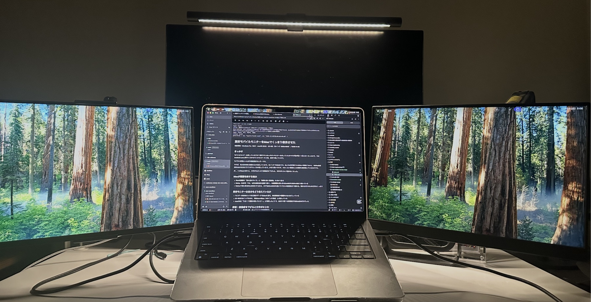
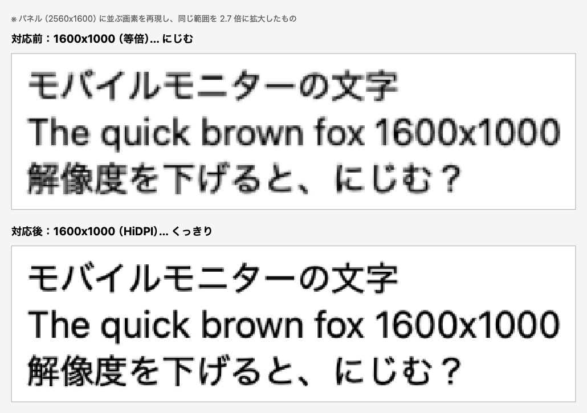
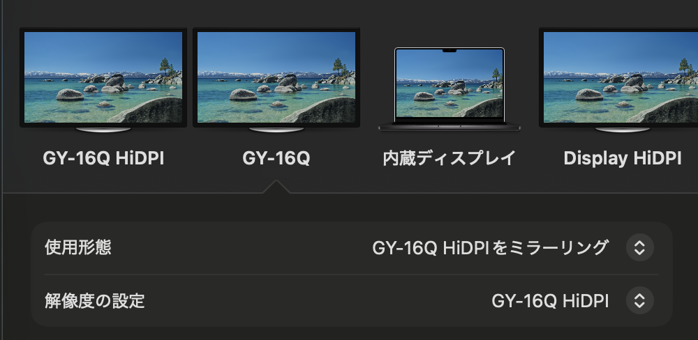

検証環境：MacBook Pro（M4）・macOS 26.5.1／2026-11-08  
モニター（macOSが読み取った値）：GY-16Q（16インチ・2560x1600・60Hz）、もう1台（16インチ・2560x1600・120Hz）

## モバモニ界隈

モバイルモニターは使っていますか？便利ですよね〜

私は27インチの大きいモニターを使っていたのですが目が悪くて見えなくなったので、今はmacbook proと同サイズのモバイルモニターを２個、並列で使っています。



モバモニ界隈といえば中国産激安モニターです。安いものだと6000円程度で買うことができます。

ですが、私は少し高価なものを使っています。15インチでWQHD、およそ2万円弱する120Hzで駆動するのと、100%sRGB 350nitsのまあカラバリがキレイなの使っています。かなり高いですが、それくらい視覚に入る情報を重要視しているわけです。

が、、いざMacに繋ぐと、

### 文字が小さい！！！

理由はデフォルトが解像度が2048x1280だからです。

windowsと異なり、macではモニターごとにテキストサイズを変更することができません。そのため、基本的にテキストサイズを合わせるにはモニターの解像度を下げなければなりません。

解像度を下げると、、

### 画質が悪い！！！

いや、正確には画素が少ない、というべきでしょうか。

私がなぜWQHD, 4Kディスプレイが好きかというと、画素が多さが魅力です。FHDやそれ以下のモニターをご使用された方ならわかると思います。

モニターは、画素（ピクセル）という小さな点の集まりに過ぎません。その点が1つ1つ色をつけ、ピクセルとなり、画面を表現します。画素の多さは表現の細かい表現を可能にし、点の粗さを認識しづらくなります。　安いのと高いのを比べたらよくわかるんですけどね、、、

話を戻して、WQHDなのに、なぜこんなにも荒々しい画素なのか、まるで引き延ばしているような奇妙さがありました。

長くなりましたが、本記事ではAI Agentを用いてその謎を解決した記事です。以下仕組みから解決までをまとめています。

## Macが画面を映す仕組み

Macは画面を2つの数字で管理しています。「見た目のサイズ」と「実際に描く画素数」です。

普通のモニターでは見た目1600x1000なら、1600x1000の画素で描きます。

Retina（Apple御用達のディスプレイ）では違います。

1つのピクセルを縦横2倍の画素で描きます。MacBook Proの画面は、見た目`1512x982`を`3024x1964`の画素で描いています。これは物理ピクセルと論理ピクセルという概念があり、本来の表示するピクセルを大きくしてから、再び画面にレンダリングすることで、負荷はかかるがキレイにできる技術なのです。

見た目1600x1000をRetinaで出すなら、Macはまず3200x2000で描きます。それをパネルの画素数（2560x1600）まで縮めて映す。Apple製品のディスプレイがやたらキレイなのはこのためですね〜

まあこの仕組みはApple, Retinaのものだけではなく、ほぼ全てのOSに対応しています。じゃないとウィンドウの解像度を変えることすらできないですから。

### このモニターの話でいうと

大きく描いて縮めると、細かい部分が残りますよね。逆に小さく描いて引き伸ばすと、ぼやけます。

何となくわかりましたかね？まあそういうことです

## モニターがOSに伝える情報

モニターはつないだ瞬間に、EDIDという自己紹介データをMacへ渡します。中身は対応している解像度や画面の大きさです。macOSはこれを見て、選べる解像度の一覧を作ります。

(脱線しますが) それ以外にも色々あって、たとえばHDMIってありますよね。あれは入り口と出口が同じ規格ですが、これもモニターが私が入力です、PCは私が出力です、というのがマッチングすることで成立するんですよね〜はい

さっそくGY-16Qの自己紹介を覗いてみると、

### 42インチ！？！？

おいおい、嘘だろ、、、約90cm×56cmと申告していました。42インチです。

実物は16インチです。こいつは16インチです。

犯人はこいつだ！と思ったのですが、もう1台は正直に16インチと申告していました。それなのに症状はまったく同じ。完全に冤罪でした。ごめんねGY-16Q。

（嘘をついているのは本当ですし、普通に意味がわかりません。42インチWQHDの基盤でもぶっこぬいて作ったのか？中国産〜教えてくれ〜）

### HiDPIって？

ここから「HiDPI」という言葉が出てくるので、少しだけ説明を。

DPIは「1インチあたりのドット数」で、HiDPIは「High DPI」の略です。macOSでは、見た目より2倍細かく描くモードをHiDPIと呼んでいます。Retinaはディスプレイの名前、HiDPIは描き方の名前くらいの理解でOKです。

macOSの解像度の一覧には、この2種類が混ざっています。

- 等倍：見た目と同じ画素数で描く（1600x1000なら1600x1000）
- HiDPI：見た目の2倍の画素で描く（1600x1000なら3200x2000）

MacBook Pro本体の`1512x982`も、もちろんHiDPIです。外部モニターでもHiDPIの1600x1000が選べれば、それで解決するはずでした。

実際、macOSが出してくる解像度の一覧は2台ともこうでした（抜粋）。

```
見た目      描く画素      種類
2560x1600   2560x1600    等倍    ← 文字が小さすぎる
1600x1000   1600x1000    等倍    ← ちょうどいい大きさ。でもガビガビ
1280x800    2560x1600    HiDPI   ← HiDPIはここだけ。文字がデカくて使いにくい
```

HiDPIで選べるのは、ちょうど2倍の1280x800だけ。ちょうどいい1600x1000は等倍しかありません。macOSさん、そこをなんとか。

はい、原因としてはもうわかりますよね。HiDPIではなく等倍でレンダリングしているため、ガビガビになっていたように見えたのでした。

## 解像度を下げると文字がにじむ

等倍の1600x1000を選ぶと、Macは1600x1000の画素で描きます。それを2560x1600のパネルいっぱいに、1.6倍で引き伸ばすわけです。

整数倍ではない引き伸ばしのため、文字の輪郭がにじみます。冒頭の「まるで引き延ばしているような」は、本当に引き延ばしていたのでした。

ちなみにデフォルトの2048x1280も、実は1.25倍の引き伸ばしです。最初から少しにじんでいたことになります。(き、気づいてたんだからなっっっ)

  
*対応前（等倍）と対応後（HiDPI）*

## 解決策：仮想モニターを挟む

macOSには、モニターを仮想的に作る仕組みがあります（`CGVirtualDisplay`という非公開API）。

これでHiDPIの仮想モニター（見た目1600x1000・描画3200x2000）を作ります。本物のモバイルモニターには、それをミラーで映させます。

```
Mac      仮想モニター（見た目 1600x1000 / 描画 3200x2000）
            │ ミラー（縮めて映す）
            ▼
モニター  2560x1600 のパネル（全画素を使う）
```

Macは仮想モニターのために3200x2000で描きます。本物のモニターは、それを2560x1600に縮めて映すので、通常のMacと同じようにキレイに映るわけです。



*実際のディスプレイ設定*

## 実装はAI、仕組みはこう

実装はAI Agent（Claude Code）に丸投げしました。Swiftで300行ほど。

やっていることは4つだけです。

1. HiDPIの仮想モニターを作る
2. 本物のモニターを、仮想モニターのミラーにする
3. モニターの抜き差しを見張る。外れたら仮想モニターも消す（残すと見えない画面にウィンドウが迷子になる）
4. ログイン時に自動で起動する（LaunchAgent）

## fix!

2台とも、見た目1600x1000のまま文字がくっきりになりました。120Hzのほうも120Hzのままです。

- モニターを抜き差ししても勝手に直る
- ログイン時に自動で起動する
- BetterDisplay（Pro版は$21.99の買い切り）というソフトウェアでもHiDPIを有効にする機能があります。サポート含めて使いたい場合はこちら
- 非公開APIを使っているため、macOSのアップデートで壊れるかもしれません。そのときは止めれば元に戻ります

### おまけ

私の特技は、モニターを見ただけでインチとリフレッシュレートを当てることです。
